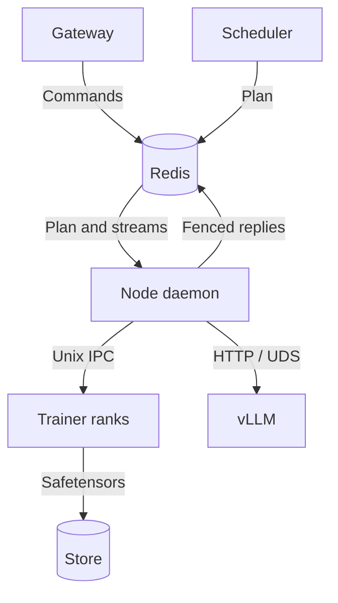

# tiny-open-rl

The [Tinker](https://thinkingmachines.ai/tinker/) training and sampling API, built on Redis Streams, PyTorch, and vLLM.

```python
client = tinker.ServiceClient(base_url="http://localhost:8000")
trainer = client.create_lora_training_client(base_model="Qwen/Qwen3-0.6B", rank=8)

for batch in data:
  trainer.forward_backward(batch, "importance_sampling")
  trainer.optim_step(types.AdamParams(learning_rate=4e-5))

sampler_path = trainer.save_weights_for_sampler("step-100").result().path
```

Supports LoRA adapters and full fine-tuning (`user_metadata={"openrl.fine_tuning_type": "full"}`), multi-GPU FSDP2 / tensor-parallel vLLM, and `base_model` hub IDs or fsspec URLs (`gs://...`, `s3://...`, local paths).

## Run it

```sh
pip install -e .
redis-server &                        # Redis 8.6+
python -m tinyrl.api.gateway &        # Tinker HTTP API on :8000
python -m tinyrl.control.scheduler &  # places trainers and sampler pools
python -m tinyrl.control.node_daemon  # owns local GPUs, trainers, and vLLM
```

For multi-node Kubernetes deployment, see [k8s/](k8s) and [docs/kubernetes.md](docs/kubernetes.md).

## Architecture



- **Redis as single state store ([bus.py](tinyrl/bus.py)):** each run is a Redis stream (groupless FIFO for trainers, shared `sampler` group for samplers) with single-writer `(owner, epoch, pos, snap, claimed)` fencing, node-renewed leases, and a single `tinyrl:ckpts` hash.
- **Cluster scheduler ([scheduler.py](tinyrl/control/scheduler.py)) & fairness ([fairness.py](tinyrl/control/fairness.py)):** places stateful trainers and per-spec stateless sampler pools across nodes, splits/merges LoRA trainers, scales samplers on backlog, and enforces per-account EEVDF `gpu_ms` fairness with single-account sampler waves.
- **Node daemon ([node_daemon.py](tinyrl/control/node_daemon.py)):** time-slices local GPUs on adaptive wall-clock quanta, parks trainers to pinned host memory, drives vLLM (or custom `ENGINE=module:Class`) with optional CRIU snapshots, and stages checkpoints off-GPU.
- **Immutable checkpoints ([store.py](tinyrl/storage/store.py)):** pure safetensors directories at `CKPT/objects/<version>` with peer-to-peer node caching and background bucket uploads.

Key environment variables: `REDIS_URL`, `PORT`, `GPUS`, `CKPT`, `CKPT_CACHE`, `MODEL_CACHE`, `MODEL_MIRROR`, `ENGINE`, `VLLM_ARGS`, `TINYRL_SNAPSHOTS`, `DEBUG=1`. Prometheus metrics live at `GET /metrics` and cluster state at `GET /api/v1/scheduling`.

## Layout

| Path | Responsibility |
|---|---|
| [tinyrl/types.py](tinyrl/types.py) | Shared stdlib-only domain types (`Op`, `Ev`, `Role`, `Run`, `Cmd`, `Reply`, `Event`, `parse_uri`) |
| [tinyrl/bus.py](tinyrl/bus.py) | Runs, sessions, streams, fenced ownership, leases, and `tinyrl:ckpts` hash |
| [tinyrl/api/gateway.py](tinyrl/api/gateway.py) | Tinker HTTP routes and Prometheus `/metrics` |
| [tinyrl/api/wire.py](tinyrl/api/wire.py) | Tinker protobuf and JSON wire codecs |
| [tinyrl/control/fairness.py](tinyrl/control/fairness.py) | Pure GPU fairness (`waterfill`, `update_lag`, `select_runs`, `plan_gpus`) |
| [tinyrl/control/scheduler.py](tinyrl/control/scheduler.py) | Cluster placement, elastic sampler pools, and rebalancing |
| [tinyrl/control/node_daemon.py](tinyrl/control/node_daemon.py) | Local GPU quanta, `TrainerLife`, and `SamplerLife` |
| [tinyrl/control/accounting.py](tinyrl/control/accounting.py) | Concurrent wave GPU-time accounting |
| [tinyrl/control/process.py](tinyrl/control/process.py) | Private Unix-socket IPC and parent-owned process groups |
| [tinyrl/control/estimator.py](tinyrl/control/estimator.py) | Model memory and GPU-width estimation from hub metadata |
| [tinyrl/workers/trainer.py](tinyrl/workers/trainer.py) | Synchronous trainer process and torchrun rank dispatch |
| [tinyrl/workers/model.py](tinyrl/workers/model.py) | PyTorch/PEFT/FSDP2 training, losses, token batching, and host parking |
| [tinyrl/workers/sampler.py](tinyrl/workers/sampler.py) | Sampling response encoding and engine lifecycle |
| [tinyrl/workers/vllm.py](tinyrl/workers/vllm.py) | vLLM driver (LoRA adapters, weight reloads, sleep/wake) |
| [tinyrl/workers/snapshot.py](tinyrl/workers/snapshot.py) | CRIU + `cuda-checkpoint` snapshots for fast vLLM starts |
| [tinyrl/storage/store.py](tinyrl/storage/store.py) | Streaming safetensors saves, peer cache, bucket uploads, and sweeps |
| [tinyrl/storage/models.py](tinyrl/storage/models.py) | Base-model mirroring and local caching |
| [tinyrl/trace.py](tinyrl/trace.py) | Optional NVTX ranges for Nsight Systems |

`python sz.py` tracks token-bearing line count (CI cap: 3,400). See also [examples/tinker_sdk.py](examples/tinker_sdk.py), [docs/model/](docs/model/README.md) (TLA+ specs), and [simulator/](simulator/README.md).

## Test

```sh
python -m unittest discover -s test -t .                           # unit + Redis integration tests
TINKER_PYTHON=$(which python) python -m unittest test.test_tinker  # end-to-end with unmodified Tinker SDK
python -m test.mutation                                            # control-plane mutation suite
SEED=1 CHAOS=1 python -m test.stress_fleet                         # randomized multi-node chaos stress test
```
