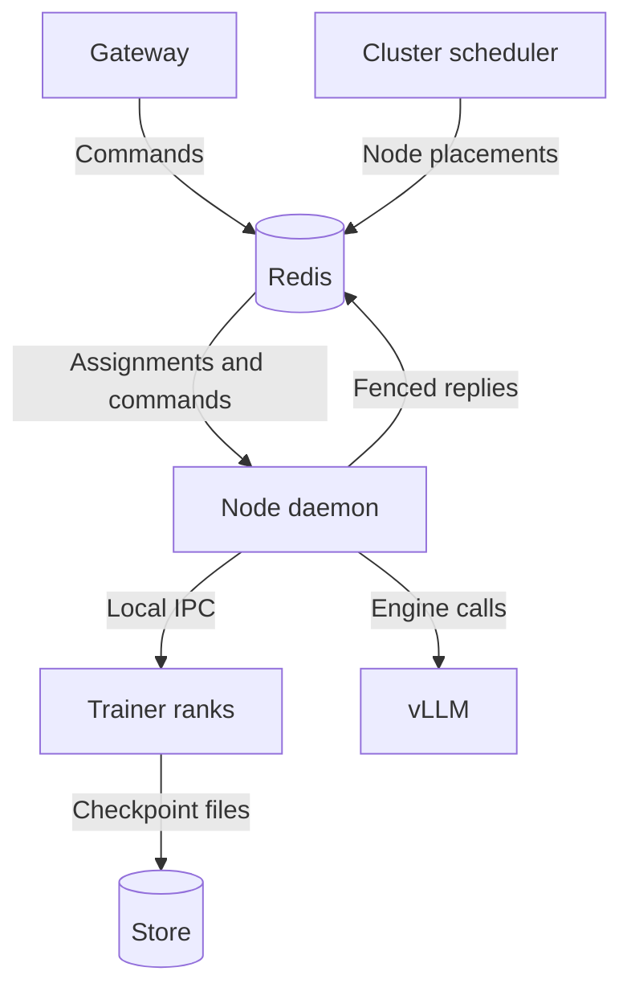

# tiny-open-rl

The [Tinker](https://thinkingmachines.ai/tinker/) training API, built on Redis Streams and PyTorch.

The Tinker SDK trains through it unchanged, for LoRA adapters and full fine-tunes alike:

```python
client = tinker.ServiceClient(base_url="http://localhost:8000")
trainer = client.create_lora_training_client(base_model="Qwen/Qwen3-0.6B", rank=8)

for batch in data:
  trainer.forward_backward(batch, "importance_sampling")
  trainer.optim_step(types.AdamParams(learning_rate=4e-5))

sampler_path = trainer.save_weights_for_sampler("step-100").result().path  # a PEFT adapter vLLM can load
```

`base_model` is a hub id, or a folder of `config.json` and `*.safetensors` anywhere fsspec reaches (`gs://...`, `s3://...`,
`/mnt/models/...`). A node fetches a bucket model once into `MODEL_CACHE`. See [models.py](tinyrl/storage/models.py).

## Run it

```sh
pip install -e .
redis-server &                                          # Redis 8.6 or newer
python -m tinyrl.api.gateway &                          # the Tinker HTTP API, on :8000
python -m tinyrl.control.scheduler &                    # assigns runs to workers and workers to nodes
python -m tinyrl.control.node_daemon                    # runs worker lifetimes and coordinates their GPUs
```

A **worker** is a group of runs sharing one trainer model or sampling engine. The gateway records what a run needs, and
the scheduler picks its worker: LoRA runs on the same base model share a trainer, sampling sessions on the same base model and
kind share a sampler, and an exclusive run's sessions share a sampler of their own. A full fine-tune
(`user_metadata={"openrl.fine_tuning_type": "full"}`) or an exclusive run (`"openrl.exclusive": "true"`) gets a worker of
its own. Worker names encode nothing.

Run one node daemon per GPU machine (`GPUS`, default 1) and one cluster scheduler. The scheduler places a worker on a
node with room for it, preferring the node of a sampler's trainer and then the least-used node, and moves work off
dead nodes and off nodes where exclusives leave it no room. It also fits the workers to the work. A shared LoRA trainer with several busy runs is split onto
unallocated GPUs, and crowded ones are merged. A shared sampler gets one replica per `SCALE_BATCH` queued commands. A
busy worker on an oversubscribed node moves to a node with spare GPUs, or to a less loaded node once its account is owed
`REBALANCE_MS` more GPU time than a worker running there. A moved trainer saves its runs and restores them on the new node.
Each node owns its workers' Redis leases and command streams, chooses their GPUs, and runs the local fairness policy.

Each worker runs in one coroutine. It peeks at each run's unclaimed command head and prepares its inputs independently.
Sampling heads become ready after their session metadata and checkpoint files are available. Checkpoint I/O runs off
the event loop and overlaps startup and execution. A slow download does not block another run's ready head or keep an
otherwise idle worker from yielding its GPU. Executable commands are claimed only after GPU admission, one bounded batch
at a time. A preparation error claims and answers its failed head without waiting for a GPU.

Under contention, the planner divides available GPU time among backlogged accounts according to their weights and
demand. Both the node and its shared trainers select the ready account owed the most service. Starting more LoRA
runs on the same base does not buy an account more turns. Among equally owed accounts, workers choose the ready runs
that received the fewest GPU-ms, breaking ties by queue arrival. A stream of sampler saves follows the same rule.
Sampling can batch multiple ready runs at the same priority. Each interval of a wave is split among the requests still
executing: for two requests finishing at 100 and 900 ms on one GPU, the charges are 50 and 850 GPU-ms.
Token estimates are still reported as run counters, but do not determine service.

The node keeps actual process placements, waiting order and GPU reservations to itself. The cluster plan in Redis holds
only each worker's node, each run's workers and each account's lag. Preparation completion and scheduling changes wake
workers through the same node change event. Workers on independent GPUs run concurrently. Node heartbeats and each
worker's lease renewal continue during model operations.

A trainer is a synchronous model process. The node sends request bytes over a private Unix socket and receives reply
bytes and checkpoint metadata. Model tensors, optimizer state and checkpoint I/O stay in the trainer. Multi-GPU
trainers use torchrun and FSDP; the whole rank group parks, resumes and exits together. A single-GPU LoRA trainer can
move between a node's GPUs without restarting its model.

Sampling controllers run in the node's event loop and drive isolated vLLM engine processes. On multi-GPU nodes the
node queues a warm startup at placement; on one GPU it starts the engine for the first request. `ENGINE=module:Class`
can select another engine implementing async `start(base, lora, env)`, `load_checkpoint(name, path)`, `sample(job, name)`,
`sleep()`, `wake()` and `close()`. Settings are per engine; loading an already loaded checkpoint name must be idempotent,
and `close()` must wait for its processes to exit. Engines identify loaded checkpoints by their immutable version IDs.

The node reserves every GPU of a worker together. An idle shared holder yields to a ready waiter. A busy holder
gets a minimum wall-clock quantum, extended when parking and resuming are expensive. Once that quantum expires,
the node can hand the GPUs to a ready process whose account is owed more service. Training yields between commands.
A trainer keeps its turn for `CYCLE_GRACE_MS` after a command while its client sends the next one. Inside that grace it
also outstays its quantum while a training step is open, until the step's `optim_step` has run, because parking between
`forward_backward` and `optim_step` moves the gradients too. Sampling yields between waves of up to `SAMPLE_RUNS` LoRA
sessions or one full fine-tune session, with at most `SAMPLE_COMMANDS` commands per session. The reservation starts
before wake and remains held until parking acknowledges or the entire process group has exited. A trainer's parking
copies weights, gradients and Adam state to pinned host memory, then restores them on its next turn.

Stop the node daemon with SIGTERM to finish its current batch and save training state before the processes are reaped.
It stops claiming new work; unclaimed commands stay queued for the replacement worker. `DRAIN_S` (default 20 s) is the
grace period for that batch and checkpointing. After it expires the node aborts
unfinished work, then still waits for process cleanup and flushes pending uploads; it is not a bound on total shutdown
time. A crash or an expired grace period fails uncertain commands instead of replaying training updates; a run with no parked
checkpoint must explicitly load a saved state before continuing. When upgrading from the former standalone worker
services, stop the nodes gracefully and restart the scheduler and node daemons together.

### Scheduling controls

| Variable | Default | Controls |
|---|---|---|
| `QUANTUM_MS` | 2000 | Minimum busy GPU turn, checked between commands or waves |
| `MAX_QUANTUM_MS` | 15000 | Upper bound on adaptive turn quantum so large PCIe parks cannot starve peers |
| `SWITCH_BUDGET` | 0.1 | Target ratio of measured park and resume time to useful time in a turn |
| `CYCLE_GRACE_MS` | 100 | How long a trainer keeps its turn after a command, waiting for its client's next one |
| `SAMPLE_RUNS` | 3 | LoRA sessions in a sampling wave; full fine-tunes use one |
| `SAMPLE_COMMANDS` | 128 | Commands from each session in a wave |
| `SCALE_BATCH` | 4 | Queued commands per replica of a shared sampler |
| `REBALANCE_MS` | 20000 | GPU time an account must be owed before its worker moves to a less loaded node |

A trainer can keep executing while it has prepared commands and uncontested capacity. The node starts preparing
the next queue heads before executing the current batch. Clients supply the training data: a trainer waiting for
rollouts or the next submission can be idle. A ready trainer sharing GPUs can wait for the current sampling wave
to finish. Its full GPU block must fit outside exclusive reservations.

### Checkpoints

Each save writes an immutable safetensors directory at `CKPT/objects/<version>`. The trainer commits the version
and its logical `tinker://` name together in Redis under its ownership token. A late writer can finish its own
directory, but readers of the name still load the version published by the current owner. There is no
migration from the older named-directory layout: its checkpoints are neither read nor collected, so delete them and
start from an empty `CKPT` and an empty Redis.

Use a shared folder for local storage or a bucket URL such as `gs://...`. Bucket saves first land in the writer's
`CKPT_CACHE`. Other nodes can fetch that exact version from the writer while the upload is pending. The uploader
writes a per-version manifest after all shards land. A node that dies before upload can lose its staged version.
Sweeps protect in-progress writes and published versions, then reclaim unreferenced versions after a grace period.

### On Kubernetes

[k8s/](k8s) runs Redis with an append-only file, the gateway, the scheduler, and a node daemon on every node labeled `tinyrl-gpu=true`.
Build the image from [Dockerfile](Dockerfile), point `CKPT` in [k8s/kustomization.yaml](k8s/kustomization.yaml) at a
bucket the nodes' service account can write, and run `kubectl apply -k k8s/`. A drained node's trainers save their runs,
and a dead node's workers move to live nodes. `python k8s/e2e.py` breaks a running cluster on purpose and checks it
survives.

## How it works



Every training or sampling call is a command on its run's Redis stream, and its reply is a stream with one entry, named by the request. That's the
whole design. Redis does the bookkeeping that would otherwise take a database, a ledger and a heartbeat.

* **The queue reads itself.** Peeking and preparation leave commands unclaimed. The node claims executable batches through
  the worker's consumer group after GPU admission; preparation failures are claimed and answered without a GPU.
  `XINFO GROUPS` says what's queued and `XPENDING` says what's in flight, under which owner, and for how long.
  `GET /api/v1/runs/<id>` just asks.
* **A dead trainer fails fast.** The current owner reads pending entries with `XPENDING` and fails each under its
  ownership token before executing new commands. A sampler replica takes over a pending sample once the replica that
  claimed it has lost its lease, even if the client never submits another request.
* **A stopping trainer saves its runs.** On node SIGTERM, the node finishes the current batch and saves weights, pending gradients
  and Adam state within the grace period. Unclaimed work stays queued. The replacement trainer restores the published checkpoint
  before its next command.
* **Retries are free.** `XREAD` from id `0` blocks until the reply is written and never consumes it, so
  `retrieve_future` can be retried, or waited on by many clients, and every one of them gets the same answer.
  A call the SDK retries with the same `seq_id` runs once, and every attempt gets the first attempt's answer.
* **Deleted runs take no work.** A run is live exactly while its stream exists, so `XADD NOMKSTREAM` turns a call on a deleted run into a 404.
* **Replies land atomically.** The reply, the acknowledgement and the run's step counter are written in one transaction.
* **One wire format.** `forward_backward` stays protobuf from the SDK to the trainer, which reads the tensors straight out of the bytes.
  Older SDKs' JSON is turned into the same protobuf at the gateway, and JSON clients get the output decoded back to JSON.
* **Cluster assignments in one key.** The scheduler writes `tinyrl:plan`: each worker's node, each run's workers and each
  account's lag. Nodes read it and wake when it changes. `tinyrl:events` is a capped log of those decisions and of runs
  and nodes coming and going, for tracing; nothing replays it. Worker coroutines prepare unclaimed heads locally and
  update the node's actual GPU reservations directly. Model processes read neither.
* **One trainer.** A base model, with a PEFT adapter per run or the whole model for a single run, behind `create_run`, `forward_backward`,
  `optim_step`, `training_state`, `sampler_weights`, `restore_run` and `delete_run`. Logprobs are computed `CHUNK` tokens at a time under checkpointing, so the
  `[tokens, vocab]` logits never exist all at once. The optimizer updates fp32 master weights and keeps fp32 AdamW state, while the
  forward pass runs in bf16 under autocast. A LoRA run's frozen base model stays bf16.
* **Portable checkpoints.** Training checkpoints (`save_weights`) and sampler weights (`save_weights_for_sampler`) go through
  [store.py](tinyrl/storage/store.py) through `put(tensors, meta)` and `get(version)` as pure `safetensors` (no `torch.save` pickle), so any trainer can
  resume a run with its exact fp32 weights and AdamW state. `CKPT` can be a bucket (`gs://...`, with `pip install .[gcs]`), so
  every node sees every checkpoint.
* **One owner per worker.** The node holds and renews its workers' leases. It verifies ownership before dispatch, and a
  WATCH/MULTI/EXEC transaction fences replies and parked pointers. A resumed stale node cannot dispatch another command or overwrite a reply.

## Reading the code

Start with the docstring at the top of [bus.py](tinyrl/bus.py), which explains the streams. Then read [gateway.py](tinyrl/api/gateway.py)
to see how each Tinker call becomes a command, [scheduler.py](tinyrl/control/scheduler.py) for how the cluster places workers on nodes,
[accounting.py](tinyrl/control/accounting.py) for how concurrent model calls share GPU time,
and [node_daemon.py](tinyrl/control/node_daemon.py) for local GPU selection, worker lifetimes and handoff,
[store.py](tinyrl/storage/store.py) to see how checkpoints are stored, and [trainer.py](tinyrl/workers/trainer.py) and
[model.py](tinyrl/workers/model.py) to see how a command runs on the model.

| File | Responsibility |
|---|---|
| [tinyrl/bus.py](tinyrl/bus.py) | runs, sessions, command streams, fenced replies and leases |
| [tinyrl/api/gateway.py](tinyrl/api/gateway.py) | Tinker HTTP routes, checkpoints and Prometheus metrics |
| [tinyrl/api/wire.py](tinyrl/api/wire.py) | Tinker protobufs and numpy arrays |
| [tinyrl/control/scheduler.py](tinyrl/control/scheduler.py) | the cluster's assignment: runs to workers, workers to nodes |
| [tinyrl/control/accounting.py](tinyrl/control/accounting.py) | monotonic GPU-time measurement across overlapping calls |
| [tinyrl/control/node_daemon.py](tinyrl/control/node_daemon.py) | worker lifetimes, leases, ready work, GPU reservations and recovery |
| [tinyrl/control/process.py](tinyrl/control/process.py) | private model IPC and parent-owned process groups |
| [tinyrl/control/estimator.py](tinyrl/control/estimator.py) | model memory and GPU-width estimates |
| [tinyrl/workers/trainer.py](tinyrl/workers/trainer.py) | synchronous model commands and checkpoint metadata |
| [tinyrl/workers/model.py](tinyrl/workers/model.py) | PyTorch/PEFT training, losses, token batching and host parking |
| [tinyrl/workers/sampler.py](tinyrl/workers/sampler.py) | sampling encoding and engine execution |
| [tinyrl/workers/vllm.py](tinyrl/workers/vllm.py) | vLLM startup, loading, completions and sleep/wake |
| [tinyrl/workers/snapshot.py](tinyrl/workers/snapshot.py) | CRIU snapshots and isolated restores |
| [tinyrl/storage/store.py](tinyrl/storage/store.py) | safetensors, chunked saves, uploads and caching |
| [tinyrl/storage/registry.py](tinyrl/storage/registry.py) | checkpoint owners, versions, TTLs and cleanup of unregistered files |
| [tinyrl/storage/models.py](tinyrl/storage/models.py) | base-model fetching and caching |
| [tinyrl/trace.py](tinyrl/trace.py) | NVTX ranges for Nsight Systems |

`python sz.py` counts token-bearing lines the way tinygrad does, and CI caps `tinyrl/` at 3,400 lines. Outside `tinyrl/`,
[examples/tinker_sdk.py](examples/tinker_sdk.py) trains and samples through the unmodified SDK. The rest of the repo holds
[k8s/](k8s), the browser [simulator/](simulator/README.md), [docs/kubernetes.md](docs/kubernetes.md), and the integration suites in [test/](test).

Settings are environment variables: `REDIS_URL`, `PORT`, `MODEL_CACHE` (where a node keeps base models it fetched), `MODEL_MIRROR` (a folder or bucket nodes read hub models from first), `CKPT` (the
checkpoint directory or bucket the trainers and samplers share), `CKPT_CACHE` (where a node keeps the checkpoints it saved or downloaded, in front of a bucket `CKPT`), `CKPT_CACHE_BYTES` (the most it keeps, least recently read first, 0 for half its disk), `TOKEN_BUDGET` (padded tokens per pass; unset, each call sizes its passes to the free
GPU memory), `CHUNK`, `GRAD_CKPT`, `WAIT`, `REPLY_TTL`, `SESSION_TTL`, `SESSION_GRACE`, `LEASE_MS`, `GPUS`, `QUANTUM_MS`,
`MAX_QUANTUM_MS`, `SWITCH_BUDGET`, `CYCLE_GRACE_MS`, `SAMPLE_RUNS`, `SAMPLE_COMMANDS`, `SCALE_BATCH`, `REBALANCE_MS`,
`IDLE_MS`, `TICK`, `TICK_MS`, `SWEEP_S`, `SHARD_BYTES`, `GPU_MEMORY_MIB`, `DRAIN_S`,
`ENGINE`, `VLLM_ARGS`, `CKPT_TTL` (the TTL, at least 3600 s, of a checkpoint saved without one; 0 keeps it until deleted), `TINYRL_SNAPSHOTS` (where a node keeps vLLM snapshots; unset, samplers boot vLLM every time) and `DEBUG=1`.

## Telemetry

Every run's hash counts the commands it ran (`cmds`), the time they spent queued (`wait_ms`, from the stream entry id to the
node dispatching it) and running (`busy_ms`), plus `steps` and `failed`. The node writes them in the same transaction as
the reply. `GET /api/v1/runs/<run>` shows one run's counters, and `GET /metrics` shows every run's in Prometheus' text
format, as `tinyrl_<counter>_total{worker, run}` in seconds. `/metrics` also has the GPU time billed to each account,
`tinyrl_account_service_total{account}` in GPU-ms, which is what fairness divides, and each node's event-loop lag,
`tinyrl_node_loop_lag_seconds{node}`. The numbers scheduling papers report are queries over the run counters:

| measure | PromQL |
|---|---|
| utilization of a worker's trainer | `sum by (worker) (rate(tinyrl_busy_seconds_total[5m]))` |
| mean queueing delay per call | `sum by (worker) (rate(tinyrl_wait_seconds_total[5m])) / sum by (worker) (rate(tinyrl_cmds_total[5m]))` |
| slowdown, (wait + run) / run | `1 + sum by (worker) (rate(tinyrl_wait_seconds_total[5m])) / sum by (worker) (rate(tinyrl_busy_seconds_total[5m]))` |
| throughput, optimizer steps per second | `sum by (worker) (rate(tinyrl_steps_total[5m]))` |
| fairness, Jain's index of recorded busy time across active runs (1 is equal shares) | `sum(rate(tinyrl_busy_seconds_total[5m]) > 0) ^ 2 / (count(rate(tinyrl_busy_seconds_total[5m]) > 0) * sum((rate(tinyrl_busy_seconds_total[5m]) > 0) ^ 2))` |
| failure rate | `sum by (worker) (rate(tinyrl_failed_total[5m])) / sum by (worker) (rate(tinyrl_cmds_total[5m]))` |

A run's wait includes waiting on its own earlier calls, since a run's calls run in order.

`GET /api/v1/scheduling` reads the cluster's plan, with each account's lag, and adds, from each node's latest heartbeat,
its workers' actual GPUs and process PID (`null` before a sampling engine starts). GPU turns are the node's own; they
are not in Redis. Per-command timing is available with `DEBUG=1`. The Redis event log traces runs and nodes coming and
going, and the scheduler's decisions.

Every model call (`model.<method>`), vLLM request (`vllm/<path>`) and checkpoint `store.put` or `store.get` is an NVTX range
in the `tinyrl` domain. Without a profiler attached a range costs about a microsecond. To see where a node's time goes, run
its node daemon under Nsight Systems, which follows the trainers and samplers it starts:

```sh
nsys profile --trace=nvtx --sample=none --cpuctxsw=none --duration=240 --kill=none python -m tinyrl.control.node_daemon
```

On the 23-job benchmark, `--trace=nvtx` adds nothing measurable. `--trace=cuda,nvtx` also records every kernel, and costs
about 5 to 7 s of a 112 s run. vLLM servers restored from a snapshot aren't traced, since nsys didn't start them.

## Throughput simulator

The [interactive simulator](simulator/README.md) explores GPU switching, arrival rates, queue growth, and data-transfer bottlenecks.
Open `simulator/index.html` in a browser; it runs locally without installing dependencies.

## Test

```sh
python -m unittest discover -s test -t .                             # starts its own redis-server, or set REDIS_URL
TINKER_PYTHON=$(which python) python -m unittest test.test_tinker   # runs examples/tinker_sdk.py against redis, gateway, scheduler and node_daemon
python -m test.mutation                                              # control-plane mutation tests
SEED=3 CHAOS=1 python -m test.stress_fleet                           # one random cluster and workload, with workers and nodes failing
```

Integration tests use real Redis, tiny random Llama models and the unmodified SDK. Deterministic node tests substitute
an inline CPU model process or a fake sampling engine; separate process tests cover Unix IPC, parent death, SIGTERM
shutdown and two-rank numerical equivalence. CUDA parking tests run when a GPU is available.

Mutation tests run the selected tests on clean code, then inject one fault at a time into a temporary copy.
They cover trainer scheduling, GPU accounting, ownership, duplicate sampler replies and checkpoint recovery.
CI fails if a fault survives or a test cannot run. The reported score covers these selected faults.

[test/stress_fleet.py](test/stress_fleet.py) is not part of the suite. Each seed runs several accounts' trainers and
samplers on a few GPUs and checks that every command is answered, that no two processes are ever on one GPU, that each
run's saved state is exactly what its client was told, and that deleting every run leaves nothing behind. `CHAOS=1` also
cancels workers, kills model processes, loses, drains and adds nodes, and cuts nodes off from Redis while clients run.

## Not here yet

* `create_training_client_from_state`.
* Distributed training across nodes and context parallelism.
* Parking idle runs, and moving a run between nodes without saving and restoring it through the checkpoint store. The
  design is in [docs/kubernetes.md](docs/kubernetes.md).
