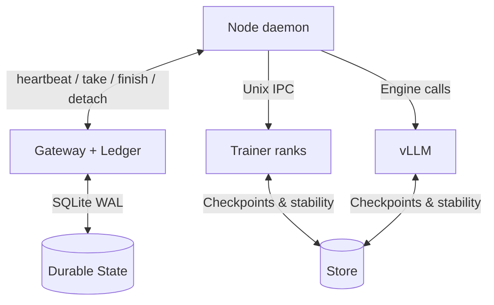

# tiny-open-rl

The [Tinker](https://thinkingmachines.ai/tinker/) training API, built on SQLite, autonomous GPU node daemons, and PyTorch.

The unmodified Tinker SDK trains and samples through it for both LoRA adapters and full fine-tunes:

```python
client = tinker.ServiceClient(base_url="http://localhost:8000")
trainer = client.create_lora_training_client(base_model="Qwen/Qwen3-0.6B", rank=8)

for batch in data:
  trainer.forward_backward(batch, "importance_sampling")
  trainer.optim_step(types.AdamParams(learning_rate=4e-5))

sampler_path = trainer.save_weights_for_sampler("step-100").result().path
```

`base_model` can be a Hugging Face ID or any fsspec path (`gs://...`, `s3://...`, `/mnt/models/...`) containing `config.json` and `*.safetensors`. Pass `user_metadata={"openrl.fine_tuning_type": "full"}` for a full fine-tune or `{"openrl.exclusive": "true"}` for a dedicated worker.

## Quickstart

```sh
pip install -e .
python -m tinyrl.api.gateway &        # Tinker HTTP API and controller (:8000)
python -m tinyrl.control.node_daemon  # supervises local workers and GPU turns
```

Run one `gateway` (persisting durable state in `TINYRL_DB`) and one `node_daemon` per GPU machine (set `CONTROL_URL`, `GPUS`).

- **Checkpoints:** Stored under `CKPT/objects/<version>` (default `/tmp/tinyrl`). Point `CKPT` at a bucket (`gs://...`, `s3://...`; `pip install .[gcs]` for GCS) to persist and share checkpoints across nodes.
- **Kubernetes:** Build [Dockerfile](Dockerfile), set `CKPT` in [k8s/kustomization.yaml](k8s/kustomization.yaml), and run `kubectl apply -k k8s/` on nodes labeled `tinyrl-gpu=true`. Verify cluster resilience with `python k8s/e2e.py`. See [docs/kubernetes.md](docs/kubernetes.md).

## Architecture



The controller owns durable facts and cluster placement; each node daemon owns local worker processes and physical GPUs. Nodes talk to the controller through four fenced calls: `heartbeat` (receiving their assigned workers), `take` (claiming the next fair command), `finish` (committing a reply, checkpoint, and GPU-ms charge), and `detach` (publishing a parked snapshot when a run moves or drains).

- **Durable training, RAM sampling:** Training runs follow an explicit `fresh -> live <-> saved -> lost -> deleted` lifecycle in SQLite WAL ([ledger.py](tinyrl/control/ledger.py), [db.py](tinyrl/control/db.py)). High-QPS sampling queues and bounded LRU replies live in RAM ([samples.py](tinyrl/control/samples.py)) with `429` backpressure and `410` on evicted promises so the SDK retries transparently.
- **Placement & local GPU turns:** [scheduler.py](tinyrl/control/scheduler.py) groups compatible LoRA runs, sizes stateless sampler pools, rebalances busy workers across nodes, and updates account EEVDF `lag`. Each [node_daemon.py](tinyrl/control/node_daemon.py) runs local GPU block allocation ([fairness.py](tinyrl/control/fairness.py)) directly against its live processes, stages sampler checkpoints off-GPU, and drains cleanly on `SIGTERM`.
- **Trainers, samplers, and store:** Trainers run as isolated synchronous PyTorch/PEFT processes (FSDP via `torchrun` across multiple GPUs) with bf16 forward, fp32 master weights + AdamW state, `cispo`/`dro`/`gspo`/`stable_reinforce` losses, and pinned host-memory parking. Samplers drive isolated vLLM processes (with optional CRIU snapshots). [store.py](tinyrl/storage/store.py) handles immutable `safetensors` checkpoints and `stable_reinforce` top-k inputs across local cache, peer HTTP, and async bucket uploads; the gateway itself never touches `Store`.

## Code layout

`tinyrl/` is kept small (`python sz.py` counts token-bearing lines). Start with [ledger.py](tinyrl/control/ledger.py) and [node_daemon.py](tinyrl/control/node_daemon.py).

| File | Responsibility |
|---|---|
| [tinyrl/control/ledger.py](tinyrl/control/ledger.py) | Sessions, runs, checkpoints, placement loop, and `heartbeat`/`take`/`finish`/`detach` |
| [tinyrl/control/trains.py](tinyrl/control/trains.py) | Durable SQLite FIFO training queues, replies, and `seq_id` deduplication |
| [tinyrl/control/samples.py](tinyrl/control/samples.py) | In-memory sampling queues and bounded LRU reply cache (`429`/`410`) |
| [tinyrl/control/nodes.py](tinyrl/control/nodes.py) | Live-node registry, lease expiry, and durable `boot_id` fencing |
| [tinyrl/control/db.py](tinyrl/control/db.py) | SQLite WAL store, rollback-safe write-through tables, and request/reply blobs |
| [tinyrl/control/scheduler.py](tinyrl/control/scheduler.py) | Pure cluster placement (`run -> proc -> node`) and account lag updates |
| [tinyrl/control/fairness.py](tinyrl/control/fairness.py) | Account waterfilling, run/sample selection, and local GPU block planning |
| [tinyrl/control/accounting.py](tinyrl/control/accounting.py) | Monotonic GPU-time accounting across overlapping calls |
| [tinyrl/control/node_daemon.py](tinyrl/control/node_daemon.py) | Local worker reconciliation, GPU handoff, off-GPU staging, drain, and RPC client |
| [tinyrl/control/process.py](tinyrl/control/process.py) | Private Unix IPC and owned process-group supervision |
| [tinyrl/control/estimator.py](tinyrl/control/estimator.py) | Framework-free model memory and GPU-width estimation |
| [tinyrl/api/gateway.py](tinyrl/api/gateway.py) | Tinker HTTP routes, `/internal/{method}` RPC, checkpoints, and `/metrics` |
| [tinyrl/api/wire.py](tinyrl/api/wire.py) | Tinker protobufs, numpy encoding, and stability packing |
| [tinyrl/types.py](tinyrl/types.py) | Domain types and worker/assignment records |
| [tinyrl/workers/trainer.py](tinyrl/workers/trainer.py) | Synchronous trainer command loop and checkpoint metadata |
| [tinyrl/workers/model.py](tinyrl/workers/model.py) | PyTorch/PEFT training, RL losses, token batching, and host parking |
| [tinyrl/workers/sampler.py](tinyrl/workers/sampler.py) | Sampling encoding, engine calls, and stability writes |
| [tinyrl/workers/vllm.py](tinyrl/workers/vllm.py) | vLLM engine lifecycle, checkpoint loading, and sleep/wake |
| [tinyrl/workers/snapshot.py](tinyrl/workers/snapshot.py) | CRIU snapshots and restores for vLLM |
| [tinyrl/storage/store.py](tinyrl/storage/store.py) | Safetensors & stability I/O, local cache, peer reads, and async uploads |
| [tinyrl/storage/models.py](tinyrl/storage/models.py) | Base-model fetching and local caching |
| [tinyrl/trace.py](tinyrl/trace.py) | NVTX ranges for Nsight Systems |

## Configuration

| Area | Variables |
|---|---|
| **Core** | `TINYRL_DB` (`/tmp/tinyrl.db`), `CONTROL_URL` (`http://127.0.0.1:8000`), `PORT` (`8000`), `GPUS` (`1`), `GPU_MEMORY_MIB`, `DRAIN_S` (`20`), `LEASE_MS`, `TICK`, `TICK_MS`, `WAIT`, `REPLY_TTL`, `SESSION_TTL`, `SESSION_GRACE` |
| **Storage** | `CKPT` (`/tmp/tinyrl`), `CKPT_CACHE`, `CKPT_CACHE_BYTES`, `CKPT_TTL`, `STABILITY_TTL`, `SHARD_BYTES`, `SWEEP_S`, `MODEL_CACHE`, `MODEL_MIRROR` |
| **Scheduling** | `QUANTUM_MS` (`2000`), `MAX_QUANTUM_MS` (`15000`), `SWITCH_BUDGET` (`0.1`), `CYCLE_GRACE_MS` (`100`), `REBALANCE_MS` (`20000`), `SAMPLE_QUEUE_BYTES`, `SAMPLE_REPLY_BYTES` |
| **Execution** | `TOKEN_BUDGET`, `CHUNK`, `GRAD_CKPT`, `ENGINE`, `VLLM_ARGS`, `STABILITY_TOPK`, `TINYRL_SNAPSHOTS`, `DEBUG=1` |

## Test

```sh
python -m unittest discover -s test -t .                            # isolated SQLite Ledger per test
TINKER_PYTHON=$(which python) python -m unittest test.test_tinker  # end-to-end via examples/tinker_sdk.py
python -m test.mutation                                             # control-plane mutation tests
SEED=3 CHAOS=1 python -m test.stress_fleet                          # randomized chaos & fleet stress test
```
