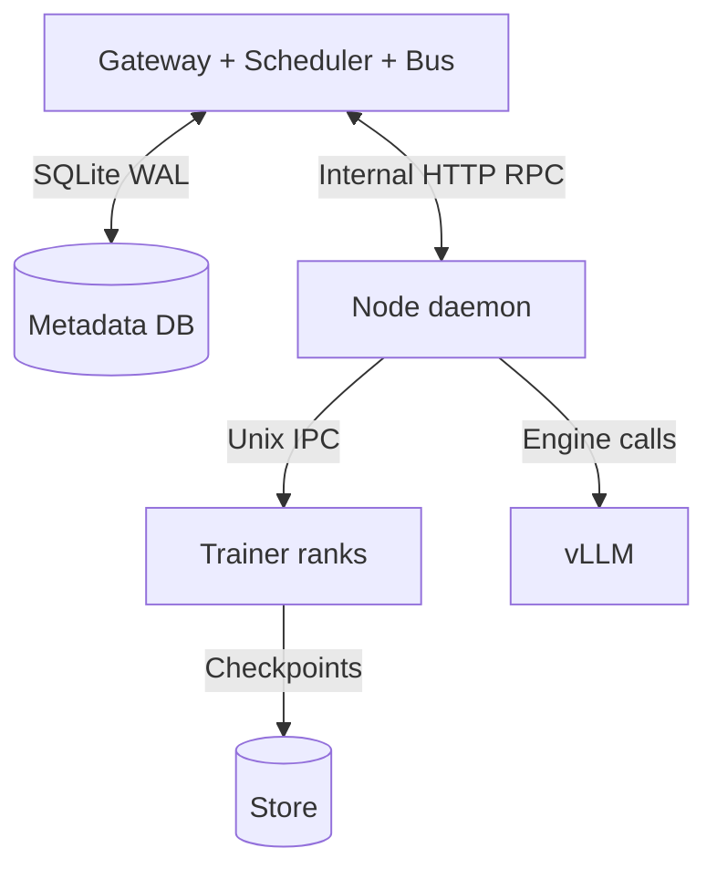

# tiny-open-rl

The [Tinker](https://thinkingmachines.ai/tinker/) training API, built on an embedded SQLite control plane and PyTorch.

The unmodified Tinker SDK trains and samples through it for both LoRA adapters and full fine-tunes:

```python
client = tinker.ServiceClient(base_url="http://localhost:8000")
trainer = client.create_lora_training_client(base_model="Qwen/Qwen3-0.6B", rank=8)

for batch in data:
  trainer.forward_backward(batch, "importance_sampling")
  trainer.optim_step(types.AdamParams(learning_rate=4e-5))

sampler_path = trainer.save_weights_for_sampler("step-100").result().path
```

`base_model` can be a Hugging Face ID or any fsspec path (`gs://...`, `s3://...`, `/mnt/models/...`) containing `config.json` and `*.safetensors`. Pass `user_metadata={"openrl.fine_tuning_type": "full"}` for a full fine-tune or `{"openrl.exclusive": "true"}` for a dedicated worker.

## Quickstart

```sh
pip install -e .
python -m tinyrl.api.gateway &        # Tinker HTTP API (:8000), scheduler, and internal RPC (:8001)
python -m tinyrl.control.node_daemon  # manages worker processes and GPUs
```

Run one `gateway` (single control-plane server with SQLite state in `TINYRL_DB`) and one `node_daemon` per GPU machine (set `CONTROL_URL`, `GPUS`).

- **Checkpoints:** Stored under `CKPT/objects/<version>` (default `/tmp/tinyrl`). Point `CKPT` at a bucket (`gs://...`, `s3://...`; `pip install .[gcs]` for GCS) to persist and share checkpoints across nodes.
- **Kubernetes:** Build [Dockerfile](Dockerfile), set `CKPT` in [k8s/kustomization.yaml](k8s/kustomization.yaml), and run `kubectl apply -k k8s/` on nodes labeled `tinyrl-gpu=true`. Verify cluster resilience with `python k8s/e2e.py`. See [docs/kubernetes.md](docs/kubernetes.md).

## Architecture



Every training or sampling call is queued in memory on the control-plane `Bus` (durable sessions, runs, checkpoints, plans, and service accounting persist in SQLite WAL), and node daemons talk to it over internal HTTP RPC (`tinyrl/rpc.py`). Lost sampling promises return HTTP `410` so the Tinker SDK resubmits them transparently.

- **Cluster placement.** Each training run has one trainer home. Compatible LoRA runs can share a trainer. Sampler sessions use any replica in a pool with the same model and worker configuration. The scheduler sizes each pool from its combined backlog and available GPUs.
- **GPU turns.** Each node grants local GPUs to one worker at a time and releases them after the worker parks or exits. A sampling wave serves one account. Its requests share the GPU time spent loading their weights and executing samples. The cluster tracks each account’s share, and nodes use billed GPU time to choose subsequent turns.
- **Trainers & samplers:** Trainers run as isolated synchronous PyTorch/PEFT processes (FSDP via `torchrun` across multiple GPUs) with bf16 forward, fp32 master weights + AdamW state, chunked logprobs, and pinned host-memory parking when yielding a GPU. Samplers drive isolated vLLM processes (or a custom `ENGINE=module:Class`).
- **Checkpoints:** Pure `safetensors` via [store.py](tinyrl/storage/store.py) (`put`/`get`), committed atomically under the worker's ownership token. Bucket saves stage in `CKPT_CACHE` and upload asynchronously; other nodes can fetch pending versions directly from the writer node.
- **Reliability:** Retried calls with the same `seq_id` execute once; replies and step counters commit atomically under lease fencing. On `SIGTERM`, a node drains its current batch and saves state within `DRAIN_S`; crashed work fails fast rather than replaying uncertain updates.
- **Wire format:** Protobuf end-to-end from SDK to trainer, with JSON conversion at the gateway for older clients.

## Code layout

`tinyrl/` is kept small (`python sz.py` counts token-bearing lines; CI caps it at 3,700). Start with [bus.py](tinyrl/bus.py).

| File | Responsibility |
|---|---|
| [tinyrl/bus.py](tinyrl/bus.py) | In-memory queues/leases/replies + SQLite WAL durable tables (`sessions`, `runs`, `checkpoints`, `meta`) |
| [tinyrl/rpc.py](tinyrl/rpc.py) | Internal HTTP JSON-RPC server and retrying client for remote node daemons |
| [tinyrl/api/gateway.py](tinyrl/api/gateway.py) | Tinker HTTP routes, checkpoints, and Prometheus `/metrics` |
| [tinyrl/api/wire.py](tinyrl/api/wire.py) | Tinker protobufs and numpy encoding |
| [tinyrl/control/scheduler.py](tinyrl/control/scheduler.py) | Cluster assignment: runs to workers, workers to nodes |
| [tinyrl/control/accounting.py](tinyrl/control/accounting.py) | Monotonic GPU-time accounting across overlapping calls |
| [tinyrl/control/node_daemon.py](tinyrl/control/node_daemon.py) | Worker lifetimes, leases, GPU reservations, and recovery |
| [tinyrl/control/process.py](tinyrl/control/process.py) | Private Unix IPC and process-group management |
| [tinyrl/control/estimator.py](tinyrl/control/estimator.py) | Model memory and GPU-width estimation |
| [tinyrl/workers/trainer.py](tinyrl/workers/trainer.py) | Synchronous trainer command loop and checkpoint metadata |
| [tinyrl/workers/model.py](tinyrl/workers/model.py) | PyTorch/PEFT training, losses, token batching, and host parking |
| [tinyrl/workers/sampler.py](tinyrl/workers/sampler.py) | Sampling encoding and engine execution |
| [tinyrl/workers/vllm.py](tinyrl/workers/vllm.py) | vLLM engine lifecycle, checkpoint loading, and sleep/wake |
| [tinyrl/workers/snapshot.py](tinyrl/workers/snapshot.py) | CRIU snapshots and restores for vLLM |
| [tinyrl/storage/store.py](tinyrl/storage/store.py) | Safetensors I/O, local cache, peer reads, and async uploads |
| [tinyrl/control/fairness.py](tinyrl/control/fairness.py) | Account service, run selection, and local GPU turn planning |
| [tinyrl/storage/models.py](tinyrl/storage/models.py) | Base-model fetching and local caching |
| [tinyrl/trace.py](tinyrl/trace.py) | NVTX ranges for Nsight Systems |

Also in the repo: [examples/tinker_sdk.py](examples/tinker_sdk.py), [examples/lab/](examples/lab/README.md), [k8s/](k8s), [docs/kubernetes.md](docs/kubernetes.md), TLA+ specs in [docs/model/](docs/model/README.md), a browser [simulator/](simulator/README.md) (`simulator/index.html`), and [test/](test).

## Configuration

All settings are environment variables:

| Area | Variables |
|---|---|
| **Core** | `TINYRL_DB` (`/tmp/tinyrl.db`), `CONTROL_URL` (`http://127.0.0.1:8001`), `PORT` (`8000`), `INTERNAL_PORT` (`8001`), `GPUS` (`1`), `GPU_MEMORY_MIB`, `DRAIN_S` (`20`), `LEASE_MS`, `IDLE_MS`, `TICK`, `TICK_MS`, `WAIT`, `REPLY_TTL`, `SESSION_TTL`, `SESSION_GRACE` |
| **Storage** | `CKPT` (`/tmp/tinyrl`), `CKPT_CACHE`, `CKPT_CACHE_BYTES`, `CKPT_TTL`, `SHARD_BYTES`, `SWEEP_S`, `MODEL_CACHE`, `MODEL_MIRROR` |
| **Scheduling** | `QUANTUM_MS` (`2000`), `MAX_QUANTUM_MS` (`15000`), `SWITCH_BUDGET` (`0.1`), `CYCLE_GRACE_MS` (`100`), `SAMPLE_RUNS` (`3`), `SAMPLE_COMMANDS` (`128`), `SCALE_BATCH` (`4`), `REBALANCE_MS` (`20000`) |
| **Execution** | `TOKEN_BUDGET`, `CHUNK`, `GRAD_CKPT`, `ENGINE`, `VLLM_ARGS`, `TINYRL_SNAPSHOTS`, `DEBUG=1` |

## Upgrading an existing cluster

Stop the old scheduler and drain the old nodes before starting the new control plane. Keep Redis, checkpoint storage, and the node caches. The scheduler reads the old trainer placements and writes one worker ID per trainer on its next tick. Sampler membership is derived from the pool configuration. Existing streams retain their pending commands and checkpoint names keep their versions.

## Observability

- **HTTP & Prometheus:** `GET /api/v1/runs/<id>` returns per-run queue/execution counters; `GET /api/v1/scheduling` returns the cluster plan, account lag, active GPUs, and worker PIDs; `GET /metrics` exports Prometheus counters (`tinyrl_{cmds,wait_seconds,busy_seconds,steps,failed}_total{worker,run}`, `tinyrl_account_service_total{account}`, `tinyrl_node_loop_lag_seconds{node}`).
- **Profiling:** Model calls, vLLM requests, and store I/O emit NVTX ranges under the `tinyrl` domain:
  ```sh
  nsys profile --trace=nvtx --sample=none --cpuctxsw=none --duration=240 --kill=none python -m tinyrl.control.node_daemon
  ```

## Test

```sh
python -m unittest discover -s test -t .                            # isolated SQLite Bus per test
TINKER_PYTHON=$(which python) python -m unittest test.test_tinker  # end-to-end via examples/tinker_sdk.py
python -m test.mutation                                             # control-plane mutation tests
SEED=3 CHAOS=1 python -m test.stress_fleet                          # randomized chaos & fleet stress test
```

Integration tests run against the real control plane with tiny random Llama models and the unmodified SDK; CUDA parking tests run automatically when a GPU is present.

## Not here yet

- `create_training_client_from_state`.
- Multi-node distributed training and context parallelism.
- Parking idle runs, and moving runs between nodes without saving and restoring through the checkpoint store (see [docs/kubernetes.md](docs/kubernetes.md)).
