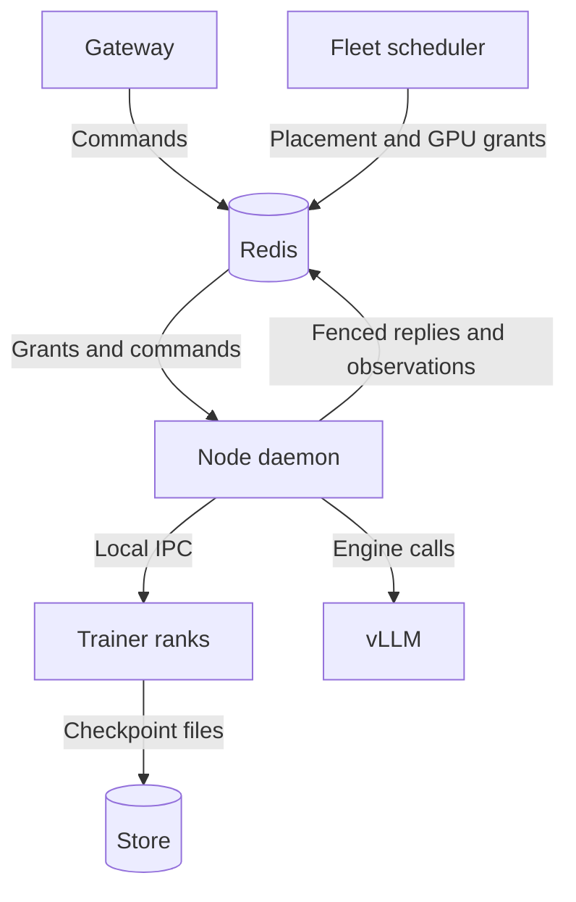

# tiny-open-rl

The [Tinker](https://thinkingmachines.ai/tinker/) training API, built on Redis Streams and PyTorch.

The Tinker SDK trains through it unchanged, for LoRA adapters and full fine-tunes alike:

```python
client = tinker.ServiceClient(base_url="http://localhost:8000")
trainer = client.create_lora_training_client(base_model="Qwen/Qwen3-0.6B", rank=8)

for batch in data:
  trainer.forward_backward(batch, "importance_sampling")
  trainer.optim_step(types.AdamParams(learning_rate=4e-5))

sampler_path = trainer.save_weights_for_sampler("step-100").result().path  # a PEFT adapter vLLM can load
```

`base_model` is a hub id, or a folder of `config.json` and `*.safetensors` anywhere fsspec reaches (`gs://...`, `s3://...`,
`/mnt/models/...`). A node fetches a bucket model once into `MODEL_CACHE`. See [models.py](tinyrl/storage/models.py).

## Run it

```sh
pip install -e .
redis-server &                                          # Redis 8.6 or newer
python -m tinyrl.api.gateway &                          # the Tinker HTTP API, on :8000
python -m tinyrl.control.scheduler &                    # claims jobs and issues finite physical GPU turns
python -m tinyrl.control.node_daemon                    # prepares inputs and executes the fleet's turns
```

The control plane has two permissions. A **claim** names the engine incarnation that owns a job's mutable state.
A **turn** names one physical GPU bundle and the bounded work that engine may execute. Claims survive ordinary
GPU turns: a trainer parks tensors in host memory and resumes them without writing a checkpoint each time.
An engine holding newer unsaved training state is its owner; only its clean model and adapter caches are disposable.

Run one node daemon per GPU machine (`GPUS`, default 1) and one fleet scheduler. `NODE_NAME` identifies the physical
machine, defaults to its hostname, and must remain stable across daemon restarts. Kubernetes supplies `spec.nodeName`.
The scheduler selects nodes, exact GPU sets and compatible jobs. It uses free capacity before sharing an existing
engine; LoRA jobs on the same base can share a trainer and sampling sessions can batch in a sampler. Full fine-tunes
have separate trainers. Every multi-GPU bundle stays within one node, and a live engine keeps its physical binding.

A turn is immutable. Its work names each expected claim and a token allowance, or an explicit export operation.
The node stages inputs, executes that work and parks the engine. It then removes that exact turn and charges its
GPU time in one transaction. A turn continues occupying its bundle through lease expiry or a missing heartbeat.
Reusing the GPUs requires confirmed park or native process exit; a replacement daemon cannot make an orphan turn
safe merely by starting. Unverified bundles remain quarantined until their former processes are verified stopped.

Fairness is per logical training account: a trainer and its owned sampling sessions share one service total.
The scheduler first favors accounts with fewer outstanding turns, then lower completed GPU service. A rotation
cursor breaks ties between engines of the same account. Service is elapsed turn time times bundle width and the
node's `GPU_RATE`, apportioned by command cost within a batch. Newly ready accounts join the current service floor,
which persists while the fleet is idle; waiting for input I/O earns no catch-up credit. `GPU_RATE=1` treats GPUs equally.
Other values are operator-supplied cost normalization, not automatic performance or numerical correction across architectures.

Only one engine has an active turn on a physical GPU. An exclusive account retains dedicated capacity while idle;
its trainer and owned sampler can alternate on that capacity. Admission waits for a bundle without another account's
live fixed cache binding. A waiting gang protects its entire bundle from lower-priority refills while existing turns
finish. `TURN` bounds admitted token cost, checked between commands or sampling waves; an indivisible command can
exceed the remaining allowance. The node may finish a turn early when its selected jobs have no prepared work.

Each engine has one coroutine and one preparation task per claimed job. Preparing ordinary work leaves the queue
unclaimed and stages exact checkpoint inputs off the event loop. Ready jobs request turns; a slow download does not
block a prepared sibling. The turn token is the Redis consumer identity. Every reply checks the turn, job claim,
engine lease and pending command together. Heartbeats and lease renewal continue during model operations.
There is no desired membership, residency acknowledgment, worker revision or job generation to reconcile.

A trainer is a synchronous model process behind a private Unix socket. Only request bytes, replies and checkpoint
references cross it. Model tensors, optimizer state and checkpoint I/O stay in the trainer. Multi-GPU trainers use
torchrun and FSDP; all ranks park, resume and exit together. Parking uses PyTorch tensor transfers to host memory;
the next grant restores those tensors to the fixed GPU bundle.

Sampling controllers drive isolated vLLM processes. Engines start on their first grant, using ordinary vLLM startup
and its native compilation cache (`VLLM_CACHE_ROOT`). Configure vLLM directly through `VLLM_ARGS`; there are no
`TINYRL_GPU_MEM`, `TINYRL_KV_BYTES` or warm-start shims. `ENGINE=module:Class` can supply another engine implementing
async `start(base, lora, env)` returning the launched engine, `ready()`, `load_checkpoint(name, path)`, `sample(job, name, request_id)`, `abort(request_ids)`,
`unload_checkpoint(name)`, `sleep()`, `wake()` and `close()`. Checkpoint loading is idempotent by URI and version, and
`close()` must wait for every owned process to exit. The sampler retains the launched handle before waiting for readiness, so failed startup cannot hide an unverified process.

SIGTERM stops new claims, finishes the current batch and exports training state before cleanup. `DRAIN_S` (20 s)
limits the grace period, not total shutdown time: process exit and pending uploads still have to finish. Unclaimed
commands remain queued. Uncertain training commands fail instead of replaying mutations; sampling can be reclaimed against pinned inputs. Captured SAVE outputs finish through their storage receipts. Recovery rules are described below.

This changes the Redis record format. For rollout, stop old nodes gracefully and start the gateway, scheduler and
nodes together against a fresh Redis database or instance via `REDIS_URL`. Existing assignment and checkpoint records
are not migrated. Redis key names still use the `tinyrl:` prefix; choosing a new database isolates that namespace.

### Scheduling controls

| Variable | Default | Controls |
|---|---|---|
| `TURN` | 200000 | Token cost admitted in one fleet grant, checked between commands or waves |
| `SAMPLE_RUNS` | 3 | LoRA sessions in a sampling wave; full fine-tunes use one |
| `SAMPLE_COMMANDS` | 128 | Commands from each session in a wave |
| `GPU_RATE` | 1 | Normalized cost per GPU-second on this node |
| `TICK_MS` | 100 | Fleet scheduler polling interval |

### Checkpoints

`CKPT` is a local folder (`/tmp/tinyrl` by default) or a bucket (`gs://...`, `s3://...`). Bucket-backed saves first publish
an immutable version in `CKPT_CACHE`; a manifest becomes visible only after every file is complete. Readers pin that
version while copying or using it. They use the local copy, fetch from its source node over the peer cache, or fetch
the durable copy. The durable manifest is published after its files upload. Checkpoints stream through bounded
chunks rather than requiring a second full host copy of the model.

A training checkpoint includes model weights, accumulated gradients, Adam state, RNG state and execution metadata.
Restoring requires compatible model configuration, dtype and rank count. A run keeps a **working** version for fast
handoff and a **durable** version for recovery after cache loss. Full `save_weights` futures succeed only after the
version reaches `CKPT`; sampler weights and working snapshots may be consumed from a peer before upload finishes.
For a local `CKPT`, durable means complete on that filesystem, not replicated to another machine.

A captured training SAVE is acknowledged out of the GPU queue into a storage receipt containing its immutable version,
checkpoint boundary and request identity. Any node holding those files can finish uploading them; any node observing the durable version
can settle that exact receipt and publish the future. Trainer loss does not rerun the save against newer weights.
Deleting the job cancels pending receipts. An owned sampling session is created together with its exact weights and
successful SAVE reply; there is no partially constructed session whose version must be filled in later.

Checkpoint references record the command boundary they contain. If a worker dies after acknowledged mutations newer
than its reachable checkpoint, the replacement reports rollback and requires an explicit load before further
mutations. A never-modified run can be recreated from its original configuration. Planned migration exports state
and atomically publishes its complete checkpoint while clearing the old claim. The destination gets a fresh claim token, which fences late source replies. A shared source engine can continue serving its other jobs. Use a shared checkpoint
filesystem or a bucket with reachable peer caches for transfers between machines.

Version references protect live checkpoints from collection. A late upload can still leave unreachable bucket bytes
if another node collects the version during that upload; fencing prevents those bytes from becoming a live alias again.
Backend lifecycle cleanup for such orphan objects is outside this collector.

### On Kubernetes

[k8s/](k8s) runs Redis with an append-only file, the gateway, the scheduler, and a node daemon on every node labeled `tinyrl-gpu=true`.
Build the image from [Dockerfile](Dockerfile), point `CKPT` in [k8s/kustomization.yaml](k8s/kustomization.yaml) at a
bucket the nodes' service account can write, and run `kubectl apply -k k8s/`. A drained node's trainers save their runs,
and a dead node's workers move to live nodes. `python k8s/e2e.py` breaks a running cluster on purpose and checks it
survives.

## How it works



Every training or sampling call is a command on its run's Redis stream, and its reply is a stream with one entry,
named by the request. Redis also holds job claims, immutable turns, engine observations, leases and account service.
The scheduler reads, decides and commits those records; no Redis event log or Lua scripts are required.

* **The queue reads itself.** Peeking and preparation leave commands unclaimed. The node claims executable batches through
  the consumer group under the turn token. Preparation failures receive a bounded error reply and end their allowance.
  `XINFO GROUPS` says what's queued and `XPENDING` says what's in flight, under which owner, and for how long.
  `GET /api/v1/runs/<id>` just asks.
* **A dead trainer fails fast.** Its commands stay in the pending list. A fresh engine fails abandoned training commands before preparing the next queue head. Eligible samples are reclaimed with `XCLAIM` against their exact pinned weights.
* **A stopping trainer saves its runs.** Within the grace period, the node finishes the current batch and exports complete
  training state. A multi-rank export needs a GPU grant too. Unclaimed work stays queued; the replacement checks the
  checkpoint boundary before continuing.
* **Retries are free.** `XREAD` from id `0` blocks until the reply is written and never consumes it, so
  `retrieve_future` can be retried, or waited on by many clients, and every one of them gets the same answer.
  A call the SDK retries with the same `seq_id` runs once, and every attempt gets the first attempt's answer.
* **Deleted runs take no work.** A run is live exactly while its stream exists, so `XADD NOMKSTREAM` turns a call on a deleted run into a 404.
* **Replies land atomically.** The reply, the acknowledgement and the run's step counter are written in one transaction.
* **One wire format.** `forward_backward` stays protobuf from the SDK to the trainer, which reads the tensors straight out of the bytes.
  Older SDKs' JSON is turned into the same protobuf at the gateway, and JSON clients get the output decoded back to JSON.
* **One scheduling authority.** The scheduler issues claims and finite turns. Nodes publish readiness and fixed engine bindings; release charges account service exactly once. WATCH/MULTI/EXEC fences publication and ownership changes.
* **One trainer.** A base model, with a PEFT adapter per run or the whole model for a single run, behind `create_run`, `forward_backward`,
  `optim_step`, `training_state`, `sampler_weights`, `restore_run` and `delete_run`. Logprobs are computed `CHUNK` tokens at a time under checkpointing, so the
  `[tokens, vocab]` logits never exist all at once. The optimizer updates fp32 master weights and keeps fp32 AdamW state, while the
  forward pass runs in bf16 under autocast. A LoRA run's frozen base model stays bf16.
* **Portable checkpoints.** Training checkpoints (`save_weights`) and sampler weights (`save_weights_for_sampler`) use
  immutable `safetensors` versions with named tensors, not Python model pickles or CRIU process images. GPU processes
  are recreated normally. `CKPT` can be a bucket (`gs://...`, with `pip install .[gcs]`).
* **One live owner per claim.** Engine incarnations start once and cannot be revived after lease expiry. A successful export publishes complete state and clears the claim atomically. No residency-absence handshake is required.

## Reading the code

Start with the docstring at the top of [bus.py](tinyrl/bus.py), which explains the streams. Then read [gateway.py](tinyrl/api/gateway.py)
to see how each Tinker call becomes a command, [scheduler.py](tinyrl/control/scheduler.py) for placement, GPU admission and ready-run selection,
and [node_daemon.py](tinyrl/control/node_daemon.py) for engine execution and GPU release,
[store.py](tinyrl/storage/store.py) to see how checkpoints are stored, and [trainer.py](tinyrl/workers/trainer.py) and
[model.py](tinyrl/workers/model.py) to see how a command runs on the model.

| File | Responsibility |
|---|---|
| [tinyrl/bus.py](tinyrl/bus.py) | runs, sessions, command streams, fenced replies and leases |
| [tinyrl/api/gateway.py](tinyrl/api/gateway.py) | Tinker HTTP routes, checkpoints and Prometheus metrics |
| [tinyrl/api/wire.py](tinyrl/api/wire.py) | Tinker protobufs and numpy arrays |
| [tinyrl/control/scheduler.py](tinyrl/control/scheduler.py) | fleet placement, account fairness, physical grants and fenced commits |
| [tinyrl/control/node_daemon.py](tinyrl/control/node_daemon.py) | preparation, grant execution, process ownership and recovery |
| [tinyrl/control/process.py](tinyrl/control/process.py) | private model IPC and parent-owned process groups |
| [tinyrl/control/estimator.py](tinyrl/control/estimator.py) | model memory and GPU-width estimates |
| [tinyrl/workers/trainer.py](tinyrl/workers/trainer.py) | synchronous model commands and checkpoint metadata |
| [tinyrl/workers/model.py](tinyrl/workers/model.py) | PyTorch/PEFT training, losses, token batching and host parking |
| [tinyrl/workers/sampler.py](tinyrl/workers/sampler.py) | sampling encoding and engine execution |
| [tinyrl/workers/vllm.py](tinyrl/workers/vllm.py) | vLLM startup, loading, completions and sleep/wake |
| [tinyrl/storage/store.py](tinyrl/storage/store.py) | safetensors, chunked saves, uploads and caching |
| [tinyrl/storage/registry.py](tinyrl/storage/registry.py) | checkpoint owners, versions, TTLs and cleanup of unregistered files |
| [tinyrl/storage/models.py](tinyrl/storage/models.py) | base-model fetching and caching |
| [tinyrl/trace.py](tinyrl/trace.py) | NVTX ranges for Nsight Systems |

`python sz.py` counts token-bearing lines the way tinygrad does, and CI caps `tinyrl/` at 3,400 lines. Outside `tinyrl/`,
[examples/tinker_sdk.py](examples/tinker_sdk.py) trains and samples through the unmodified SDK. The rest of the repo holds
[k8s/](k8s), the browser [simulator/](simulator/README.md), [docs/kubernetes.md](docs/kubernetes.md), and the integration suites in [test/](test).

Settings are environment variables: `REDIS_URL`, `PORT`, `MODEL_CACHE` (where a node keeps base models it fetched), `MODEL_MIRROR` (a folder or bucket nodes read hub models from first), `CKPT` (the
checkpoint directory or bucket the trainers and samplers share), `CKPT_CACHE` (where a node keeps the checkpoints it saved or downloaded, in front of a bucket `CKPT`), `CKPT_CACHE_BYTES` (the most it keeps, least recently read first, 0 for half its disk), `TOKEN_BUDGET` (padded tokens per pass; unset, each call sizes its passes to the free
GPU memory), `CHUNK`, `GRAD_CKPT`, `WAIT`, `REPLY_TTL`, `SESSION_TTL`, `SESSION_GRACE`, `LEASE_MS`, `GPUS`, `TURN`,
`GPU_RATE`, `NODE_NAME`, `GPU_MEMORY_MIB` (optional node diagnostic), `TICK_MS`, `SAMPLE_RUNS`, `SAMPLE_COMMANDS`, `DRAIN_S`,
`ENGINE`, `VLLM_ARGS`, `VLLM_CACHE_ROOT` (vLLM's native compilation cache), `CKPT_TTL` (the TTL, at least 3600 s, of a checkpoint saved without one; 0 keeps it until deleted) and `DEBUG=1`.

**Draft benchmark gate:** measure cold and cached startup, park/resume, full training handoff and mixed-user throughput
on the target GPUs before merging. This version removes CRIU startup, concurrent engine packing on one GPU and the
model's custom host slabs in favor of ordinary vLLM startup, explicit fleet turns and native tensor transfers.
CPU integration tests do not establish the performance of those replacements. The hardware run must also verify
multi-rank release, descendant cleanup and residual GPU memory while engines are parked.

## Telemetry

Every run's hash counts the commands it ran (`cmds`), the time they spent queued (`wait_ms`, from the stream entry id to the
node dispatching it) and running (`busy_ms`), plus `steps` and `failed`. The node writes them in the same transaction as
the reply. `GET /api/v1/runs/<run>` shows one run's counters, and `GET /metrics` shows every run's in Prometheus' text
format, as `tinyrl_<counter>_total{worker, run}` in seconds. The numbers scheduling papers report are queries over those
counters:

| measure | PromQL |
|---|---|
| utilization of a worker's trainer | `sum by (worker) (rate(tinyrl_busy_seconds_total[5m]))` |
| mean queueing delay per call | `sum by (worker) (rate(tinyrl_wait_seconds_total[5m])) / sum by (worker) (rate(tinyrl_cmds_total[5m]))` |
| slowdown, (wait + run) / run | `1 + sum by (worker) (rate(tinyrl_wait_seconds_total[5m])) / sum by (worker) (rate(tinyrl_busy_seconds_total[5m]))` |
| throughput, optimizer steps per second | `sum by (worker) (rate(tinyrl_steps_total[5m]))` |
| fairness, Jain's index of recorded busy time across active runs (1 is equal shares) | `sum(rate(tinyrl_busy_seconds_total[5m]) > 0) ^ 2 / (count(rate(tinyrl_busy_seconds_total[5m]) > 0) * sum((rate(tinyrl_busy_seconds_total[5m]) > 0) ^ 2))` |
| failure rate | `sum by (worker) (rate(tinyrl_failed_total[5m])) / sum by (worker) (rate(tinyrl_cmds_total[5m]))` |

A run's wait includes waiting on its own earlier calls, since a run's calls run in order.

`GET /api/v1/scheduling` exposes runs, claims, outstanding turns, engine observations, reservations and account service.
A job claim identifies its live state owner; an outstanding turn identifies occupied capacity. The `worker` metric
label contains the engine incarnation for compatibility with existing dashboards. Per-command timing is available with `DEBUG=1`; the counters and NVTX spans remain the tracing interfaces.

Every model call (`model.<method>`), vLLM request (`vllm/<path>`) and checkpoint `store.put` or `store.get` is an NVTX range
in the `tinyrl` domain. Without a profiler attached a range costs about a microsecond. To see where a node's time goes, run
its node daemon under Nsight Systems, which follows the trainers and samplers it starts:

```sh
nsys profile --trace=nvtx --sample=none --cpuctxsw=none --duration=240 --kill=none python -m tinyrl.control.node_daemon
```

Add `cuda` to `--trace` to capture kernels as well. Earlier profiling measurements are recorded in
[docs/benchmarks.md](docs/benchmarks.md); rerun them for this control-plane revision.

## Throughput simulator

The [interactive simulator](simulator/README.md) explores GPU switching, arrival rates, queue growth, and data-transfer bottlenecks.
Open `simulator/index.html` in a browser; it runs locally without installing dependencies.

## Test

```sh
python -m unittest discover -s test -t .                             # starts its own redis-server, or set REDIS_URL
TINKER_PYTHON=$(which python) python -m unittest test.test_tinker   # runs examples/tinker_sdk.py against redis, gateway, scheduler and node_daemon
```

Integration tests use real Redis, tiny random Llama models and the unmodified SDK. Deterministic node tests substitute
an inline CPU model process or a fake sampling engine; separate process tests cover Unix IPC, parent death, SIGTERM
shutdown and two-rank numerical equivalence. CUDA parking tests run when a GPU is available.

## Not here yet

* `create_training_client_from_state`.
* Distributed training across nodes and context parallelism.
* Automatic load-driven migration, learned heterogeneous-GPU rates and a storage-placement optimizer. Explicit target
  migration, idle parking, versioned local caches and peer checkpoint reads are implemented.
