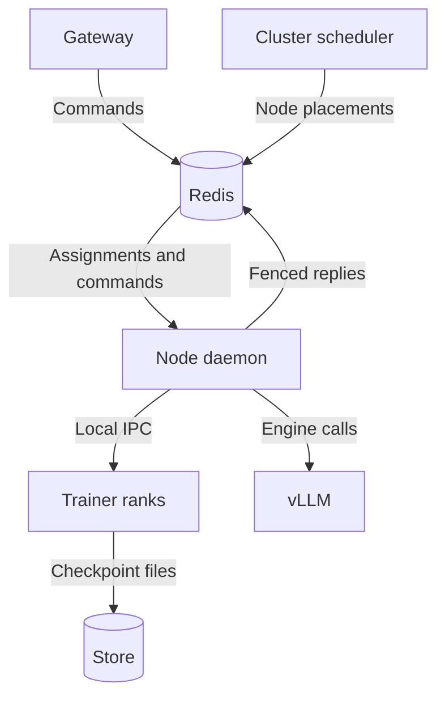

# tiny-open-rl

The [Tinker](https://thinkingmachines.ai/tinker/) training API, built on Redis Streams and PyTorch.

The Tinker SDK trains through it unchanged, for LoRA adapters and full fine-tunes alike:

```python
client = tinker.ServiceClient(base_url="http://localhost:8000")
trainer = client.create_lora_training_client(base_model="Qwen/Qwen3-0.6B", rank=8)

for batch in data:
  trainer.forward_backward(batch, "importance_sampling")
  trainer.optim_step(types.AdamParams(learning_rate=4e-5))

sampler_path = trainer.save_weights_for_sampler("step-100").result().path  # a PEFT adapter vLLM can load
```

`base_model` is a hub id, or a folder of `config.json` and `*.safetensors` anywhere fsspec reaches (`gs://...`, `s3://...`,
`/mnt/models/...`). A node fetches a bucket model once into `MODEL_CACHE`. See [models.py](tinyrl/storage/models.py).

## Run it

```sh
pip install -e .
redis-server &                                          # Redis 8.4 or newer
python -m tinyrl.api.gateway &                          # the Tinker HTTP API, on :8000
python -m tinyrl.control.scheduler &                    # assigns runs to workers and workers to nodes
python -m tinyrl.control.node_daemon                    # runs worker lifetimes and coordinates their GPUs
```

A **worker** is a group of runs sharing one trainer model or sampling engine. The gateway records what a run needs, and
the scheduler picks its worker: LoRA runs on the same base model share a trainer, sampling sessions on the same base model and
kind share a sampler, and an exclusive run's sessions share a sampler of their own. A full fine-tune
(`user_metadata={"openrl.fine_tuning_type": "full"}`) or an exclusive run (`"openrl.exclusive": "true"`) gets a worker of
its own. Worker names encode nothing.

Run one node daemon per GPU machine (`GPUS`, default 1) and one cluster scheduler. The scheduler places workers on
nodes with the fewest workers per GPU, keeps full fine-tune samplers near their trainers, and moves work off dead nodes.
Each node owns its workers' Redis leases and command streams, chooses their GPUs, and runs the local fairness policy.

Each worker runs in one coroutine. Its executor, lease token, ready queue and checkpoint preparation task belong to
that lifetime. Sampling commands become ready after their session metadata and checkpoint files are available.
Checkpoint I/O runs off the event loop, and preparation can overlap startup and execution. Missing sessions and failed
checkpoint downloads receive fenced error replies before entering the GPU queue. The worker wakes its model, executes ready
work and parks when another worker needs its GPUs. On shutdown it stops claiming commands, finishes the work already
claimed, saves its training state and closes, with process cleanup in `finally`.

The node keeps GPU placements, waiting order and reservations. Preparation completion and scheduling changes wake
workers through the same node change event. A worker waiting for its GPUs checks admission when it wakes. Workers on
independent GPUs run concurrently. Node heartbeats and each worker's lease renewal continue during model operations,
and a download does not keep an otherwise idle worker from yielding its GPU.

A trainer is a synchronous model process. The node sends request bytes over a private Unix socket and receives reply
bytes and checkpoint metadata. Model tensors, optimizer state and checkpoint I/O stay in the trainer. Multi-GPU
trainers use torchrun and FSDP; the whole rank group parks, resumes and exits together. A single-GPU LoRA trainer can
move between a node's GPUs without restarting its model.

Sampling controllers run in the node's event loop and drive isolated vLLM engine processes. On multi-GPU nodes the
node queues a warm startup at placement; on one GPU it starts the engine for the first request. `ENGINE=module:Class`
can select another engine implementing async `start(base, lora, env)`, `load_checkpoint(name, path)`, `sample(job, name)`,
`sleep()`, `wake()` and `close()`. Settings are per engine; loading an already loaded checkpoint name must be idempotent,
and `close()` must wait for its processes to exit. Checkpoint names include both the URI and its version.

The node reserves every GPU of a worker together, honoring readiness order on each GPU. Workers with known memory
budgets can share when they fit; others take turns. An idle holder yields to a waiter, and a busy holder yields
after `QUANTUM` (30 s), starting after cold engine startup completes. Training yields between commands; sampling yields
between waves of up to three sessions for a LoRA engine or one session for a full fine-tune engine. The reservation
starts before wake and remains held until parking acknowledges or the entire process group has exited. A trainer's
parking copies weights, gradients and Adam state to pinned host memory, then restores them on its next turn.

Stop the node daemon with SIGTERM to drain work and save its training state before the processes are reaped. `DRAIN_S`
(default 20 s) is the grace period for already claimed work and checkpointing. After it expires the node aborts
unfinished work, then still waits for process cleanup and flushes pending uploads; it is not a bound on total shutdown
time. A crash or an expired drain fails uncertain commands instead of replaying training updates; a run with no parked
checkpoint must explicitly load a saved state before continuing. When upgrading from the former standalone worker
services, drain the nodes and restart the scheduler and node daemons together.

### Checkpoints

`CKPT` is where checkpoints live. On one machine it is a folder (`/tmp/tinyrl` unless set), and nothing leaves the
machine. Set it to a bucket (`gs://...`, `s3://...`) to keep checkpoints past a machine, or to share them across
machines. A save still lands in the node's `CKPT_CACHE` first and replies, and the node daemon uploads it behind, so a
bucket never holds up a step. A sampler on the node reads the cached copy; one on another node waits for the upload.

A full fine-tune's sampler weights change in few bytes a step, so they upload as the bytes that changed since the save
before, in chains of at most `KEYFRAME_EVERY` (8) saves that start with a whole one. Another node rebuilds a save from
the newest one it has and checks each chunk against the CRC the saving node took. The node daemons delete the links no registered checkpoint needs.

### On Kubernetes

[k8s/](k8s) runs Redis with an append-only file, the gateway, the scheduler, and a node daemon on every node labeled `tinyrl-gpu=true`.
Build the image from [Dockerfile](Dockerfile), point `CKPT` in [k8s/kustomization.yaml](k8s/kustomization.yaml) at a
bucket the nodes' service account can write, and run `kubectl apply -k k8s/`. A drained node's trainers save their runs,
and a dead node's workers move to live nodes. `python k8s/e2e.py` breaks a running cluster on purpose and checks it
survives.

## How it works



Every training or sampling call is a command on its run's Redis stream, and its reply is a stream with one entry, named by the request. That's the
whole design. Redis does the bookkeeping that would otherwise take a database, a ledger and a heartbeat.

* **The queue reads itself.** The node reads each worker's run streams through one consumer group so `XINFO GROUPS` says what's queued,
  and `XPENDING` says what's in flight, under which owner, and for how long. `GET /api/v1/runs/<id>` just asks.
* **A dead trainer fails fast.** Its commands stay in the pending list. The node claims abandoned work with `XAUTOCLAIM`
  and fails it before replacement execution starts, so clients receive a definite failure instead of an uncertain replay.
* **A stopping trainer saves its runs.** On node SIGTERM, the node uses the drain grace period to finish already claimed commands and save weights,
  pending gradients and Adam state. The replacement trainer restores the published checkpoint before its next command.
* **Retries are free.** `XREAD` from id `0` blocks until the reply is written and never consumes it, so
  `retrieve_future` can be retried, or waited on by many clients, and every one of them gets the same answer.
  A call the SDK retries with the same `seq_id` runs once, and every attempt gets the first attempt's answer.
* **Deleted runs take no work.** A run is live exactly while its stream exists, so `XADD NOMKSTREAM` turns a call on a deleted run into a 404.
* **Replies land atomically.** The reply, the acknowledgement and the run's step counter are written in one transaction.
* **One wire format.** `forward_backward` stays protobuf from the SDK to the trainer, which reads the tensors straight out of the bytes.
  Older SDKs' JSON is turned into the same protobuf at the gateway, and JSON clients get the output decoded back to JSON.
* **Cluster assignments in one log.** The gateway, scheduler and nodes use `tinyrl:events` for run membership and node placement.
  Worker coroutines keep their ready queues locally and update the node's GPU reservations directly.
  Model processes do not read the log.
* **One trainer.** A base model, with a PEFT adapter per run or the whole model for a single run, behind `create_run`, `forward_backward`,
  `optim_step`, `training_state`, `sampler_weights`, `restore_run` and `delete_run`. Logprobs are computed `CHUNK` tokens at a time under checkpointing, so the
  `[tokens, vocab]` logits never exist all at once. The optimizer updates fp32 master weights and keeps fp32 AdamW state, while the
  forward pass runs in bf16 under autocast. A LoRA run's frozen base model stays bf16.
* **Portable checkpoints.** Training checkpoints (`save_weights`) and sampler weights (`save_weights_for_sampler`) go through
  [store.py](tinyrl/storage/store.py) behind `put(uri)` and `get(uri)` as pure `safetensors` (no `torch.save` pickle), so any trainer can
  resume a run with its exact fp32 weights and AdamW state. `CKPT` can be a bucket (`gs://...`, with `pip install .[gcs]`), so
  every node sees every checkpoint.
* **One owner per worker.** The node holds and renews its workers' leases. It verifies ownership before dispatch, and a
  WATCH/MULTI/EXEC transaction fences replies and parked pointers. A resumed stale node cannot dispatch another command or overwrite a reply.

## Reading the code

Start with the docstring at the top of [bus.py](tinyrl/bus.py), which explains the streams. Then read [gateway.py](tinyrl/api/gateway.py)
to see how each Tinker call becomes a command, [scheduler.py](tinyrl/control/scheduler.py) for placement and GPU admission,
and [node_daemon.py](tinyrl/control/node_daemon.py) for worker lifetimes and GPU handoff,
[store.py](tinyrl/storage/store.py) to see how checkpoints are stored, and [trainer.py](tinyrl/workers/trainer.py) and
[model.py](tinyrl/workers/model.py) to see how a command runs on the model.

| File | Responsibility |
|---|---|
| [tinyrl/bus.py](tinyrl/bus.py) | runs, sessions, command streams, fenced replies and leases |
| [tinyrl/api/gateway.py](tinyrl/api/gateway.py) | Tinker HTTP routes, checkpoints and Prometheus metrics |
| [tinyrl/api/wire.py](tinyrl/api/wire.py) | Tinker protobufs and numpy arrays |
| [tinyrl/control/scheduler.py](tinyrl/control/scheduler.py) | cluster assignment, local GPU placement and admission rules |
| [tinyrl/control/node_daemon.py](tinyrl/control/node_daemon.py) | worker lifetimes, leases, command preparation, GPU reservations, recovery, uploads and checkpoint sweeps |
| [tinyrl/control/process.py](tinyrl/control/process.py) | private model IPC and parent-owned process groups |
| [tinyrl/control/estimator.py](tinyrl/control/estimator.py) | model memory and GPU-width estimates |
| [tinyrl/workers/trainer.py](tinyrl/workers/trainer.py) | synchronous model commands and checkpoint metadata |
| [tinyrl/workers/model.py](tinyrl/workers/model.py) | PyTorch/PEFT training, losses, token batching and host parking |
| [tinyrl/workers/sampler.py](tinyrl/workers/sampler.py) | sampling encoding and engine execution |
| [tinyrl/workers/vllm.py](tinyrl/workers/vllm.py) | vLLM startup, loading, completions and sleep/wake |
| [tinyrl/workers/snapshot.py](tinyrl/workers/snapshot.py) | CRIU snapshots and isolated restores |
| [tinyrl/storage/store.py](tinyrl/storage/store.py) | safetensors, chunked saves, uploads, caching and delta chains |
| [tinyrl/storage/registry.py](tinyrl/storage/registry.py) | checkpoint owners, sizes, versions and TTLs |
| [tinyrl/storage/models.py](tinyrl/storage/models.py) | base-model fetching and caching |

`python sz.py` counts token-bearing lines the way tinygrad does, and CI caps `tinyrl/` at 3,200 lines. Outside `tinyrl/`,
[examples/tinker_sdk.py](examples/tinker_sdk.py) trains and samples through the unmodified SDK. The rest of the repo holds
[k8s/](k8s), the browser [simulator/](simulator/README.md), [docs/kubernetes.md](docs/kubernetes.md), and the integration suites in [test/](test).

Settings are environment variables: `REDIS_URL`, `PORT`, `MODEL_CACHE` (where a node keeps base models it fetched), `MODEL_MIRROR` (a folder or bucket nodes read hub models from first), `CKPT` (the
checkpoint directory or bucket the trainers and samplers share), `CKPT_CACHE` (where a node keeps the checkpoints it saved or downloaded, in front of a bucket `CKPT`), `CKPT_CACHE_BYTES` (the most it keeps, least recently read first, 0 for half its disk), `KEYFRAME_EVERY`, `TOKEN_BUDGET` (padded tokens per pass; unset, each call sizes its passes to the free
GPU memory), `CHUNK`, `GRAD_CKPT`, `WAIT`, `REPLY_TTL`, `SESSION_TTL`, `SESSION_GRACE`, `LEASE_MS`, `GPUS`, `QUANTUM`, `IDLE_MS`, `DRAIN_S`,
`ENGINE`, `VLLM_ARGS`, `CKPT_TTL` (the TTL, at least 3600 s, of a checkpoint saved without one; 0 keeps it until deleted), `TINYRL_SNAPSHOTS` (where a node keeps vLLM snapshots; unset, samplers boot vLLM every time) and `DEBUG=1`.

## Telemetry

Every run's hash counts the commands it ran (`cmds`), the time they spent queued (`wait_ms`, from the stream entry id to the
node dispatching it) and running (`busy_ms`), plus `steps` and `failed`. The node writes them in the same transaction as
the reply. `GET /api/v1/runs/<run>` shows one run's counters, and `GET /metrics` shows every run's in Prometheus' text
format, as `tinyrl_<counter>_total{worker, run}` in seconds. The numbers scheduling papers report are queries over those
counters:

| measure | PromQL |
|---|---|
| utilization of a worker's trainer | `sum by (worker) (rate(tinyrl_busy_seconds_total[5m]))` |
| mean queueing delay per call | `sum by (worker) (rate(tinyrl_wait_seconds_total[5m])) / sum by (worker) (rate(tinyrl_cmds_total[5m]))` |
| slowdown, (wait + run) / run | `1 + sum by (worker) (rate(tinyrl_wait_seconds_total[5m])) / sum by (worker) (rate(tinyrl_busy_seconds_total[5m]))` |
| throughput, optimizer steps per second | `sum by (worker) (rate(tinyrl_steps_total[5m]))` |
| fairness, Jain's index of the GPU time active runs get (1 is equal shares) | `sum(rate(tinyrl_busy_seconds_total[5m]) > 0) ^ 2 / (count(rate(tinyrl_busy_seconds_total[5m]) > 0) * sum((rate(tinyrl_busy_seconds_total[5m]) > 0) ^ 2))` |
| failure rate | `sum by (worker) (rate(tinyrl_failed_total[5m])) / sum by (worker) (rate(tinyrl_cmds_total[5m]))` |

A run's wait includes waiting on its own earlier calls, since a run's calls run in order.

`GET /api/v1/scheduling` combines cluster assignments with the latest live-node heartbeat: actual GPUs, waiting workers,
reservations, accumulated busy time, and the owned process PID (or `null` before a sampling engine starts). These local
snapshots are diagnostic; the node's live GPU state governs admission. Per-command timing is available with `DEBUG=1`.
The Redis event log contains cluster assignments.

## Throughput simulator

The [interactive simulator](simulator/README.md) explores GPU switching, arrival rates, queue growth, and data-transfer bottlenecks.
Open `simulator/index.html` in a browser; it runs locally without installing dependencies.

## Test

```sh
python -m unittest discover -s test -t .                             # starts its own redis-server, or set REDIS_URL
TINKER_PYTHON=$(which python) python -m unittest test.test_tinker   # runs examples/tinker_sdk.py against redis, gateway, scheduler and node_daemon
```

Integration tests use real Redis, tiny random Llama models and the unmodified SDK. Deterministic node tests substitute
an inline CPU model process or a fake sampling engine; separate process tests cover Unix IPC, parent death, SIGTERM
draining and two-rank numerical equivalence. CUDA parking tests run when a GPU is available.

## Not here yet

* `create_training_client_from_state`.
* Distributed training across nodes and context parallelism.
* Moving runs between live nodes to balance load, parking idle runs, and the `/dev/shm` and peer checkpoint tiers. The
  design is in [docs/kubernetes.md](docs/kubernetes.md).
