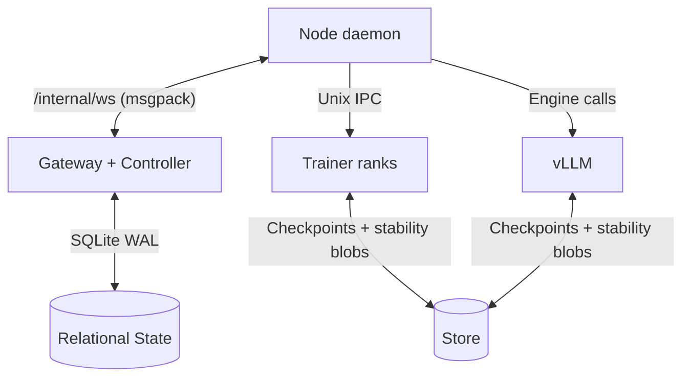

# tiny-open-rl

The [Tinker](https://thinkingmachines.ai/tinker/) training API, built on SQLite, GPU node daemons, and PyTorch.

The unmodified Tinker SDK trains and samples through it for both LoRA adapters and full fine-tunes:

```python
client = tinker.ServiceClient(base_url="http://localhost:8000")
trainer = client.create_lora_training_client(base_model="Qwen/Qwen3-0.6B", rank=8)

for batch in data:
  trainer.forward_backward(batch, "importance_sampling")
  trainer.optim_step(types.AdamParams(learning_rate=4e-5))

sampler_path = trainer.save_weights_for_sampler("step-100").result().path
```

`base_model` can be a Hugging Face ID or any fsspec path (`gs://...`, `s3://...`, `/mnt/models/...`) containing `config.json` and `*.safetensors`. Pass `user_metadata={"openrl.fine_tuning_type": "full"}` for a full fine-tune or `{"openrl.exclusive": "true"}` for a dedicated worker.

## Quickstart

```sh
pip install -e .
python -m tinyrl.api.gateway &        # Tinker HTTP API and controller (:8000)
python -m tinyrl.control.node_daemon  # runs assigned tasks on local GPUs
```

Run one `gateway` (persisting durable state in `TINYRL_DB`) and one `node_daemon` per GPU machine (set `CONTROL_URL`, `GPUS`).

- **Checkpoints:** Stored under `CKPT/objects/<version>` (default `/tmp/tinyrl`). Point `CKPT` at a bucket (`gs://...`, `s3://...`; `pip install .[gcs]` for GCS) to persist and share checkpoints across nodes.
- **Kubernetes:** Build [Dockerfile](Dockerfile), set `CKPT` in [k8s/kustomization.yaml](k8s/kustomization.yaml), and run `kubectl apply -k k8s/` on nodes labeled `tinyrl-gpu=true`. Verify cluster resilience with `python k8s/e2e.py`. See [docs/kubernetes.md](docs/kubernetes.md).

## Architecture



Each GPU node holds one full-duplex msgpack WebSocket (`/internal/ws`) to the controller. Treating GPU VRAM across the fleet as a directly paged cache of training runs and sampler engines, the controller pushes explicit tasks (`train`, `sample`, `park`, `save`, `drop`, `stop`) plus off-GPU prefetch/sweep directives directly against live reported workers—with no persisted cluster plan or virtual process layer. Outstanding GPU grants reserve one quantum in EEVDF projected lag before the next grant is chosen, and two-phase `save` commits a detached snapshot before releasing a source worker.

- **Durable training, RAM sampling:** Training runs follow an explicit `fresh -> live <-> saved -> lost -> deleted` lifecycle in [ledger.py](tinyrl/control/ledger.py) backed by [db.py](tinyrl/control/db.py) (the sole module speaking SQL). Sampling queues and bounded LRU replies live in RAM with `429` backpressure, `410` on evicted promises, submission-time version pinning, and attempt-fenced failover.
- **Layered EEVDF fleet paging:** [policy.py](tinyrl/control/policy.py) holds pure waterfilling, EEVDF + projected lag, sample admission, and GPU/node math; [pager.py](tinyrl/control/pager.py) evicts, places, stages, grants, and parks; and [controller.py](tinyrl/control/controller.py) wires `Ledger`, live nodes/workers, and the swappable `scheduler` over `NodeMsg`.
- **Trainers, samplers, and store:** Trainers run as isolated synchronous PyTorch/PEFT processes (FSDP via `torchrun` across multiple GPUs) with bf16 forward, fp32 master weights + AdamW state, `cispo`/`dro`/`gspo`/`stable_reinforce` losses, and pinned host-memory parking. Samplers drive isolated vLLM processes (with optional CRIU snapshots). [store.py](tinyrl/storage/store.py) stores immutable `safetensors` checkpoints and `stable_reinforce` top-k blobs across local cache, peer HTTP, and async bucket uploads, with SQLite recording only byte-range metadata.

## Code layout

`tinyrl/` is structured in small, one-way layers (`python sz.py` counts token-bearing lines). Start with [controller.py](tinyrl/control/controller.py), [pager.py](tinyrl/control/pager.py), and [policy.py](tinyrl/control/policy.py).

| File | Responsibility |
|---|---|
| [tinyrl/control/db.py](tinyrl/control/db.py) | All SQLite WAL schema and queries (sessions, runs, checkpoints, commands, replies, stability, GC) |
| [tinyrl/control/policy.py](tinyrl/control/policy.py) | Pure waterfilling, EEVDF + projected lag, sample admission, GPU block selection, and placement |
| [tinyrl/control/ledger.py](tinyrl/control/ledger.py) | Client runs, durable/RAM queues, sample LRU cache, completions, and billing |
| [tinyrl/control/pager.py](tinyrl/control/pager.py) | Worker eviction, placement, checkpoint staging, projected-lag GPU dispatch, and parking |
| [tinyrl/control/controller.py](tinyrl/control/controller.py) | Execution kernel connecting `Ledger`, live nodes/workers, and a swappable `scheduler` over `NodeMsg` |
| [tinyrl/control/node_daemon.py](tinyrl/control/node_daemon.py) | Stateless task executor, `/internal/ws` WebSocket client, staging, sweep, and drain |
| [tinyrl/control/accounting.py](tinyrl/control/accounting.py) | Monotonic GPU-time accounting across overlapping calls |
| [tinyrl/control/process.py](tinyrl/control/process.py) | Private Unix IPC and owned process-group supervision |
| [tinyrl/control/estimator.py](tinyrl/control/estimator.py) | Framework-free model memory and GPU-width estimation |
| [tinyrl/api/gateway.py](tinyrl/api/gateway.py) | Tinker HTTP routes, `/internal/ws` channel, checkpoints, and `/metrics` |
| [tinyrl/api/wire.py](tinyrl/api/wire.py) | Tinker protobufs, numpy encoding, and stability packing |
| [tinyrl/types.py](tinyrl/types.py) | Domain types and binary msgpack node protocol frames |
| [tinyrl/workers/trainer.py](tinyrl/workers/trainer.py) | Synchronous trainer command loop, stability fetch, and checkpoint metadata |
| [tinyrl/workers/model.py](tinyrl/workers/model.py) | PyTorch/PEFT training, RL losses, token batching, and host parking |
| [tinyrl/workers/sampler.py](tinyrl/workers/sampler.py) | Coalesced checkpoint loading, sample encoding, and Store-backed stability blobs |
| [tinyrl/workers/vllm.py](tinyrl/workers/vllm.py) | vLLM engine lifecycle, checkpoint loading, and sleep/wake |
| [tinyrl/workers/snapshot.py](tinyrl/workers/snapshot.py) | CRIU snapshots and restores for vLLM |
| [tinyrl/storage/store.py](tinyrl/storage/store.py) | Safetensors + blob I/O, local cache, peer reads, async uploads, and sweep |
| [tinyrl/storage/models.py](tinyrl/storage/models.py) | Base-model fetching and local caching |
| [tinyrl/trace.py](tinyrl/trace.py) | NVTX ranges for Nsight Systems |

## Configuration

| Area | Variables |
|---|---|
| **Core** | `TINYRL_DB` (`/tmp/tinyrl.db`), `CONTROL_URL` (`http://127.0.0.1:8000`), `PORT` (`8000`), `GPUS` (`1`), `GPU_MEMORY_MIB`, `DRAIN_S` (`20`), `LEASE_MS`, `TICK`, `TICK_MS`, `WAIT`, `REPLY_TTL`, `SESSION_TTL`, `SESSION_GRACE` |
| **Storage** | `CKPT` (`/tmp/tinyrl`), `CKPT_CACHE`, `CKPT_CACHE_BYTES`, `CKPT_TTL`, `STABILITY_TTL`, `STABILITY_BYTES`, `SHARD_BYTES`, `SWEEP_S`, `MODEL_CACHE`, `MODEL_MIRROR` |
| **Scheduling** | `QUANTUM_MS` (`2000`), `MAX_QUANTUM_MS` (`15000`), `SWITCH_BUDGET` (`0.1`), `CYCLE_GRACE_MS` (`100`), `REBALANCE_MS` (`20000`), `SAMPLE_QUEUE_BYTES`, `SAMPLE_REPLY_BYTES` |
| **Execution** | `TOKEN_BUDGET`, `CHUNK`, `GRAD_CKPT`, `ENGINE`, `VLLM_ARGS`, `STABILITY_TOPK`, `TINYRL_SNAPSHOTS`, `DEBUG=1` |

## Test

```sh
python -m unittest discover -s test -t .                            # isolated SQLite Controller per test
TINKER_PYTHON=$(which python) python -m unittest test.test_tinker  # end-to-end via examples/tinker_sdk.py
python -m test.mutation                                             # control-plane mutation tests
SEED=3 CHAOS=1 python -m test.stress_fleet                          # randomized chaos & fleet stress test
```
