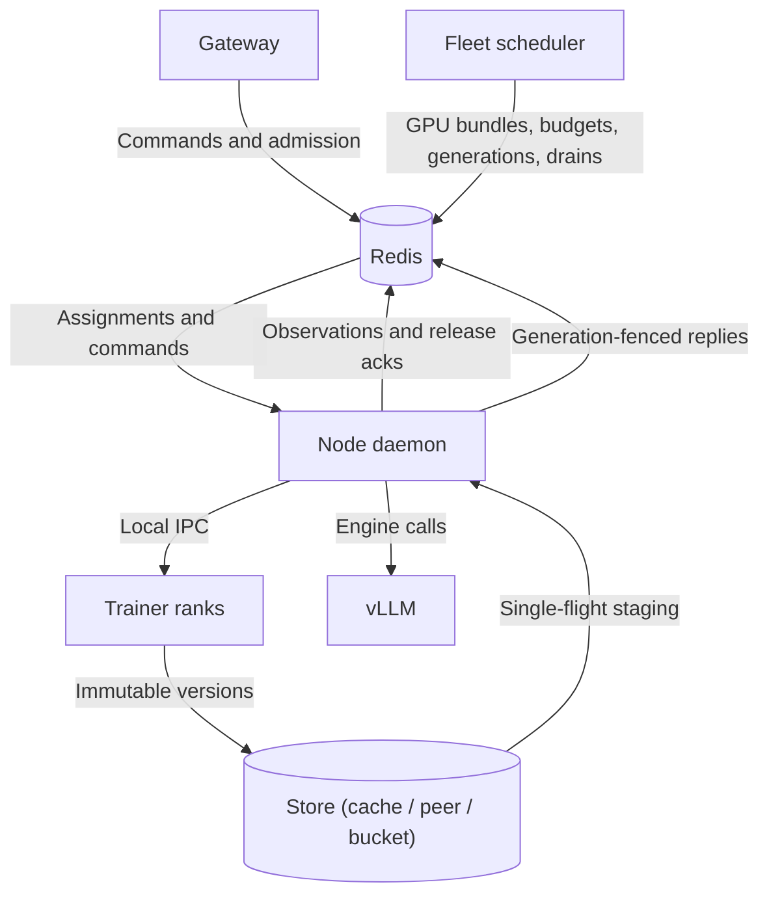

# tiny-open-rl

The [Tinker](https://thinkingmachines.ai/tinker/) training API, built on Redis Streams and PyTorch.

The Tinker SDK trains through it unchanged, for LoRA adapters and full fine-tunes alike:

```python
client = tinker.ServiceClient(base_url="http://localhost:8000")
trainer = client.create_lora_training_client(base_model="Qwen/Qwen3-0.6B", rank=8)

for batch in data:
  trainer.forward_backward(batch, "importance_sampling")
  trainer.optim_step(types.AdamParams(learning_rate=4e-5))

sampler_path = trainer.save_weights_for_sampler("step-100").result().path  # a PEFT adapter vLLM can load
```

`base_model` is a hub id, or a folder of `config.json` and `*.safetensors` anywhere fsspec reaches (`gs://...`, `s3://...`,
`/mnt/models/...`). A node fetches a bucket model once into `MODEL_CACHE`. See [models.py](tinyrl/storage/models.py).

## Run it

```sh
pip install -e .
redis-server &                                          # Redis 8.6 or newer
python -m tinyrl.api.gateway &                          # the Tinker HTTP API, on :8000
python -m tinyrl.control.scheduler &                    # assigns runs to workers and workers to nodes
python -m tinyrl.control.node_daemon                    # runs worker lifetimes and coordinates their GPUs
```

A **worker** is a group of runs sharing one trainer model or sampling engine. The gateway records what a run needs, and
the scheduler picks its worker: LoRA runs on the same base model share a trainer, sampling sessions on the same base model and
kind share a sampler, and an exclusive run's sessions share a sampler of their own. A full fine-tune
(`user_metadata={"openrl.fine_tuning_type": "full"}`) or an exclusive run (`"openrl.exclusive": "true"`) gets a worker of
its own. Worker names encode nothing.

Run one node daemon per GPU machine (`GPUS`, default 1) and one fleet scheduler. The scheduler runs under a
single-writer Redis lease (`sched_owner`/`sched_epoch`), assigns physical intra-node GPU bundles (`gpus`), bounded work
budgets (`TURN`), per-job ownership generations, `run`/`idle`/`drain` intents, and checkpoint `prepare` lists in a single
Redis assignment table, and reads each node's reported state from the `obs` hash. Nodes are passive assignment executors:
they prepare inputs, run assigned GPU bundles until a budget or drain boundary, park or export state, report verified
physical GPU release, and never choose GPUs locally.

Each logical job gets equal weight by default, and its trainer and sampler replicas share one persisted service `account`.
The fleet scheduler enforces weighted start-time fair service across active accounts, reconciles predictions against
observed execution time, holds idle residents warm at zero service cost until another eligible worker needs the bundle,
and joins newly arriving or returning idle accounts at the active waiting floor so inactivity never earns catch-up credit.
Starving wide or exclusive requests reserve an eligible GPU bundle (`STARVE_S`), exclusive admission is bounded by
`EXCLUSIVE_FRACTION` and `EXCLUSIVE_MAX_GPUS` (with infeasible width or `openrl.gpu_classes` requests rejected at HTTP
400), host-memory pressure (`HOST_MEMORY_MIB`) triggers checkpoint-and-evict of parked workers, and makespan estimates
guide placement and deliberate cross-node migration with transfer hysteresis (`RESTORE_S`).

Each worker runs in one coroutine. It peeks at each run's unclaimed command head and prepares its inputs independently.
Assignment-driven prefetches and command-head staging go through one single-flight transfer layer with separate
`REQ_TRANSFERS` and `PREFETCH_TRANSFERS` lanes and chunk-level cancellation when assignments change. If a worker is
waiting on host checkpoint I/O while another worker needs its GPUs, it reports `preparing` so the scheduler can park it
and yield the bundle while the host transfer continues. Executable commands are claimed only after GPU admission, under
the run's current ownership generation. Preparation errors claim and answer their failed head without waiting for a GPU.

Within a shared engine, `scheduler.select_runs` chooses ready runs served the fewest tokens after any sampler save,
continuing the current trainer run for up to `RUN_COMMANDS` commands while queued, and overlapping concurrent sampling
requests across ready LoRA sessions (up to `SAMPLE_RUNS` sessions, `SAMPLE_COMMANDS` commands each; full fine-tune
samplers run one checkpoint at a time) while accounting wall time over a single busy interval. Each command carries its
cost at submission: training tokens for `forward_backward`, prompt plus max generated tokens for `sample`, and 1
otherwise.

A trainer is a synchronous model process driven over a private Unix socket; multi-GPU trainers use torchrun and FSDP with
a collective timeout (`COLL_TIMEOUT_S`), parking, resuming and exiting as one rank group. Shared LoRA trainers isolate
each job's CPU and CUDA RNG stream across commands so interleaving siblings does not perturb randomness. Sampling
controllers run in the node's event loop and drive isolated vLLM engine processes with compatibility-keyed compile caches
(`ARTIFACT_CACHE`); `TINYRL_SNAPSHOTS` remains optional until target GPU hardware passes `vllm.startup_gate`
(`STARTUP_GATE_P95_S`). `ENGINE=module:Class` selects an alternate sampling engine implementing async
`start(base, lora, env)`, `load_checkpoint(name, path)`, `sample(job, name)`, `sleep()`, `wake()` and `close()` (plus
optional `abort(request_ids)` for single-job cancellation).

### Ownership, suspension, and crash recovery

Every run carries a monotonic ownership `generation` independent of its worker's process lease. Command claims, reply
publication, and checkpoint state commits verify the job's generation in `WATCH`/`MULTI` transactions. Moving or fencing
one job out of a shared LoRA worker drains or cancels only that job (preserving its training state or aborting only its
in-flight sampler requests and unloading unshared adapters) while sibling jobs keep executing on the same engine.

Lease expiry fences stale publication, and physical GPU reuse additionally requires a matching node release observation
or verified process-group termination (`pids_clear`). A timed-out suspension (`DRAIN_S`, default 20 s) is treated as a
failure to recover from, not a valid parked state. Stop a node daemon with SIGTERM to finish the current command
boundary, commit training snapshots, reap child process groups, and flush pending durable uploads.

* **Planned handoffs** (local park, single-job shared-worker drain, cross-node migration, SIGTERM drain) preserve every
  completed command at the committed boundary, including FP32 master weights, AdamW moments and steps, accumulated
  gradients, and per-job/per-rank RNG state (with deterministic fallback remapping if rank width changes).
* **Explicit `save_weights`** completes its future only after durable storage commit, while durable upload runs in the
  background outside GPU ownership so the trainer can release or continue immediately. Temporary
  `save_weights_for_sampler` exports become usable as soon as a complete protected copy exists and are rejected for
  optimizer-state training recovery.
* **Unexpected process or node loss** recovers from the last committed checkpoint that survived (retaining the previous
  durable recovery point until a replacement is durably committed). If that boundary covers all acknowledged mutations,
  the job resumes automatically; if acknowledged mutations were lost, the backend exposes the rollback and rejects
  further mutations until the client explicitly restores a checkpoint via `load_weights` (never combining older tensors
  with a newer command cursor). Partially failed operations taint the live state and cannot be published.
* **Fresh-session reconstruction** resolves exact registered checkpoint versions via `POST /api/v1/weights_info` and
  create-via-load `POST /api/v1/load_weights`, enabling `create_training_client_from_state` and
  `create_training_client_from_state_with_optimizer` for both full fine-tunes and nondefault LoRA configurations.
* **Out of scope for backend job recovery:** transparent preservation of every uncheckpointed mutation across crashes,
  and client workflow state (dataset cursors, unfinished tool calls, external sandboxes).

### Scheduling controls

| Variable | Default | Controls |
|---|---|---|
| `TURN` | 200000 | Per-job token budget assigned per GPU turn before yielding to waiting accounts |
| `RUN_COMMANDS` | 4 | Commands in a preferred trainer continuation within a turn |
| `SAMPLE_RUNS` | 3 | LoRA sessions dispatched concurrently in a sampling wave; full fine-tunes use one |
| `SAMPLE_COMMANDS` | 128 | Commands claimed per session in a sampling wave |
| `STARVE_S` | 2.0 | Wait threshold before reserving a physical GPU bundle for a starving wide/exclusive worker |
| `RESTORE_S` | 0.5 | Base restore overhead in makespan and cross-node migration hysteresis |
| `EXCLUSIVE_FRACTION` | 1.0 | Maximum fraction of fleet GPUs reservable by exclusive requests (`EXCLUSIVE_MAX_GPUS` caps count) |

### Checkpoints

`CKPT` is where durable checkpoints live: a local folder (`/tmp/tinyrl` by default) on one machine, or an fsspec bucket
(`gs://...`, `s3://...`) across machines, fronted on each node by `CKPT_CACHE` (bounded by `CKPT_CACHE_BYTES`) and an
optional peer HTTP server (`CKPT_PEER`). Each immutable version publishes an atomic `.manifest.json` (file list, sizes,
metadata, format version) only after its safetensors files are complete, and records confirmed durable upload separately
(`.durable`) from local and peer locations. Explicit version reads never fall back through `_latest`; legacy
`version@peer` references and pre-manifest folders remain readable through a narrow compatibility boundary. Redis
reference sets (`vref:<version>`) and cross-process file locks protect recovery points, sampler pins, scheduled
assignments, and active readers from concurrent cleanup or local cache eviction until unreferenced.

### On Kubernetes

[k8s/](k8s) runs Redis with an append-only file, the gateway, the scheduler, and a node daemon on every node labeled `tinyrl-gpu=true`.
Build the image from [Dockerfile](Dockerfile), point `CKPT` in [k8s/kustomization.yaml](k8s/kustomization.yaml) at a
bucket the nodes' service account can write, and run `kubectl apply -k k8s/`. A drained node's trainers save their runs,
and a dead node's workers move to live nodes. `python k8s/e2e.py` breaks a running cluster on purpose and checks it
survives.

## How it works



Every training or sampling call is a command on its run's Redis stream, and its reply is a stream with one entry, named by the request. That's the
whole design. Redis does the bookkeeping that would otherwise take a database, a ledger and a heartbeat.

* **The queue reads itself.** Peeking and preparation leave commands unclaimed. The node claims executable batches through
  the worker's consumer group after GPU admission, under the run's current generation; preparation failures are claimed
  and answered without a GPU. `XINFO GROUPS` says what's queued and `XPENDING` says what's in flight, under which owner,
  and for how long. `GET /api/v1/runs/<id>` just asks.
* **A dead trainer fails fast and never guesses.** Abandoned commands are claimed with `XAUTOCLAIM` and failed before
  replacement execution starts. Replacement restoration checks acknowledged progress against the surviving committed
  boundary, auto-resuming when covered and requiring an explicit `load_weights` restore on rollback.
* **A draining job saves an exact boundary.** Planned suspension, single-job migration, and SIGTERM finish the current
  command boundary, write weights, pending gradients, Adam state, and per-rank RNG into an immutable version, commit that
  version and boundary under the job's generation, and acknowledge physical GPU release.
* **Retries are free.** `XREAD` from id `0` blocks until the reply is written and never consumes it, so
  `retrieve_future` can be retried, or waited on by many clients, and every one of them gets the same answer.
  A call the SDK retries with the same `seq_id` runs once, and every attempt gets the first attempt's answer.
* **Deleted runs take no work.** A run is live exactly while its stream exists, so `XADD NOMKSTREAM` turns a call on a deleted run into a 404.
* **Replies land atomically.** The reply, acknowledgement, generation check, progress marker and counters are written in one `WATCH`/`MULTI` transaction.
* **One wire format.** `forward_backward` stays protobuf from the SDK to the trainer, which reads the tensors straight out of the bytes.
  Older SDKs' JSON is turned into the same protobuf at the gateway, and JSON clients get the output decoded back to JSON.
* **One inspectable assignment table.** The scheduler holds a single-writer lease and updates physical GPU bundles,
  per-job budgets, generations, drains, preparation lists and persisted account service in Redis; node daemons publish
  matching revision observations (`obs`). Model processes do not touch Redis.
* **One trainer.** A base model, with a PEFT adapter per run or the whole model for a single run, behind `ensure_run`,
  `forward_backward`, `optim_step`, `snapshot_job`, `sampler_weights`, `restore_job` and `drop_run`. Logprobs are
  computed `CHUNK` tokens at a time under checkpointing, so `[tokens, vocab]` logits never exist all at once. The
  optimizer updates fp32 master weights and keeps fp32 AdamW state, while the forward pass runs in bf16 under autocast.
* **Portable versioned checkpoints.** Training checkpoints (`save_weights`), handoff snapshots, and sampler exports
  (`save_weights_for_sampler`) go through [store.py](tinyrl/storage/store.py) and [registry.py](tinyrl/storage/registry.py)
  as pure `safetensors` with atomic `.manifest.json` manifests, explicit version identities, reference-counted retention,
  and peer/bucket staging.
* **Fenced ownership.** Nodes hold worker leases to supervise processes and check per-job generations when claiming work,
  publishing replies, and advancing restore state. Failed publications leave unreferenced versions for ordinary sweep cleanup.

## Reading the code

Start with the docstring at the top of [bus.py](tinyrl/bus.py), which explains the Redis records. Then read
[gateway.py](tinyrl/api/gateway.py) to see how each Tinker call becomes a command,
[scheduler.py](tinyrl/control/scheduler.py) for fleet GPU bundle assignment and persisted fair service,
[node_daemon.py](tinyrl/control/node_daemon.py) for assignment execution, staging and drain handoff,
[store.py](tinyrl/storage/store.py) and [registry.py](tinyrl/storage/registry.py) for version manifests and retention, and
[trainer.py](tinyrl/workers/trainer.py) and [model.py](tinyrl/workers/model.py) for model execution and state recovery.

| File | Responsibility |
|---|---|
| [tinyrl/bus.py](tinyrl/bus.py) | runs, generations, recovery reconciliation, command streams, fenced replies, scheduler/worker leases and observations |
| [tinyrl/api/gateway.py](tinyrl/api/gateway.py) | Tinker HTTP routes, admission checks, checkpoint reconstruction (`weights_info`, `load_weights`) and Prometheus metrics |
| [tinyrl/api/wire.py](tinyrl/api/wire.py) | Tinker protobufs and numpy arrays |
| [tinyrl/control/scheduler.py](tinyrl/control/scheduler.py) | single-writer fleet GPU allocation, persisted fair service, wide/exclusive reservations, makespan migration and host eviction |
| [tinyrl/control/node_daemon.py](tinyrl/control/node_daemon.py) | passive assignment execution, single-flight staging, bounded turns, single-job drains, durable save completion and GPU release |
| [tinyrl/control/process.py](tinyrl/control/process.py) | private model IPC, RSS tracking and verified process-group termination |
| [tinyrl/control/estimator.py](tinyrl/control/estimator.py) | model memory, GPU-width, hardware-bundle compatibility and execution/transfer cost models |
| [tinyrl/workers/trainer.py](tinyrl/workers/trainer.py) | synchronous model commands, job restore/snapshot and checkpoint metadata |
| [tinyrl/workers/model.py](tinyrl/workers/model.py) | PyTorch/PEFT training, per-job RNG isolation, self-contained FP32 recovery and host parking |
| [tinyrl/workers/sampler.py](tinyrl/workers/sampler.py) | sampling encoding, single-job request cancellation and engine execution |
| [tinyrl/workers/vllm.py](tinyrl/workers/vllm.py) | vLLM startup, compatibility-keyed artifact caches, startup latency gate, abort and sleep/wake |
| [tinyrl/workers/snapshot.py](tinyrl/workers/snapshot.py) | optional CRIU snapshots (`TINYRL_SNAPSHOTS`) pending GPU compiled-artifact startup gate |
| [tinyrl/storage/store.py](tinyrl/storage/store.py) | safetensors, atomic `.manifest.json` versions, durable uploads, peer HTTP serving and cancellable single-flight staging |
| [tinyrl/storage/registry.py](tinyrl/storage/registry.py) | immutable version metadata, peer/durable locations, reference-counted retention, TTLs and orphan cleanup |
| [tinyrl/storage/models.py](tinyrl/storage/models.py) | base-model fetching and caching |
| [tinyrl/trace.py](tinyrl/trace.py) | NVTX ranges for Nsight Systems |

`python sz.py` counts token-bearing lines the way tinygrad does, and CI caps `tinyrl/` at 6,250 lines. Outside `tinyrl/`,
[examples/tinker_sdk.py](examples/tinker_sdk.py) trains and samples through the unmodified SDK. The rest of the repo holds
[k8s/](k8s), the browser [simulator/](simulator/README.md), [docs/kubernetes.md](docs/kubernetes.md), and the integration suites in [test/](test).

Settings are environment variables: `REDIS_URL`, `PORT`, `MODEL_CACHE`, `MODEL_MIRROR`, `CKPT` (durable checkpoint
folder or bucket), `CKPT_CACHE` (local version cache), `CKPT_CACHE_BYTES` (cache limit; 0 uses half the disk),
`CKPT_PEER` (peer HTTP address for cache pulls), `REQ_TRANSFERS`, `PREFETCH_TRANSFERS`, `SHARD_BYTES`, `COPY_CHUNK`,
`TOKEN_BUDGET`, `CHUNK`, `GRAD_CKPT`, `COLL_TIMEOUT_S`, `WAIT`, `REPLY_TTL`, `SESSION_TTL`, `SESSION_GRACE`,
`LEASE_MS`, `NODE_MS`, `GPUS`, `GPU_MEMORY_MIB`, `HOST_MEMORY_MIB`, `GPU_CLASS`, `GPU_RATE`, `MAX_CLUSTER_GPUS`,
`TURN`, `TICK_MS`, `TICK`, `IDLE_MS`, `MAX_SHARED_JOBS`, `STARVE_S`, `RESTORE_S`, `EXCLUSIVE_FRACTION`,
`EXCLUSIVE_MAX_GPUS`, `RUN_COMMANDS`, `SAMPLE_RUNS`, `SAMPLE_COMMANDS`, `DRAIN_S`, `SWEEP_S`, `ENGINE`, `VLLM_ARGS`,
`ARTIFACT_CACHE`, `STARTUP_GATE_P95_S`, `CKPT_TTL`, `TINYRL_SNAPSHOTS` and `DEBUG=1`.

## Telemetry

Every run's hash counts the commands it ran (`cmds`), the time they spent queued (`wait_ms`, from the stream entry id to the
node dispatching it) and running (`busy_ms`), plus `steps` and `failed`. The node writes them in the same transaction as
the reply. `GET /api/v1/runs/<run>` shows one run's counters, and `GET /metrics` shows every run's in Prometheus' text
format, as `tinyrl_<counter>_total{worker, run}` in seconds. The numbers scheduling papers report are queries over those
counters:

| measure | PromQL |
|---|---|
| utilization of a worker's trainer | `sum by (worker) (rate(tinyrl_busy_seconds_total[5m]))` |
| mean queueing delay per call | `sum by (worker) (rate(tinyrl_wait_seconds_total[5m])) / sum by (worker) (rate(tinyrl_cmds_total[5m]))` |
| slowdown, (wait + run) / run | `1 + sum by (worker) (rate(tinyrl_wait_seconds_total[5m])) / sum by (worker) (rate(tinyrl_busy_seconds_total[5m]))` |
| throughput, optimizer steps per second | `sum by (worker) (rate(tinyrl_steps_total[5m]))` |
| fairness, Jain's index of recorded busy time across active runs (1 is equal shares) | `sum(rate(tinyrl_busy_seconds_total[5m]) > 0) ^ 2 / (count(rate(tinyrl_busy_seconds_total[5m]) > 0) * sum((rate(tinyrl_busy_seconds_total[5m]) > 0) ^ 2))` |
| failure rate | `sum by (worker) (rate(tinyrl_failed_total[5m])) / sum by (worker) (rate(tinyrl_cmds_total[5m]))` |

A run's wait includes waiting on its own earlier calls, since a run's calls run in order.

`GET /api/v1/scheduling` reads the fleet assignment table—including worker GPU bundles, revisions, intents, budgets,
job ownership generations, node observations (`obs`), bundle reservations, and persisted account service—and merges each
node's latest heartbeat metadata (process PID, local status, cached versions). Per-command timing is available with
`DEBUG=1`. The Redis event log traces runs, nodes, assignments, reservations, drains, and migrations.

Every model call (`model.<method>`), vLLM request (`vllm/<path>`) and checkpoint `store.put` or `store.get` is an NVTX range
in the `tinyrl` domain. Without a profiler attached a range costs about a microsecond. To see where a node's time goes, run
its node daemon under Nsight Systems, which follows the trainers and samplers it starts:

```sh
nsys profile --trace=nvtx --sample=none --cpuctxsw=none --duration=240 --kill=none python -m tinyrl.control.node_daemon
```

On the 23-job benchmark, `--trace=nvtx` adds nothing measurable. `--trace=cuda,nvtx` also records every kernel, and costs
about 5 to 7 s of a 112 s run. vLLM servers restored from a snapshot aren't traced, since nsys didn't start them.

## Throughput simulator

The [interactive simulator](simulator/README.md) explores GPU switching, arrival rates, queue growth, and data-transfer bottlenecks.
Open `simulator/index.html` in a browser; it runs locally without installing dependencies.

## Test

```sh
python -m unittest discover -s test -t .                             # starts its own redis-server, or set REDIS_URL
TINKER_PYTHON=$(which python) python -m unittest test.test_tinker   # runs examples/tinker_sdk.py against redis, gateway, scheduler and node_daemon
```

Integration tests use real Redis, tiny random Llama models and the unmodified SDK. Deterministic node tests substitute
an inline CPU model process or a fake sampling engine; separate process tests cover Unix IPC, parent death, SIGTERM
shutdown and two-rank numerical equivalence. CUDA parking tests run when a GPU is available.

## Not here yet

* Distributed training across multiple nodes and context parallelism.
* Transparent preservation of every uncheckpointed mutation across unexpected crashes (durable-before-ack state commits
  or retained-command replay), and client-side workflow recovery (dataset cursors, unfinished tool calls, sandboxes).
* Kubernetes burst-pod autoscaling, Spot termination notice watchers, and RDMA/delta checkpoint transport; see
  [docs/kubernetes.md](docs/kubernetes.md).
* Removing `tinyrl/workers/snapshot.py` once target GPU hardware passes the cold/warm compiled-artifact
  `vllm.startup_gate` p95 measurement.
