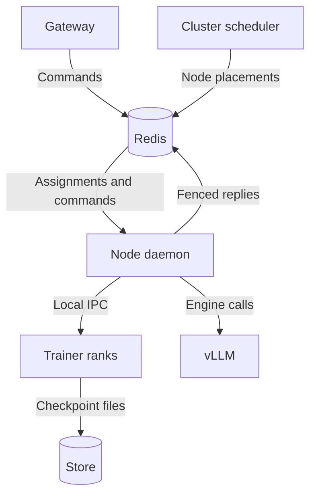

# tiny-open-rl

The [Tinker](https://thinkingmachines.ai/tinker/) training API, built on Redis Streams and PyTorch.

The Tinker SDK trains through it unchanged, for LoRA adapters and full fine-tunes alike:

```python
client = tinker.ServiceClient(base_url="http://localhost:8000")
trainer = client.create_lora_training_client(base_model="Qwen/Qwen3-0.6B", rank=8)

for batch in data:
  trainer.forward_backward(batch, "importance_sampling")
  trainer.optim_step(types.AdamParams(learning_rate=4e-5))

sampler_path = trainer.save_weights_for_sampler("step-100").result().path  # a PEFT adapter vLLM can load
```

`base_model` is a hub id, or a folder of `config.json` and `*.safetensors` anywhere fsspec reaches (`gs://...`, `s3://...`,
`/mnt/models/...`). A node fetches a bucket model once into `MODEL_CACHE`. See [models.py](tinyrl/storage/models.py).

## Run it

```sh
pip install -e .
redis-server &                                          # Redis 8.6 or newer
python -m tinyrl.api.gateway &                          # the Tinker HTTP API, on :8000
python -m tinyrl.control.scheduler &                    # assigns runs to workers and workers to nodes
python -m tinyrl.control.node_daemon                    # runs worker lifetimes and coordinates their GPUs
```

A **worker** is a group of runs sharing one trainer model or sampling engine. The gateway records what a run needs, and
the scheduler picks its worker: LoRA runs on the same base model share a trainer, sampling sessions on the same base model and
kind share a sampler, and an exclusive run's sessions share a sampler of their own. A full fine-tune
(`user_metadata={"openrl.fine_tuning_type": "full"}`) or an exclusive run (`"openrl.exclusive": "true"`) gets a worker of
its own. Worker names encode nothing.

Run one node daemon per GPU machine (`GPUS`, default 1) and one fleet scheduler. The fleet scheduler assigns jobs to
workers, places workers onto physical GPU bundles using storage readiness and GPU availability, enforces per-job fair
service across trainer and sampler replicas, serializes multi-GPU wide-job reservations, caps exclusive GPU fraction
(`EXCLUSIVE_CAP`), and offloads coldest host-parked trainers under host-RAM pressure (`HOST_RAM_HIGH`). Each node owns
its workers' process supervision and leases, prepares assignment inputs off the GPU, executes bounded GPU turns, and
reports explicit physical GPU release acknowledgments back to the scheduler.

Each worker runs in one coroutine. It peeks at each active run's unclaimed command head and prepares its inputs
independently (including assignment-driven background prefetch of exact restore and sampler versions). Sampling heads
become ready after their session metadata and checkpoint files are available. Checkpoint I/O runs off the event loop
and overlaps startup and execution. A slow download does not block another run's ready head or keep an otherwise idle
worker from yielding its GPU. Executable commands are claimed only after fleet GPU grant and ownership-generation
verification, one bounded batch at a time. A preparation error claims and answers its failed head without waiting for a
GPU.

Across the fleet, the scheduler tracks persisted fair service per logical job account (a training run and its samplers
share one account) and issues bounded GPU budgets (`BUDGET_S`, default 10 s per GPU). Within a shared engine, the node
serves ready runs by local service after any sampler save, and a trainer may continue its current run for up to
`RUN_COMMANDS` commands while its next command is queued. Each command carries its cost when queued (tokens trained or
prompt plus `max_tokens` sampled, and 1 otherwise). Newly ready accounts join the active service floor so idle periods
do not accumulate catch-up credit.

Assignments, physical GPU bundles, per-job budgets, job ownership generations, drain intents, and restore/prefetch
references live in the Redis assignment table, written by the single-leader scheduler. Nodes report matching revisions,
phases, cumulative per-job usage, local version/transfer progress, and explicit GPU release in their heartbeats. Workers
on independent GPUs run concurrently. Node heartbeats and worker lease renewals continue during model operations.

A trainer is a synchronous model process. The node sends request bytes over a private Unix socket and receives reply
bytes and checkpoint metadata. Model tensors, optimizer state, accumulated gradients, per-rank RNG state, and checkpoint
I/O stay in the trainer. Multi-GPU trainers use torchrun and FSDP; all ranks reach command boundaries, park, restore
directly from local safetensors shards without pickle, and exit together. A single-GPU LoRA trainer can move between a
node's GPUs without restarting its model.

Sampling controllers run in the node's event loop and drive isolated vLLM engine processes. On multi-GPU nodes the
node queues a warm startup at placement; on one GPU it starts the engine for the first request. `ENGINE=module:Class`
can select another engine implementing async `start(base, lora, env)`, `load_checkpoint(name, path)`, `sample(job, name)`,
`sleep()`, `wake()` and `close()`. Settings are per engine; loading an already loaded checkpoint name must be idempotent,
and `close()` must wait for its processes to exit. Checkpoint names include both the URI and its exact version.

The fleet scheduler reserves every GPU of a worker together and never reuses a physical GPU until release is observed or
node termination is confirmed. Workers with known memory budgets can share a GPU when they fit; others take turns. An
idle holder yields to a waiter, and a busy holder yields once its observed usage reaches its granted budget (`BUDGET_S`).
Training yields between commands; sampling yields between waves of up to `SAMPLE_RUNS` LoRA sessions or one full
fine-tune session, with at most `SAMPLE_COMMANDS` commands per session. During drain or handoff, the node stops
admitting new commands, finishes in-flight boundaries, parks weights/gradients/Adam/RNG state locally in pinned host
memory or publishes an immutable checkpoint under the current job generation, and confirms physical GPU release (bounded
by `PARK_TIMEOUT_S`). Single jobs can also be drained and moved out of a shared LoRA engine without stopping sibling
jobs.

Stop the node daemon with SIGTERM to finish its current batch and publish portable training state before processes are
reaped. It stops claiming new work; unclaimed commands stay queued for the replacement worker. `DRAIN_S` (default 20 s)
is the grace period for that batch and checkpointing. After it expires the node aborts unfinished work, then waits for
process cleanup and flushes pending uploads. Planned handoffs preserve every completed command included at the handoff
boundary. A crash or expired grace period fails uncertain in-flight commands and recovers automatically from the last
durable checkpoint when it covers acknowledged progress; if acknowledged mutations are absent, the run enters explicit
rollback recovery and requires `load_weights` before further mutations.

### Scheduling controls

| Variable | Default | Controls |
|---|---|---|
| `BUDGET_S` | 10.0 | Fleet GPU turn budget in seconds per GPU when another worker contends |
| `EXCLUSIVE_CAP` | 0.5 | Maximum fraction of fleet GPUs reserved for exclusive workers |
| `HOST_RAM_HIGH` | 0.8 | Host-RAM utilization threshold above which coldest parked trainers offload |
| `PARK_TIMEOUT_S` | 30.0 | Timeout for parking/releasing GPUs before failing and reaping the worker |
| `RUN_COMMANDS` | 4 | Commands in a preferred trainer continuation within a shared worker |
| `SAMPLE_RUNS` | 3 | LoRA sessions in a sampling wave; full fine-tunes use one |
| `SAMPLE_COMMANDS` | 128 | Commands from each session in a wave |

When no other run is ready, the scheduler extends the active worker's budget in place.

### Checkpoints

`CKPT` is where checkpoints live. On one machine it is a folder (`/tmp/tinyrl` unless set), and nothing leaves the
machine. Set it to a bucket (`gs://...`, `s3://...`) to keep checkpoints past a machine, or to share them across
machines. Every saved version is an immutable directory with a `manifest.json` written last (listing files, sizes,
metadata, and format version). Explicit versions resolve directly without re-reading `_latest`, and local/peer copies
are distinguished from confirmed durable uploads (`.durable`). Cross-process file locks and registry references protect
current recovery points, active assignments, and live readers during cleanup and cache eviction. Explicit `save_weights`
completes its future only after the durable storage commit (waiting outside GPU ownership), while sampler exports become
usable as soon as a complete protected copy exists. Fresh sessions can inspect any version via `/api/v1/weights_info`
and reconstruct full fine-tunes or nondefault LoRA configurations via `/api/v1/load_weights`.

### On Kubernetes

[k8s/](k8s) runs Redis with an append-only file, the gateway, the scheduler, and a node daemon on every node labeled `tinyrl-gpu=true`.
Build the image from [Dockerfile](Dockerfile), point `CKPT` in [k8s/kustomization.yaml](k8s/kustomization.yaml) at a
bucket the nodes' service account can write, and run `kubectl apply -k k8s/`. A drained node's trainers save their runs,
and a dead node's workers move to live nodes. `python k8s/e2e.py` breaks a running cluster on purpose and checks it
survives.

## How it works



Every training or sampling call is a command on its run's Redis stream, and its reply is a stream with one entry, named by the request. That's the
whole design. Redis does the bookkeeping that would otherwise take a database, a ledger and a heartbeat.

* **The queue reads itself.** Peeking and preparation leave commands unclaimed. The node claims executable batches through
  the worker's consumer group after GPU admission; preparation failures are claimed and answered without a GPU.
  `XINFO GROUPS` says what's queued and `XPENDING` says what's in flight, under which owner, and for how long.
  `GET /api/v1/runs/<id>` just asks.
* **A dead trainer fails fast.** Its commands stay in the pending list. The node claims abandoned work with `XAUTOCLAIM`
  and fails it before replacement execution starts, so clients receive a definite failure instead of an uncertain replay.
* **A stopping trainer saves its runs.** On node SIGTERM, the node finishes the current batch and saves weights, pending gradients
  and Adam state within the grace period. Unclaimed work stays queued. The replacement trainer restores the published checkpoint
  before its next command.
* **Retries are free.** `XREAD` from id `0` blocks until the reply is written and never consumes it, so
  `retrieve_future` can be retried, or waited on by many clients, and every one of them gets the same answer.
  A call the SDK retries with the same `seq_id` runs once, and every attempt gets the first attempt's answer.
* **Deleted runs take no work.** A run is live exactly while its stream exists, so `XADD NOMKSTREAM` turns a call on a deleted run into a 404.
* **Replies land atomically.** The reply, the acknowledgement and the run's step counter are written in one transaction.
* **One wire format.** `forward_backward` stays protobuf from the SDK to the trainer, which reads the tensors straight out of the bytes.
  Older SDKs' JSON is turned into the same protobuf at the gateway, and JSON clients get the output decoded back to JSON.
* **Cluster assignments in one log.** The gateway, scheduler and nodes use `tinyrl:events` for run membership and node placement.
  Worker coroutines prepare unclaimed heads locally and update the node's actual GPU reservations directly.
  Model processes do not read the log.
* **One trainer.** A base model, with a PEFT adapter per run or the whole model for a single run, behind `create_run`, `forward_backward`,
  `optim_step`, `training_state`, `sampler_weights`, `restore_run` and `delete_run`. Logprobs are computed `CHUNK` tokens at a time under checkpointing, so the
  `[tokens, vocab]` logits never exist all at once. The optimizer updates fp32 master weights and keeps fp32 AdamW state, while the
  forward pass runs in bf16 under autocast. A LoRA run's frozen base model stays bf16.
* **Portable checkpoints.** Training checkpoints (`save_weights`) and sampler weights (`save_weights_for_sampler`) go through
  [store.py](tinyrl/storage/store.py) behind `put(uri)` and `get(uri)` as pure `safetensors` (no `torch.save` pickle), so any trainer can
  resume a run with its exact fp32 weights and AdamW state. `CKPT` can be a bucket (`gs://...`, with `pip install .[gcs]`), so
  every node sees every checkpoint.
* **One owner per worker, one generation per job.** The node holds and renews its workers' process leases, while each
  job carries an authoritative ownership generation in Redis. WATCH/MULTI/EXEC transactions fence replies, restore
  pointers, and durable commits by job generation, independently of the worker lease, so a stale engine cannot advance a
  moved job's state even while remaining alive for sibling jobs.

## Reading the code

Start with the docstring at the top of [bus.py](tinyrl/bus.py), which explains the streams and generation-fenced
transactions. Then read [gateway.py](tinyrl/api/gateway.py) to see how each Tinker call becomes a command,
[scheduler.py](tinyrl/control/scheduler.py) for fleet placement, physical GPU & budget allocation, and persisted fair
service, [node_daemon.py](tinyrl/control/node_daemon.py) for worker lifetimes, acknowledged suspension, and storage
preparation, [store.py](tinyrl/storage/store.py) and [registry.py](tinyrl/storage/registry.py) for versioned manifests
and ref-counted retention, and [trainer.py](tinyrl/workers/trainer.py) and [model.py](tinyrl/workers/model.py) to see
how a command runs on the model.

| File | Responsibility |
|---|---|
| [tinyrl/bus.py](tinyrl/bus.py) | runs, sessions, command streams, generation-fenced replies/state commits, and leases |
| [tinyrl/api/gateway.py](tinyrl/api/gateway.py) | Tinker HTTP routes, `weights_info`, fresh-session restore, checkpoints, and Prometheus metrics |
| [tinyrl/api/wire.py](tinyrl/api/wire.py) | Tinker protobufs and numpy arrays |
| [tinyrl/control/scheduler.py](tinyrl/control/scheduler.py) | fleet assignment, physical GPU bundles, budgets, persisted fair service, and prefetch planning |
| [tinyrl/control/node_daemon.py](tinyrl/control/node_daemon.py) | worker lifetimes, leases, acknowledged drain/GPU release, preparation, and recovery |
| [tinyrl/control/process.py](tinyrl/control/process.py) | private model IPC and parent-owned process groups |
| [tinyrl/control/estimator.py](tinyrl/control/estimator.py) | model memory and GPU-width estimates |
| [tinyrl/workers/trainer.py](tinyrl/workers/trainer.py) | synchronous model commands, single-job/full parking, and checkpoint metadata |
| [tinyrl/workers/model.py](tinyrl/workers/model.py) | PyTorch/PEFT training, per-job RNG isolation, losses, token batching, zero-pickle shard restore, and host parking |
| [tinyrl/workers/sampler.py](tinyrl/workers/sampler.py) | sampling encoding and engine execution |
| [tinyrl/workers/vllm.py](tinyrl/workers/vllm.py) | vLLM startup, compiled-artifact compatibility hooks, loading, completions, and sleep/wake |
| [tinyrl/workers/snapshot.py](tinyrl/workers/snapshot.py) | CRIU snapshots and isolated restores (retained pending GPU startup validation gate) |
| [tinyrl/storage/store.py](tinyrl/storage/store.py) | safetensors, version manifests, durability markers, flock read pins, uploads, and peer/cache management |
| [tinyrl/storage/registry.py](tinyrl/storage/registry.py) | version identity, copy locations, durability status, ref-counted retention, TTLs, and cleanup |
| [tinyrl/storage/models.py](tinyrl/storage/models.py) | base-model fetching and caching |
| [tinyrl/trace.py](tinyrl/trace.py) | NVTX ranges for Nsight Systems |

`python sz.py` counts token-bearing lines the way tinygrad does, and CI caps `tinyrl/` at 6,000 lines. Outside `tinyrl/`,
[examples/tinker_sdk.py](examples/tinker_sdk.py) trains and samples through the unmodified SDK. The rest of the repo holds
[k8s/](k8s), the browser [simulator/](simulator/README.md), [docs/kubernetes.md](docs/kubernetes.md), and the integration suites in [test/](test).

Settings are environment variables: `REDIS_URL`, `PORT`, `MODEL_CACHE` (where a node keeps base models it fetched), `MODEL_MIRROR` (a folder or bucket nodes read hub models from first), `CKPT` (the
checkpoint directory or bucket the trainers and samplers share), `CKPT_CACHE` (where a node keeps the checkpoints it saved or downloaded, in front of a bucket `CKPT`), `CKPT_CACHE_BYTES` (the most it keeps, least recently read first, 0 for half its disk), `TOKEN_BUDGET` (padded tokens per pass; unset, each call sizes its passes to the free
GPU memory), `CHUNK`, `GRAD_CKPT`, `WAIT`, `REPLY_TTL`, `SESSION_TTL`, `SESSION_GRACE`, `LEASE_MS`, `GPUS`, `BUDGET_S`,
`EXCLUSIVE_CAP`, `HOST_RAM_HIGH`, `PARK_TIMEOUT_S`, `RUN_COMMANDS`, `SAMPLE_RUNS`, `SAMPLE_COMMANDS`, `IDLE_MS`,
`DRAIN_S`, `ENGINE`, `VLLM_ARGS`, `CKPT_TTL` (the TTL, at least 3600 s, of a checkpoint saved without one; 0 keeps it until deleted), `TINYRL_ARTIFACT_CACHE` / `TINYRL_COMPILED_ARTIFACT_URI` (compatible compiled startup artifacts), `TINYRL_SNAPSHOTS` (where a node keeps vLLM CRIU snapshots; unset, samplers boot vLLM every time) and `DEBUG=1`.

## Telemetry

Every run's hash counts the commands it ran (`cmds`), the time they spent queued (`wait_ms`, from the stream entry id to the
node dispatching it) and running (`busy_ms`), plus `steps` and `failed`. The node writes them in the same transaction as
the reply. `GET /api/v1/runs/<run>` shows one run's counters, and `GET /metrics` shows every run's in Prometheus' text
format, as `tinyrl_<counter>_total{worker, run}` in seconds. The numbers scheduling papers report are queries over those
counters:

| measure | PromQL |
|---|---|
| utilization of a worker's trainer | `sum by (worker) (rate(tinyrl_busy_seconds_total[5m]))` |
| mean queueing delay per call | `sum by (worker) (rate(tinyrl_wait_seconds_total[5m])) / sum by (worker) (rate(tinyrl_cmds_total[5m]))` |
| slowdown, (wait + run) / run | `1 + sum by (worker) (rate(tinyrl_wait_seconds_total[5m])) / sum by (worker) (rate(tinyrl_busy_seconds_total[5m]))` |
| throughput, optimizer steps per second | `sum by (worker) (rate(tinyrl_steps_total[5m]))` |
| fairness, Jain's index of recorded busy time across active runs (1 is equal shares) | `sum(rate(tinyrl_busy_seconds_total[5m]) > 0) ^ 2 / (count(rate(tinyrl_busy_seconds_total[5m]) > 0) * sum((rate(tinyrl_busy_seconds_total[5m]) > 0) ^ 2))` |
| failure rate | `sum by (worker) (rate(tinyrl_failed_total[5m])) / sum by (worker) (rate(tinyrl_cmds_total[5m]))` |

A run's wait includes waiting on its own earlier calls, since a run's calls run in order.

`GET /api/v1/scheduling` reads the cluster's assignment table (including physical GPU bundles, budgets, ownership
generations, restore/prefetch references, and persisted service) and merges each node's latest observed worker state
(phase, held GPUs, release flag, host RAM, and process PID). Per-command timing is available with `DEBUG=1`. The Redis
event log traces runs and nodes coming and going, and the scheduler's decisions.

Every model call (`model.<method>`), vLLM request (`vllm/<path>`) and checkpoint `store.put` or `store.get` is an NVTX range
in the `tinyrl` domain. Without a profiler attached a range costs about a microsecond. To see where a node's time goes, run
its node daemon under Nsight Systems, which follows the trainers and samplers it starts:

```sh
nsys profile --trace=nvtx --sample=none --cpuctxsw=none --duration=240 --kill=none python -m tinyrl.control.node_daemon
```

On the 23-job benchmark, `--trace=nvtx` adds nothing measurable. `--trace=cuda,nvtx` also records every kernel, and costs
about 5 to 7 s of a 112 s run. vLLM servers restored from a snapshot aren't traced, since nsys didn't start them.

## Throughput simulator

The [interactive simulator](simulator/README.md) explores GPU switching, arrival rates, queue growth, and data-transfer bottlenecks.
Open `simulator/index.html` in a browser; it runs locally without installing dependencies.

## Test

```sh
python -m unittest discover -s test -t .                             # starts its own redis-server, or set REDIS_URL
TINKER_PYTHON=$(which python) python -m unittest test.test_tinker   # runs examples/tinker_sdk.py against redis, gateway, scheduler and node_daemon
```

Integration tests use real Redis, tiny random Llama models and the unmodified SDK. Deterministic node tests substitute
an inline CPU model process or a fake sampling engine; separate process tests cover Unix IPC, parent death, SIGTERM
shutdown and two-rank numerical equivalence. CUDA parking tests run when a GPU is available.

## Not here yet

* Distributed training across nodes and context parallelism.
* Removing CRIU snapshot fallback (`tinyrl/workers/snapshot.py`) once compiled-artifact cold start meets the GPU p95 startup gate.
* Dedicated `/dev/shm` checkpoint tier beyond local disk cache and peer HTTP staging (see [docs/kubernetes.md](docs/kubernetes.md)).
