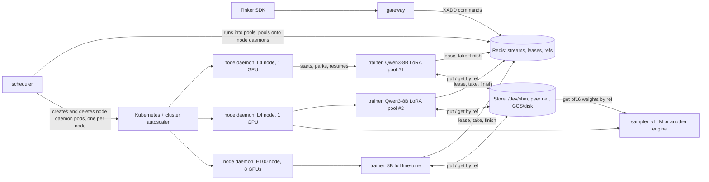
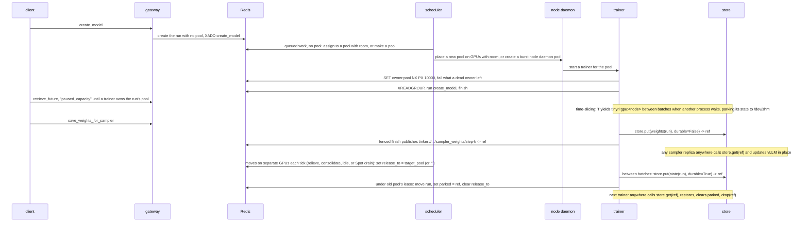

# tinyrl on Kubernetes

**Status.** Portable checkpoints, one owner per pool, and per-run telemetry (`GET /metrics`) are built. Nothing else here
exists yet. Figures marked measured come from an H100 and an L4 on GKE, driver 580; the rest are estimates.

Today you start a trainer for each pool by hand: `python -m tinyrl.trainer <pool>`. Nothing starts trainers for new pools,
sizes them, puts them on GPUs, shares a GPU between them, grows them when they're busy, moves them off a dying Spot node,
or brings them back after a crash. This is the design for the piece that does, on GKE.

## The idea

**Kubernetes supplies GPUs. Redis decides who runs where. A fast state store lets any trainer or sampler resume anywhere.**



- **A checkpoint is the only state that matters.** A run's state is a flat map of canonical, unsharded named tensors: its
  trainable fp32 master weights plus AdamW `exp_avg`, `exp_avg_sq` and `step` for a trainer (12 bytes per trainable
  parameter), or its bf16 weights for a sampler (2 bytes per parameter). Once those tensors are in the store under an
  immutable `ref`, a trainer holds nothing irreplaceable: any trainer or sampler on any node—and at any GPU count—can pull
  that `ref` and continue from the exact next step.
- **One state store does every transfer.** User checkpoints (`save_weights` / `load_weights`), sampler weight sync
  (`save_weights_for_sampler`), GPU time-slicing, resizing LoRA pools, migrating full fine-tunes off crowded or preempted
  nodes, and idling runs to zero GPUs all call the same `store.put` and `store.get`. `put` stages tensors into `/dev/shm`
  (`emptyDir: {medium: Memory}`, 26.6 GB/s measured on an H100) so the GPU is free in under a second for most bundles, serves remote nodes
  straight from that RAM over the pod network (gVNIC TCP/HTTP, or GPUDirect-TCPX / RoCE RDMA on A3/A4), and flushes durable
  checkpoints to shared disk or GCS in the background.
- **A pool is the set of runs one trainer serves**, as the README says today: some LoRA runs on one base model, or one full
  fine-tune. What changes is who makes pools. Today [`pool_for`](../tinyrl/gateway.py) puts every LoRA run on a base into
  one pool, so one GPU serves them all. Here the scheduler makes pools, and a base model gets as many as its load needs.
- **What gets placed is a pool's process**, onto GPUs of a node daemon. GPU node pools are dedicated to tinyrl, so there is one
  node daemon pod per node, and it requests every GPU on the node with plain `nvidia.com/gpu`. The node daemon starts a process for
  each pool or sampler placed on it, with `CUDA_VISIBLE_DEVICES` set to the GPUs the placement names. Processes that share
  a GPU take turns on it through a Redis lease, and each one parks its own state when it yields.
- **GPUs come in two tiers.** Reserved capacity is billed whether it's used or not, so its node pools stay at full size
  and a DaemonSet puts a node daemon on every node. Burst capacity (on-demand, Spot, or DWS flex-start) is billed only while it
  runs, so the scheduler adds burst nodes when work waits and removes them as soon as they drain.
- **Moves are cheap, so placement can be wrong.** Parking a LoRA run takes about 41 ms, so the scheduler doesn't pick
  binpack or spread up front. It moves work toward the load it measures, a few moves per tick on separate GPUs, and
  corrects a bad move on the next tick.
- **A pool has one owner.** A trainer serves a pool only while it holds the pool's lease in Redis. Every reply, checkpoint
  `ref` pointer, and run handoff is committed in a WATCH/MULTI/EXEC transaction on the lease key.

## What runs where

| Piece | Runs as | Code | Does |
|---|---|---|---|
| gateway | Deployment | [gateway.py](../tinyrl/gateway.py) | the Tinker API, as today. It stops picking a run's pool or filesystem paths: it records the run's base, rank and LoRA config, and passes logical `tinker://` URIs. While a run has no trainer, `retrieve_future` answers `queue_state: "paused_capacity"`, which the SDK logs, instead of `"active"`. |
| scheduler | Deployment, 1 replica | new: `tinyrl/scheduler.py` | puts runs into pools and pools/samplers onto node daemons; one loop moves work toward a target utilization, which grows, shrinks, drains and defragments; creates node daemon pods when nothing has room, and deletes empty ones |
| node daemon | one pod per GPU node, holding all its GPUs: a DaemonSet on reserved pools, a pod the scheduler creates on burst pools | new: `tinyrl/node_daemon.py` | starts and stops a trainer or sampler per placement on it; serves `/dev/shm` blobs to peers; watches for Spot preemption |
| trainer | a process in a node daemon pod | [trainer.py](../tinyrl/trainer.py), extended | serves its pool while it holds the lease; puts and gets run state and sampler weights through `store.py` |
| sampler | a process in a node daemon pod | new: `tinyrl/sampler.py` | wraps an inference engine (vLLM first, not required) behind a small interface; takes weights from `store.py` through the engine's own weight-loading hook; sleeps and wakes on its node daemon's GPU |
| store | library in trainers, samplers and node daemons | new: `tinyrl/store.py` | `put`, `get`, `drop` across `/dev/shm`, peer network, and durable storage (`CKPT` or GCS) |
| Redis | StatefulSet, AOF on | | streams, leases, checkpoint `ref`s, blob locations, placements, heartbeats, load |

Kubernetes sees a gateway, a scheduler, Redis and one node daemon pod per GPU node (each mounting `emptyDir: {medium: Memory}`
at `/dev/shm`, since Kubernetes otherwise caps `/dev/shm` at 64 MiB). Every process on a node shares that one `/dev/shm`,
so parking, resuming and moving a run to other GPUs on the same node never touch the network. On burst pools the scheduler
creates and deletes node daemon pods, which is how GKE's cluster autoscaler and DWS flex-start know to add and remove nodes, so it
needs one namespaced Role (`create`, `delete`, `list` on Pods). Nothing is privileged, nothing uses the host network, and there are no CRDs. GKE image streaming
keeps a new node's node daemon from waiting on the full image pull.

## State in Redis

Everything [bus.py](../tinyrl/bus.py) has today stays. The scheduler, node daemons and samplers reach this state only through
`Bus` methods (`nodes()`, `units()`, `place()`, `request_release()`), never through keys, so the store behind `Bus` can
change without touching scheduling. What's new, and who writes it:

| Key | Type | Written by | Read by |
|---|---|---|---|
| `pool` in `tinyrl:run:<run>`, and `tinyrl:pool:<pool>` | the run's pool, and each pool's runs | **whoever holds the run**: the scheduler while the run is in no pool, its pool's trainer while it's in one | trainers, scheduler |
| `release_to` in `tinyrl:run:<run>` | a request: move the run to this pool, or to `""` (none) | scheduler (or node daemon on Spot drain); the trainer clears it when done | the run's trainer |
| `parked` in `tinyrl:run:<run>` | immutable `ref` of the run's state in the store while between pools | the trainer that releases it, and the one that restores and drops it | trainers |
| `tinyrl:ckpt:<run>` | hash `{<kind>/<name>: ref}` mapping `tinker://` URIs to immutable `ref`s | `Bus.finish`, under the pool's lease | trainers, samplers |
| `tinyrl:loc:<ref>` | string with TTL: peer address of a node daemon holding `<ref>` in `/dev/shm` | the node daemon that staged `<ref>` | any trainer or sampler calling `store.get` |
| `tinyrl:owner:<pool>` | string with a 10 s TTL: the lease | the trainer that holds it | trainers, scheduler, gateway |
| `tinyrl:place:<pool>` | string: a node daemon id and its GPU indexes, like `<node>/0,1` | scheduler | node daemons |
| `tinyrl:node:<id>` | hash `{gpus, gpu_bytes, host_bytes, gpu_model, tier, addr, draining}` with a 30 s TTL; `tier` is `reserved` or `burst`, from a node label | that node daemon | scheduler, store |
| `tinyrl:gpu:<node>:<i>` | string with a TTL: the process holding GPU `i`, a lease like `tinyrl:owner:<pool>` | the process holding it | processes on that node daemon |
| `cmds`, `wait_ms`, `busy_ms` in `tinyrl:run:<run>` | counters (built): calls run, time queued, time running | `Bus.finish`, under the pool's lease | scheduler, `GET /metrics` |
| `gpu_bytes`, `host_bytes` in `tinyrl:run:<run>` | measured state size, so a move's cost is known | the run's trainer | scheduler |

A run's membership has one writer at a time, and the writer changes hands with the run. The scheduler can only put a run
into a pool while it's in none (checked in the same WATCH/MULTI/EXEC transaction that writes it), and only the trainer holding a run can take
it out, under that pool's lease. So two parties never both think they own a run.

## A run's life



## The store: a trainer can resume anywhere

Today [`Model.save`](../tinyrl/trainer.py) calls Hugging Face's `save_pretrained` and `torch.save(optimizer.state_dict())`
to a mutable directory on `CKPT`. In open-rl's two-job 8B full fine-tune benchmark (`docs/fft/fft.md` §9), writing sampler
weights to shared NFS took **74 to 88 seconds of every 130-second RL step**—three fifths of the whole job spent waiting on
storage while GPUs sat idle.

What a trainer or sampler actually needs to move is just a flat `dict[str, torch.Tensor]` plus a small JSON `meta` dict
(`base`, `rank`, `lora`, `step`):

| Bundle | What's in it | Bytes / param | 0.5B LoRA (r=32, 17.6M adapter params) | 8B LoRA (r=32, 92M adapter params) | 1.5B full fine-tune | 8B full fine-tune |
|---|---|---:|---:|---:|---:|---:|
| `weights(run)` | bf16 parameters (adapter or full model), for a sampler | 2 B | 35 MB | 184 MB | 3.1 GB | 16.4 GB |
| `state(run)` | trainable fp32 master weights + fp32 AdamW `exp_avg`, `exp_avg_sq` and `step`, for a trainer | 12 B | 0.21 GB | 1.1 GB | 18.5 GB | 98 GB (12.3 GB/GPU ×8) |

Three choices make these bundles completely portable:

1. **Pure named tensors, no pickle.** Keeping AdamW's `exp_avg`, `exp_avg_sq`, and `step` in the same tensor map under each
   parameter's name (`f"{name}.exp_avg"`, `f"{name}.exp_avg_sq"`, `f"{name}.step"`) instead of a pickled `optimizer.pt`
   indexed by parameter-group integers lets weights and optimizer travel together through zero-copy `safetensors` / raw
   memory buffers. Because [`optim_step`](../tinyrl/trainer.py) sets `lr`, `betas`, `eps`, and `weight_decay` on every
   step, nothing else lives in `AdamW`.
2. **bf16 sampler dumps.** For a full fine-tune, `weights(run)` casts fp32 master weights to bf16 as they leave the GPU,
   cutting sampler transfers in half (16.4 GB instead of 32.8 GB for Qwen3-8B) and avoiding vLLM's `dtype="auto"` trap,
   where an fp32 checkpoint is silently served in fp16.
3. **Canonical, unsharded shapes.** Even when tinyrl adds multi-GPU FSDP2, `state(run)` gathers canonical full tensors
   layer by layer (rank `r` gathering layers `i % W == r` into its own `/dev/shm` in parallel, so peak overhead is one
   layer and all `W` NICs serve peers in parallel), and a restoring trainer slices whichever ranges its new world size
   owns. A run saved on `2×H100` (80 GB) restores straight onto `1×H200` (141 GB), `1×B200` (192 GB), or `4×H100` with
   zero format conversion.

### One interface, three tiers

`tinyrl/store.py` (~85 lines) has one job: take a bundle of tensors out of a GPU, return a fresh immutable `ref`
(`<run>/<uuid>`), and get those tensors into whichever process asks for `ref` as fast as the hardware between them allows.

```python
class Store:
  def put(self, tensors: dict[str, Tensor], meta: dict, *, durable: bool = False) -> str: ...
  def get(self, ref: str, device: str = "cpu") -> tuple[dict[str, Tensor], dict]: ...
  def drop(self, ref: str) -> None: ...
```

Because `ref` is write-once, readers never see torn or overwritten files, and a paused trainer whose lease expired can call
`put` without harming anything—its `Bus.finish` transaction rejects publishing `ref` to `tinyrl:ckpt:<run>`. Every `put` and
`get` moves through up to three tiers behind that interface:

1. **Tier 1 — GPU ↔ `/dev/shm` on the node daemon (26.6 GB/s pinned D2H, 25 GB/s H2D, measured per GPU on `a3-highgpu-1g`).**
   `store.put` writes a `safetensors` buffer into `/dev/shm/tinyrl/<ref>` and sets `tinyrl:loc:<ref>` to the node daemon's peer
   endpoint in Redis. As soon as `/dev/shm` has the bytes, **GPU memory can be freed and the trainer is done waiting**.
   Same-node readers—a trainer resuming after a time-slice turn, or a colocated sampler—`mmap` `/dev/shm/tinyrl/<ref>`
   directly with zero network or disk I/O.
2. **Tier 2 — Peer `/dev/shm` → remote node over the cluster network (12–25 GB/s on gVNIC; 100–400 GB/s on A3/A4).**
   When a trainer or sampler on another node calls `store.get(ref)`, it checks `tinyrl:loc:<ref>`. If the writer's node daemon is
   alive, it pulls parallel byte ranges straight from that node daemon's `/dev/shm` into its own `/dev/shm` and onto GPU (using
   stock asyncio HTTP/TCP range streams by default, and swapping in UCX / NVIDIA NIXL over GPUDirect-TCPX on `a3-highgpu-8g`
   or RoCE RDMA on `a3-ultragpu-8g` / `a4` under the same `get` call). When several sampler replicas pull the same `ref`,
   each replica registers its own `loc:<ref>` once fetched so peers fan out instead of bottlenecking on the trainer's NIC.
3. **Tier 3 — `/dev/shm` → durable storage (`CKPT` on Lustre/Filestore, or a GCS/S3 bucket).**
   When `durable=True` (`save_weights`, idle scale-to-zero, or Spot drain), the node daemon streams `/dev/shm/tinyrl/<ref>` to
   durable storage (synchronously before `save_weights` resolves its future or before a draining node daemon exits; in the
   background for live moves) and evicts the `/dev/shm` copy once space is needed. If no live peer holds `<ref>`,
   `store.get` reads from durable storage.

| Payload | Size | Tier 1: same-node `/dev/shm` (26.6 GB/s/GPU) | Tier 2: peer gVNIC (20 GB/s) | Tier 2: peer TCPX / RDMA (100–400 GB/s) | Tier 3: GCS / Lustre (~10 GB/s) | Tier 3: Filestore (2 GB/s) |
|---|---:|---:|---:|---:|---:|---:|
| 0.5B LoRA `state` | 0.21 GB | 8 ms | 10 ms | < 5 ms | 20 ms | 0.1 s |
| 8B LoRA `state` | 1.1 GB | 41 ms | 55 ms | 3–11 ms | 0.11 s | 0.6 s |
| **8B sampler `weights` (bf16)** | **16.4 GB** | **0.62 s** | **0.8 s** | **0.04–0.16 s** | **1.6 s** | **8.2 s** |
| 1.5B FFT `state` | 18.5 GB | 0.70 s | 0.9 s | 0.05–0.19 s | 1.9 s | 9.3 s |
| **8B FFT `state` + AdamW** | **98 GB** | **3.7 s (0.46 s ×8)** | **4.9 s** | **0.25–1.0 s** | **9.8 s** | **49 s** |

### Every state movement is the same call

| Operation | What happens | Tier hit on the critical path | Trainer stall |
|---|---|---|---|
| **Time-slice park / resume** | `ref = store.put(pool_state, durable=False)` → free GPU; later `store.get(ref, "cuda")` | Tier 1 (`/dev/shm` on same node daemon) | 41 ms (8B LoRA run) to 0.70 s (1.5B FFT) |
| **Sampler weight sync** (`save_weights_for_sampler`) | `ref = store.put(weights(run), durable=False)`; fenced publish to `tinyrl:ckpt:<run>`; samplers call `store.get(ref)` | Tier 1 if colocated, Tier 2 if remote (never touches disk) | **0.04 to 0.62 s** (vs. 74–88 s on NFS) |
| **Move a run** (LoRA split/merge, crowded node daemon, defrag) | `ref = store.put(state(run), durable=True)` → fenced `parked = ref`; target trainer calls `store.get(ref)` | Tier 1 stage + Tier 2 peer pull (Tier 3 flushes in background) | **41 ms** stage (8B LoRA); **0.05–0.9 s** peer pull |
| **Idle scale-to-zero or Spot drain** | `ref = store.put(state(run), durable=True)` → leave pool (`release_to = ""`) | Tier 1 stage → Tier 3 flush before pod exit | 0.02–2 s GPU release; survives pod/node deletion |
| **User checkpoint** (`save_weights` / `load_weights`) | `ref = store.put(state(run), durable=True)` → flush to Tier 3 → fenced publish to `tinyrl:ckpt:<run>` | Tier 1 + Tier 3 | 0.1–10 s on Lustre/GCS |

## Scaling every workload

Because `store.put` and `store.get` decouple a run's state from the process and node currently holding it, every workload
scales and moves with demand:

| Workload | What it holds | How it scales & moves | Signal | What a change costs |
|---|---|---|---|---|
| LoRA trainer pool | a frozen bf16 base, plus 0.21–1.1 GB of adapter `state` per run | more or fewer pools per base; runs hop between pools or park when idle | `busy`, `wait`, memory | 41 ms to stage + ~55 ms peer pull per 8B LoRA run |
| full fine-tune trainer | 18.5 GB (1.5B) to 98 GB (8B) of `state` | time-shares GPUs via Tier 1 between steps; migrates across nodes (crowded node daemon, Spot drain, defrag, idle) or changes GPU width across a release via Tier 2/3 | node daemon utilization, `wait`, `draining` | 0.46–3.7 s locally; 0.25–5 s across nodes over `Peer` |
| sampler | 3.1–16.4 GB of bf16 `weights`, plus droppable KV cache | stateless replicas anywhere in the cluster | sampling queue | 0.04–0.8 s to pull bf16 weights; 0 s to scale down |

The signals are counters every run already has (built): `cmds`, `wait_ms` (from a command's `XADD`, read from its stream
entry ID, to its start) and `busy_ms`. The scheduler diffs them between ticks to get each run's, pool's and node daemon's
utilization and mean queueing delay over the last interval. `GET /metrics` serves the same counters to Prometheus, so a
dashboard and the scheduler always see the same numbers.

### LoRA trainer pools: elastic pools per base

One GPU serving every LoRA run on a base is a queue that grows with the number of runs. Say a run's RL step spends 10 s
training and 50 s sampling and scoring: one GPU keeps up with about six such runs, and from the seventh on, every run
waits for every other's `forward_backward`. Ten GPUs serving one run each is the opposite mistake. So:

- **Assigning.** A run with queued work and no pool (a new run, or one waking from idle) goes into the least utilized pool
  on its base that has memory for its adapter. If every pool on the base is over `TARGET_UTIL`, the scheduler makes a
  pool. A full fine-tune, or a run marked `openrl.exclusive`, always gets a pool of its own. This step can ship first and
  alone: `pool_for` picks the least busy `lora:<base>:<n>` from the run counters, and no run ever moves.
- **Growing and shrinking aren't separate rules.** They fall out of the loop in [Moving work toward the
  target](#moving-work-toward-the-target): a hot pool sheds runs to a cooler one, and a cold pool's runs drain into others
  until it's empty and retires.
- **The hard cap is memory**: the base model, plus each run's adapter state, plus a floor for activations, must fit the GPU.
  Load sets the soft cap below it. `MAX_RUNS_PER_POOL` is there for operators who want a fixed cap.

**Releasing a run** is one operation across growing, shrinking, migrating, idling and draining. Between batches, so nothing
of the run is in flight, the trainer calls `ref = store.put(state(run), durable=True)`, frees the run from GPU memory, and
in one WATCH/MULTI/EXEC transaction on the lease key moves the run from its pool to the target (or to `""`), sets
`parked = ref`, and clears `release_to`. Commands that arrive meanwhile wait in the run's stream. The target pool's trainer
sees the run in its pool, pulls `ref` via `store.get`, restores the tensors, clears `parked`, and calls `store.drop(ref)`.

### Full fine-tunes: time-sliced locally, portable everywhere

A full fine-tune is one run, so it can't split its runs across two pools, and widening its trainer automatically every few
steps buys little once `Store` removes the 74–88 s NFS bottleneck: training is ~25 s of a ~50 s step, and every width
change moves 12 B/param and alters floating-point reduction order. Instead, it scales cleanly at two timescales:

1. **Step to step on one node daemon (Tier 1).** Between `optim_step` and the next `forward_backward`, while the client generates
   rollouts and rewards, the node daemon parks the full fine-tune to `/dev/shm` (0.70 s for 1.5B, 0.46–3.7 s for 8B) whenever
   another pool on the node daemon has queued work.
2. **Across nodes and hardware shapes (Tiers 2 & 3).** A full fine-tune is never pinned to the node or GPU SKU it started
   on:
   - **Crowded-node evacuation & defragmentation:** if two full fine-tunes on one node daemon become busy simultaneously (high
     `wait`, low `busy`), or two half-empty nodes can consolidate onto one, the scheduler moves one pool to a free node daemon
     and the new trainer streams `state(run)` over the pod network in 0.25–5 s.
   - **Spot VM preemption:** when GKE gives its 30-second Spot termination notice, the node daemon sets `draining=1`, the trainer
     dumps `state(run)` (`durable=True`) after its current batch, and the run resumes on a healthy node with zero lost
     steps.
   - **Changing GPU width (FSDP resharding):** because `state(run)` uses canonical unsharded parameter names, a run
     released from `2×H100` (80 GB) can be placed onto `1×H200` (141 GB), `1×B200` (192 GB), or `4×H100` and slice its new
     shards directly from `store.get(ref)`.

### Samplers: decoupled replicas fed by the store

Generating rollouts splits cleanly across prompts and samples, and a sampler holds nothing irreplaceable. Because Tier 2
delivers 16.4 GB of bf16 weights across nodes in under a second (instead of 74–88 s over NFS), **sampler placement is
completely decoupled from trainer placement**:

- **Scale out / in:** more sampler replicas when the sampling queue grows (on any node with free GPUs, including Spot
  pools), fewer when it drains, with nothing to save on scale-down.
- **Opportunistic co-location:** placing a run's single sampler on its trainer's node daemon is still a great default when host
  RAM fits both—they time-share one GPU and hit Tier 1 `/dev/shm`—but scaling beyond one GPU never hits a storage cliff.

## Pools onto node daemons

The scheduler places waiting work, then makes moves that touch separate GPUs:

```python
async def tick(self) -> None:
  nodes = await self.bus.nodes()  # live heartbeats: GPU and host memory, addr, draining
  units = await self.bus.units()  # LoRA runs, full fine-tune pools and samplers, with utilization, wait and state bytes

  for node in nodes.values():
    if node.draining:  # a Spot notice: everything on it leaves first
      await self.release_all(node, units)
  await self.place_waiting(units, nodes)  # best fit decreasing onto GPUs, reserved first, or one pending burst node daemon pod

  for move in plan_moves(units, nodes):  # relieve, then consolidate; no two moves share a GPU
    await self.bus.request_release(move.unit, move.target)  # sets release_to; the unit's trainer moves it between batches

  for node in nodes.values():
    if node.tier == "burst" and node.empty_for_s > EMPTY_NODE_S:
      await self.kube.delete_node_daemon(node.id)  # the cluster autoscaler removes the empty burst node
```

- **A pool fits a set of a node daemon's GPUs** when its GPU footprint fits those GPUs on its own, and the footprints placed on
  the node daemon fit its `/dev/shm` budget. GPUs can hold more pools than fit at once, and they take turns; `OVERSUBSCRIBE`
  caps that multiple. A multi-GPU pool takes GPUs on one NVLink domain.
- **Scaling up and down happens only on burst pools.** Reserved nodes are always up, and the scheduler never removes one.
  Unplaced work that doesn't fit the reserved fleet creates at most one pending burst node daemon pod per node shape,
  requesting all of that shape's GPUs, so the cluster autoscaler or DWS flex-start adds exactly one node (`nodeSelector`
  picks L4, H100, H200 or B200 by memory). A multi-node gang asks for its nodes all at once with a `ProvisioningRequest`.
  Node daemons with no placements and no unflushed `durable=True` blobs for 10 minutes are deleted. Queue lag is never the
  scale-down signal: an RL trainer's queue is empty throughout sampling, and runs leave node daemons only by parking to
  `Store`.

### Moving work toward the target

One setting, `TARGET_UTIL` (0.7 to start), replaces binpack and spread. A GPU's utilization is the summed `busy_ms` rate of
every process on it, and a node daemon's is the mean over its GPUs. Moves between GPUs on one node daemon cost only a restore from
`/dev/shm`, so the loop prefers them. Each tick plans moves until every candidate is taken, and no two moves in one tick
touch the same GPU:

1. **Relieve.** A GPU above `TARGET_UTIL + BAND` moves its hottest movable unit to the coolest GPU that has room and
   stays under `TARGET_UTIL` afterward. The move happens only when the wait it saves, from the measured `wait_ms` rate,
   exceeds its cost: the unit's state bytes divided by the bandwidth of the tier the move uses. High wait with low busy,
   a pool starved for GPU turns on a crowded node daemon, is the same case.
2. **Consolidate.** When the cluster is below `TARGET_UTIL - BAND`, units move off the most expensive node daemon first: burst
   before reserved, and the emptiest among equals. An empty burst node daemon is deleted. A reserved GPU costs nothing more to
   use, so the loop fills reserved GPUs before burst ones and never deletes a reserved node daemon.
3. **Cool down.** A unit that moved doesn't move again for `COOLDOWN_S` (120 s).

`TARGET_UTIL` near 1 packs work onto as few GPUs as fit it, and a low value spreads it out. What moves depends on cost:

| Unit | Move cost | Moves on |
|---|---|---|
| LoRA run | 41 ms stage + ~55 ms peer pull (8B) | relieve, consolidate, idle, Spot drain |
| full fine-tune pool | 0.46–3.7 s locally, 0.25–5 s across nodes (8B) | relieve or consolidate only when the saved wait is larger; idle, Spot drain |
| sampler | nothing to save | anything; scale out and in on the sampling queue |
| multi-node gang | one shard per rank, all ranks at once | idle and Spot drain only |

The loop is a greedy controller, not an optimizer, and that's the point: a wrong move costs one cheap move on the next
tick. Gandiva (OSDI 2018) made the same argument for suspend and migrate, and Llumnix (OSDI 2024) and dLoRA (OSDI 2024)
move requests and adapters instead of fixing a policy. `TARGET_UTIL`, `BAND` and `COOLDOWN_S` are the only parameters to
tune, and the [telemetry](../README.md#telemetry) queries show whether they're right.

### Keeping scale-up off the critical path

A burst node takes minutes to be useful. Recreating an H100 node took about 2 min 15 s to `Ready` and about 45 s more
before its GPU was usable (measured). A 4.3 GB PyTorch image took 52 s to pull (measured), and a cold vLLM start took
190 s (measured, see [Samplers](#samplers)). So no call waits for a new node. New work starts right away on reserved GPUs,
taking turns if it has to, and the loop spreads it onto burst nodes once they're up. Moves are cheap enough that the
first placement doesn't have to be the final one. The scheduler also asks for burst nodes when utilization has stayed
above `TARGET_UTIL` for a while, before work queues.

## Taking turns on a node daemon's GPUs

**When everything fits, nothing parks.** All processes on the node daemon stay resident and CUDA interleaves their kernels.
When they don't fit, they take turns through one Redis lease per GPU, `tinyrl:gpu:<node>:<i>`, using the same `SET NX PX`,
`SET IFEQ` and `DELEX IFEQ` calls as the pool lease. A process on several GPUs takes their leases in index order, so two
processes never deadlock:

1. A process with queued work and no seat sets `wait` on the lease's key and retries `SET NX`.
2. Between batches, the holder checks for a waiter. If one waits and the holder has held the seat for 30 s, or its own
   queue is empty, it parks and releases the lease.
3. Parking is in the application, not the driver. A trainer calls `store.put(..., durable=False)` and
   `torch.cuda.empty_cache()`. A sampler puts its engine to sleep.

Measured on an H100: parking 16 GB takes 0.60 s, resuming takes 0.64 s, and 725–781 MiB stay on the GPU (529 MiB of
CUDA context, about 210 MiB of cuBLAS, and allocator slack). vLLM's level 1 sleep leaves 808 MiB on an L4. That leftover
caps how many processes one GPU can host, at about 0.8 GB each.

There's no queue for the lease: whoever retries first after a release wins. Jain's index in `/metrics` shows whether
that's fair enough, and a queue gets added only if it isn't.

**LoRA pools park like any other, and so do their runs.** An active LoRA pool stays resident while it has queued work; an
idle 8B LoRA base parks 16.4 GB of bf16 to `/dev/shm` in 0.62 s. A run inside a busy pool that sits idle for 30 minutes
is released to `Store` (`durable=True`) on its own, which frees its adapter and optimizer state without stopping the
pool's other runs.

With fp32 master weights an 8B full fine-tune (98 GB between steps, 131 GB at peak) doesn't fit an 80 GB H100 on its own;
it needs an H200 or B200, or multi-GPU FSDP. Three 1.5B full fine-tunes share an 80 GB GPU between steps (55 GB) without
parking, or two at peak (49 GB).

## Multi-node pools

A 70B full fine-tune needs about 1.1 TB of `state` (16 B/param at peak), more than one 8-GPU node. A multi-node pool is
a gang of whole-node node daemons created together by one LeaderWorkerSet group, on compact placement. Rank 0 holds the pool
lease and talks to the bus, and the other ranks follow it. `tinyrl:place:<pool>` holds a list of node daemons. Every rank
takes the leases of its GPUs, so the gang parks and resumes together, and each rank `put`s its own canonical shard, so
the `ref` is a list. The trainer tears down NCCL communicators before parking and rebuilds them after. DRA earns a place
here only for RDMA NICs, if GKE multi-networking doesn't already cover them.

## Estimator

No model-size tables. Before a run's first placement, build its model on PyTorch's `meta` device from its config
(`AutoConfig.from_pretrained`) and count parameters. [trainer.py](../tinyrl/trainer.py) keeps fp32 master weights, so a
full fine-tune holds 16 bytes per parameter at peak (weights, gradients and two AdamW moments) and 12 between steps,
because `optimizer.zero_grad()` frees the gradients. A LoRA pool holds 2 bytes per parameter of bf16 base, plus 16 per
adapter parameter of each run. Activations don't need estimating: [`token_budget`](../tinyrl/trainer.py) sizes every pass
to the GPU memory that's free.

Once running, the trainer writes measured bytes to `tinyrl:load:<pool>` every minute, and the scheduler and node daemon use that
from then on.

## One owner per pool

Two trainers serving one pool would split its runs' commands between two copies of the model, and a paused trainer
waking up late must neither answer a client nor overwrite a checkpoint or `parked` pointer. Three pieces in `bus.py`
and `trainer.py` plus immutable `Store` `ref`s enforce that:

1. **The lease.** A trainer serves a pool only after `SET tinyrl:owner:<pool> <worker> NX PX 10000` succeeds. It renews
   every 2.5 s with `SET ... IFEQ <worker>` from the event loop while commands run in a thread. If a renewal fails, the
   trainer stops before reading or running another command.
2. **The fenced finish and handoff.** `Bus.finish` writes the reply, acknowledges the command, updates counters, and (for
   `save_weights*`) publishes `ref` into `tinyrl:ckpt:<run>` in one WATCH/MULTI/EXEC transaction on the lease key.
   Releasing a run (`parked = ref`) goes through the same lease check.

   ```python
   async with self.r.pipeline(transaction=True) as p:
     await p.watch(lease_key)
     if await p.get(lease_key) == worker.encode():
       p.multi()
       # write reply, ack, update counters
       await p.execute()
   ```

3. **The stranded sweep.** Between batches, when the owner has nothing in flight itself, it `XAUTOCLAIM`s anything in its
   pool pending for 5 seconds and fails it cleanly.

`test/test_lease.py` verifies takeover under `SIGSTOP` against a real `redis-server` and two trainer subprocesses, and
`test/test_trainer.py` verifies that restoring a run with its optimizer produces identical losses and bitwise-equal weights
over subsequent steps.

## When things fail

| Failure | What happens | What's lost |
|---|---|---|
| a trainer dies mid-`optim_step` | lease expires within 10 s; node daemon starts a new trainer, which claims and fails the command | uncheckpointed in-memory steps of active runs in that pool; runs parked in `Store` (`durable=True`) lose nothing |
| a trainer dies while releasing a run | before the release transaction: run stays in the old pool as above (orphan `ref` is swept); after: `parked = ref` is set and the new pool loads it | as above, or nothing |
| source node daemon dies while a peer pulls `<ref>` from `/dev/shm` | `store.get` catches the connection error and falls back to durable storage (`CKPT` / GCS) | nothing once flushed; if the source node died before a background flush completed, same as sudden node death |
| a Spot VM gets a 30 s preemption notice | node daemon marks `draining=1`; trainers dump active runs (`durable=True`) after their current batch and release them | nothing when current batch + flush completes within 30 s |
| a node dies suddenly | node daemon heartbeat expires in 30 s; scheduler places its pools elsewhere | same as a trainer dying |
| a paused trainer writes `save_weights` | `store.put` writes an unreferenced immutable `ref`, then `Bus.finish` fails the lease check; `tinyrl:ckpt:<run>` is untouched | one failed command; existing checkpoints are never overwritten |
| the scheduler dies | trainers and samplers keep serving; Deployment restarts it from Redis state | nothing |
| Redis restarts (AOF, every-second fsync) or fails over | up to 1 s of writes may be lost, triggering early lease takeover; replies and `ref` pointers remain fenced | at most in-flight commands during the window, failed cleanly, never answered twice |

## Samplers

A sampler (`tinyrl/sampler.py`) is any inference engine behind four calls. vLLM is the first engine, not a requirement.

```python
class Engine(Protocol):
  def sample(self, prompts: list[list[int]], params: dict) -> list[list[int]]: ...
  def load(self, tensors: Iterable[tuple[str, Tensor]]) -> None: ...  # full weights, a delta, or an adapter, in place
  def sleep(self) -> None: ...
  def wake(self) -> None: ...
```

- **Weights go through the engine's own loading hook**, not a restart or a reload from disk. Measured with Qwen2.5-7B on
  an L4: vLLM's `reload_weights`, which reads from disk, wakes in 5.2 s warm and 19 s cold, while a level 1 wake, which
  copies the same 15 GB back from host memory, takes 1.6 s. So `load` streams tensors from `store.get(ref)` straight into
  the engine's weight loader (vLLM's `load_weights` path) and resets the prefix cache.
- **Full fine-tunes sync deltas against anchors.** One RL step changes the weights a little. The trainer `put`s an anchor,
  a full bf16 `weights` bundle, every `ANCHOR_STEPS` steps, and a delta for every step in between. A sampler that holds
  step `k` applies the deltas after `k`. A new or lagging sampler pulls the latest anchor, then its deltas. Anchors also
  bound the rounding drift of applying bf16 deltas. Anchors and deltas are ordinary `ref`s, so they live in the store's
  tiers like everything else: anchors flush to Tier 3, deltas mostly stay in Tiers 1 and 2.
- **LoRA adapters move whole.** An adapter is 35–184 MB, so a delta saves little. `store.get(ref)` fetches it into
  `/dev/shm/tinyrl/<ref>` for the engine's adapter loader (vLLM's `LoRARequest`), evicting least recently used adapters
  when local slots fill up.
- **Startup.** Measured with Qwen2.5-7B on an L4 (vLLM 0.32): 190 s fully cold, 58 s with weights local and the compile
  cache warm, and 26.6 s from a process that had already imported vLLM, with weights in `/dev/shm` and 8 CUDA graph sizes
  instead of 51. A sleeping engine wakes in 1.6 s. So each node keeps one sleeping engine for each config it has served,
  at about 0.8 GB of GPU memory each, and a new config takes the 26.6 s path.
- **GPU sharing.** The sampler takes the node daemon's GPU lease like any process, and `sleep` / `wake` park it. For RL, sleeping
  without keeping the stale weights (vLLM level 2) and then `load`ing the new ones may beat a level 1 wake. That hasn't
  been measured yet.

## Code

| File | Lines | Change |
|---|---:|---|
| [bus.py](../tinyrl/bus.py) | 160 → ~215 | `own`, `renew`, `release`; fenced `finish` (with `ckpt` `ref` publish) and `release_run`; `reclaim` with minimum idle time (prototyped); placement, heartbeat, load and `loc` helpers |
| `store.py` | new, ~85 | `Store.put`, `get` and `drop` across `/dev/shm` mmap, peer range pulls, and durable `safetensors` on `CKPT` / GCS |
| [trainer.py](../tinyrl/trainer.py) | 271 → ~335 | lease loop and sweep (prototyped); `Model.weights` (bf16) and `Model.state` (fp32 weights + named AdamW `exp_avg`, `exp_avg_sq`, `step`); parking, releasing and restoring through `Store`; load reporting |
| `node_daemon.py` | new, ~90 | heartbeat, Spot preemption watch, process supervisor, `/dev/shm` peer server |
| `scheduler.py` | new, ~150 | assigning runs, best-fit placement, the relieve / consolidate loop, Spot drain, burst node daemon Pods |
| `estimator.py` | new, ~25 | parameter count from `AutoConfig` on `meta` device, bytes/param |
| [gateway.py](../tinyrl/gateway.py) | 154 → ~145 | `pool_for` and `CKPT` paths go away; records LoRA config; passes `tinker://` URIs; `paused_capacity` |
| `k8s/` | ~120 lines of YAML | gateway, Redis with AOF, scheduler + Role, node daemon DaemonSet for reserved pools; GKE image streaming instead of a pre-pull DaemonSet |

About 1,115 lines of Python (plus `sampler.py` when vLLM sampling lands), up from 692.

## Testing

Against a real `redis-server`, real subprocesses, `/dev/shm`, loopback peer HTTP, and tiny CPU models—no cluster needed:

- Lease takeover under `SIGSTOP` and stranded-command sweep (`test_lease.py`, done).
- Bitwise-identical training continuation across `state(run)` → `Store` → restore into a fresh `Model` (done for disk,
  extend to named-tensor `Store` across Tier 1 `/dev/shm`, Tier 2 peer HTTP, and Tier 3 fallback when the source peer dies).
- Zombie trainer fenced during `save_weights`: verify its `Store` `ref` is never published to `tinyrl:ckpt:<run>`.
- Live run migration between two running trainers (`release_to`) while commands keep arriving.
- Scheduler decisions as a pure function of counters and heartbeats (relieve, consolidate, cooldown, Spot `draining=1`),
  and the GPU lease handing off between two processes.

On a real GKE GPU cluster, done: VRAM left after an app-level park and after vLLM sleep, and Tier 1 bandwidth. Still to
do: cross-node throughput over gVNIC and TCPX/RDMA, delta weight sync, Spot VM evacuation within 30 s, and node
autoscaling in both directions.

## How this differs from open-rl

open-rl keeps placement truth in Kubernetes CRDs and moves weights through a shared POSIX filesystem (`/mnt/shared`).
tinyrl keeps control truth in Redis, moves weights through `Store` so any process can resume any run anywhere, and asks
Kubernetes only for GPU pods.

| | open-rl | tinyrl |
|---|---|---|
| Checkpoints & weight sync | mutable paths on shared NFS (`save_pretrained` + `torch.save`): 74–88 s per 8B FFT step (`docs/fft/fft.md` §9) | immutable `ref`s in `Store`: GPU → `/dev/shm` in 0.01–0.70 s, streamed to peers/samplers from RAM in < 1 s, flushed to GCS/disk in background |
| Where a run can resume | LoRA pinned to `instance-0`; FFT tied to its pod's GPU count and pickled optimizer; samplers require shared FS | anywhere in the cluster—any pool, any node, any sampler replica, and (with canonical tensors) any FSDP GPU width |
| What gets placed | a Pod + DRA `ResourceClaim` per worker process | a pool or sampler process onto a node daemon Pod with plain `nvidia.com/gpu` |
| LoRA capacity | one worker per base model (`instance` hardcoded to 0) | elastic pools per base; runs hop between pools in about 0.1 s through `Store` |
| Placement | ~2,700-line Go controller (`Workload` + `ClaimLedger` CRDs, kube-scheduler probes, CAS seat booking, 2-min wedge grace), binpack or spread | ~150-line Python loop over run counters and heartbeats, one `TARGET_UTIL` setting |
| Sharing a GPU | host-network time-slicer DaemonSet; pods `ACQUIRE`/`RELEASE` around batches, one resident per claim | a Redis lease per node daemon; processes stay co-resident when they fit and park themselves when they don't |
| Getting state off GPU | two ways: privileged host-PID `cuda-checkpoint` DaemonSet + custom FFT sleep/wake | one: `store.put` and `store.get`, used for time-slicing, sampler sync, resizing, Spot drain and checkpoints |
| LoRA workers | exclusive: always resident, never share a GPU | park and migrate through `Store` like any other pool |
| One owner & fencing | cooperative agreement across CRD status, ledger seat, assignment ID and env vars; NFS writes unfenced | Redis lease per pool; WATCH transaction fences every reply, checkpoint `ref` publish, and run handoff |
| Queues | Redis lists (`LPOP`), separate in-flight tracking | Redis streams (`XPENDING` + `XAUTOCLAIM`) |
| Sizing | hardcoded parameter/KV tables per model name (unknown → Qwen3-8B) | exact `meta`-device parameter count from `AutoConfig`, then live measurement |
| Privileges | 2 CRDs, ClusterRole, DRA driver, host-network + privileged host-PID DaemonSets | 1 namespaced Role over Pods |
| Size | ~4,000+ lines across Go controller, time-slicer (677), worker managers (432), estimator (128), and CRDs | ~480 lines of new Python |

What open-rl has today that this doesn't yet: working vLLM samplers, multi-GPU FSDP training, DRA attribute-based GPU
selection, `kubectl get workloads` visibility (tinyrl exposes state via Redis / `/api/v1/runs`), and real cluster miles.

## Alternatives considered

- **Writing every park and weight sync straight through POSIX/NFS `save_pretrained`.** On Filestore (2 GB/s), parking a
  1.5B full fine-tune takes 9 s each way and an 8B one takes 49 s; in open-rl's benchmark, `save_pretrained` took 74–88 s
  per step. Staging to `/dev/shm` frees the GPU in 0.70 s and lets peers and samplers pull straight from RAM.
- **`cuda-checkpoint` and the driver checkpoint API for migration and time-slicing.** Snapshots opaque CUDA driver state
  tied to one GPU SKU and count, and can neither reshard across GPU widths nor feed weights to a sampler. Measured on an
  H100: checkpointing about 18 GB took 24.6 s (0.7 GB/s without hugepages), and a failed restore left the GPU unusable
  until its VM was recreated. GPU-CR and llm-d's `cuda` and `direct_memory` backends build on the same API.
- **llm-d time-slicing as the GPU arbiter.** Its orchestrator's `Acquire` / `Yield` does what the Redis GPU lease does, and
  its Snapshot Agent is a privileged host-PID DaemonSet. Its `app_endpoint` backend calls the same engine sleep endpoint the
  sampler calls itself.
- **A node daemon pod per pool shape (1, 2, 4 or 8 GPUs).** kube-scheduler would pack GPUs within a node, and each pod would
  get its own memory limit. But `/dev/shm` is per pod, so same-node parks and moves would go over the network, and a
  new pool shape would wait on a new pod's image pull (52 s for a 4.3 GB PyTorch image, measured). With dedicated GPU
  node pools, one node daemon per node is simpler and faster. Per-pod node daemons fit better on nodes shared with other workloads.
- **Resizing burst node pools directly** instead of creating pending node daemon pods. It gives exact control of which node
  goes, but it skips the cluster autoscaler, and DWS flex-start capacity is handed out through pending pods and
  `ProvisioningRequest`s. Deleting a drained burst node daemon's pod already lets the autoscaler remove that node.
- **Ray for process supervision and moving bytes.** Placement groups, actors on chosen GPUs and the object store would
  replace the node daemon's supervisor and the store's peer tier, a few hundred lines. They don't cover taking turns on a GPU,
  leases, durable checkpoints or Tinker's semantics, and they add a head node and a large dependency. Revisit when
  multi-node full fine-tunes are common, since all-or-nothing placement across nodes is where Ray helps most.
- **Fixed binpack or spread modes.** A placement has to be right when it's made, which is hard. Cheap moves let one
  `TARGET_UTIL` setting cover both, with the loop correcting mistakes.
- **Goodput-based schedulers (Pollux, Sia).** They need online models of each job's throughput and statistical efficiency.
  The greedy loop needs only the counters every run already has.
- **Trainers claiming pools directly with no scheduler.** A worker that parks a pool in its local `/dev/shm` and drops the
  lease lets another node take the pool before `/dev/shm` state has flushed, or spin up duplicate base models unpacked.
- **Per-run leases across symmetric LoRA replicas.** Works, but renews a lease per run and fences per run instead of one
  lease per trainer process.
- **A fixed run cap per LoRA pool.** Ten runs that are sampling cost the trainer nothing; three training back-to-back can
  saturate it. Memory is the hard cap; measured `busy` and `wait` set the soft cap.
- **Widening an active full fine-tune automatically every few steps.** Canonical checkpoints make resharding across GPU
  counts straightforward at release boundaries, but doing it continually moves 12 B/param and shifts floating-point
  reduction order to save a fraction of a ~25 s training step.
- **Autoscaling on queue lag (HPA / KEDA).** An RL trainer's queue is empty throughout rollout generation, and blind Pod
  scale-down kills `/dev/shm` state.

## Open questions

1. Start Tier 2 with a ~50-line asyncio HTTP/TCP range server over `/dev/shm` (covers standard gVNIC at 12–25 GB/s with
   zero native dependencies), and add an optional UCX / NIXL transport for GPUDirect-TCPX and RoCE RDMA on A3/A4?
2. Should `save_weights` wait synchronously for Tier 3 durable flush before resolving its future, or resolve as soon as two
   nodes hold `<ref>` in RAM and flush asynchronously? (Synchronous on Lustre/GCS is simpler and keeps strict durability.)
3. Keep Tinker's crash semantics (unexpected node loss fails steps since the client's last `save_weights`), or optionally
   background-checkpoint active runs to `Store` every `N` steps?
4. What are the right starting values for `TARGET_UTIL` (0.7), `BAND` (0.15) and `COOLDOWN_S` (120 s)? The telemetry
   queries in the README measure the result.
5. How should deltas be encoded (a dense bf16 difference, top-k sparse, or quantized), and what `ANCHOR_STEPS` balances
   delta size against a lagging sampler's catch-up time?
6. Does vLLM level 2 sleep plus `load` of new weights beat a level 1 wake plus `load` for RL samplers?
