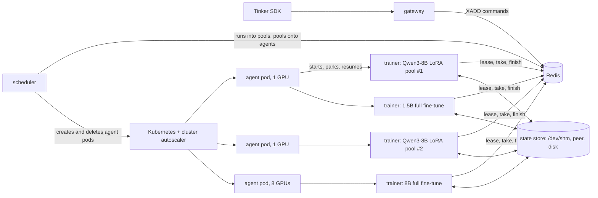
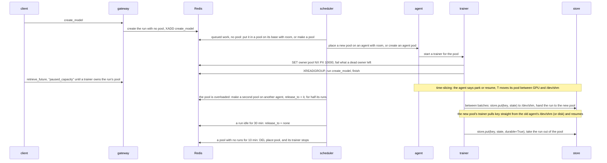

# tinyrl on Kubernetes

**Status: design.** The first piece, one owner per pool, is built and tested on the
[`k8s-prototype`](https://github.com/ShubyM/tiny-open-rl/tree/k8s-prototype) branch. Nothing else here exists yet.

Today you start a trainer for each pool by hand: `python -m tinyrl.trainer <pool>`. Nothing starts trainers for new pools,
sizes them, puts them on GPUs, shares a GPU between them, grows them when they're busy, or brings them back after a crash.
This is the design for the piece that does, on GKE.

## The idea

**Kubernetes supplies GPUs. Redis decides who runs where. A fast state store lets any trainer resume any run anywhere.**



- **A checkpoint is the only state that matters.** A run's state is a flat map of tensors: its trainable fp32 master
  weights and two fp32 AdamW moments for a trainer (12 bytes per trainable parameter), or its bf16 weights for a sampler (2
  bytes per parameter). Once those tensors are in the state store, a trainer holds nothing irreplaceable. Any trainer on
  any node can pull them and resume from the exact next step.
- **One state store does five jobs.** Checkpointing (`save_weights` / `load_weights`), weight sync to samplers
  (`save_weights_for_sampler`), time-slicing a GPU, resizing pools by moving runs between trainers, and idling runs to
  scale down all call the same `store.put` and `store.get`. The store stages tensors into pinned host RAM (`/dev/shm`,
  ~50 GB/s) so the GPU is free in under half a second, serves other nodes straight from that RAM over the pod network, and
  flushes durable checkpoints to shared storage in the background.
- **A pool is the set of runs one trainer serves**, as the README says today: some LoRA runs on one base model, or one full
  fine-tune. What changes is who makes pools. Today [`pool_for`](../tinyrl/gateway.py) puts every LoRA run on a base into
  one pool, so one GPU serves them all. Here the scheduler makes pools, and a base model gets as many as its load needs.
- **What gets placed is a pool's trainer process**, onto an agent pod that holds GPUs. The scheduler creates agent pods
  with plain `nvidia.com/gpu` requests, sized to the pools that need them (1, 2, 4 or 8 GPUs). An agent starts a trainer
  for each pool placed on it and decides which of them are on its GPUs.
- **A pool has one owner.** A trainer serves a pool only while it holds the pool's lease in Redis, and every reply or state
  handoff is written by a script that checks the lease first.

## What runs where

| Piece | Runs as | Code | Does |
|---|---|---|---|
| gateway | Deployment | [gateway.py](../tinyrl/gateway.py) | the Tinker API, as today. It stops picking a run's pool: it records the run's base, rank and LoRA config, and the scheduler does the rest. While a run has no trainer, `retrieve_future` answers `queue_state: "paused_capacity"`, which the SDK logs, instead of `"active"`. |
| scheduler | Deployment, 1 replica | new: `tinyrl/scheduler.py` | puts runs into pools and pools onto agents; grows and shrinks each base model's LoRA pools with their load; moves crowded pools to free agents; creates agent pods when nothing has room, and deletes empty ones |
| agent | one per agent pod | new: `tinyrl/agent.py` | starts and stops a trainer per pool placed on it; decides which pools are resident on its GPUs; serves `/dev/shm` checkpoints to peer agents over HTTP |
| trainer | a process in an agent pod | [trainer.py](../tinyrl/trainer.py), extended | serves its pool while it holds the lease; puts and gets run state through `store.py` |
| Redis | StatefulSet, AOF on | | streams, leases, placements, heartbeats, load, checkpoint locations |

Kubernetes sees a gateway, a scheduler, Redis and some agent pods. The scheduler needs one namespaced Role (`create`,
`delete`, `list` on Pods). Nothing is privileged, nothing uses the host network, and there are no CRDs. A pre-pull
DaemonSet on GPU node pools, or GKE image streaming, keeps a new agent from waiting on the image.

## State in Redis

Everything [bus.py](../tinyrl/bus.py) has today stays. What's new, and who writes it:

| Key | Type | Written by | Read by |
|---|---|---|---|
| `pool` in `tinyrl:run:<run>`, and `tinyrl:pool:<pool>` | the run's pool, and each pool's runs | **whoever holds the run**: the scheduler while the run is in no pool, its pool's trainer while it's in one | trainers, scheduler |
| `release_to` in `tinyrl:run:<run>` | a request: move the run to this pool, or to none | scheduler; the trainer clears it when it's done | the run's trainer |
| `parked` in `tinyrl:run:<run>` | key of the run's latest state in the store, while the run isn't loaded in a trainer | the trainer that puts it, and the one that gets it | trainers |
| `tinyrl:loc:<key>` | string with TTL: `http://pod-ip:port` of an agent holding `<key>` in `/dev/shm` | the agent that staged `<key>` | any trainer or sampler calling `store.get` |
| `tinyrl:owner:<pool>` | string with a 10 s TTL: the lease | the trainer that holds it | trainers, scheduler, gateway |
| `tinyrl:place:<pool>` | string: an agent id | scheduler | agents |
| `tinyrl:agent:<id>` | hash {gpus, gpu_bytes, host_bytes, gpu_model, addr} with a 30 s TTL: a heartbeat | that agent | scheduler, store |
| `tinyrl:load:<pool>` | hash {gpu_bytes, host_bytes, busy, wait}: measured | the pool's trainer | scheduler, agent |

A run's membership has one writer at a time, and the writer changes hands with the run. The scheduler can only put a run
into a pool while it's in none (checked in the same script that writes it), and only the trainer holding a run can take
it out, under that pool's lease. So two parties never both think they own a run.

## A run's life



## The store: a trainer can resume anywhere

Today [`Model.save`](../tinyrl/trainer.py) calls Hugging Face's `save_pretrained` and `torch.save(optimizer.state_dict())`
to a directory on `CKPT`. In open-rl's two-job 8B full fine-tune benchmark (`docs/fft/fft.md` §9), that single-threaded
write to NFS took **74 to 88 seconds of every 130-second RL step**—three fifths of the whole job spent waiting on disk,
while the GPUs sat idle.

What a trainer or sampler actually needs to move is just a flat `dict[str, torch.Tensor]`:

| Bundle | What's in it | Bytes per parameter | 0.5B LoRA (r=32, 17.6M adapter params) | 8B LoRA (r=32, 92M adapter params) | 1.5B full fine-tune | 8B full fine-tune |
|---|---|---|---|---|---|---|
| `weights(run)` | bf16 parameters (adapter or full model), for a sampler | 2 B | 35 MB | 184 MB | 3.1 GB | 16.4 GB |
| `state(run)` | trainable fp32 master weights + fp32 AdamW `exp_avg` and `exp_avg_sq`, for a trainer | 12 B | 0.21 GB | 1.1 GB | 18.5 GB | 98 GB (12.3 GB/GPU across 8) |

For a LoRA run, the base model is frozen and loaded once from the node's Hugging Face cache; `state(run)` holds only the
adapter's fp32 weights and moments. For a full fine-tune, `weights(run)` casts the fp32 master weights to bf16 as it copies
them out, cutting sampler transfers in half and avoiding vLLM's `dtype="auto"` fp16 fallback. Keeping the AdamW moments in
the same named tensor map (`f"{name}.exp_avg"`, `f"{name}.exp_avg_sq"`) instead of a pickled `optimizer.pt` lets weights and
optimizer state travel through the same zero-copy `safetensors` path.

### One interface, three speeds

`tinyrl/store.py` (~80 lines) has one job: get a named bundle of tensors out of a GPU and into whichever process needs it
next, as fast as the hardware between them allows.

```python
class Store:
  def put(self, key: str, tensors: dict[str, Tensor], meta: dict, *, durable: bool = False) -> None: ...
  def get(self, key: str, device: str = "cpu") -> tuple[dict[str, Tensor], dict]: ...
  def drop(self, key: str) -> None: ...
```

Every `put` and `get` moves through up to three tiers behind that call:

1. **GPU ↔ `/dev/shm` on the agent (~50 GB/s pinned D2H/H2D on PCIe Gen5).**
   `store.put` copies GPU tensors into a memory-mapped file in `/dev/shm` (backed by host RAM) and records
   `tinyrl:loc:<key> = http://<agent-ip>:<port>` in Redis. As soon as the copy to `/dev/shm` finishes, **the GPU memory is
   freed and the trainer is done waiting**:
   - **25 ms** for a 0.5B LoRA pool, **60 ms** for an 8B LoRA run's state (1.1 GB), **0.33 s** for an 8B LoRA base or an 8B
     full fine-tune's bf16 sampler weights (16.4 GB), **0.37 s** for a 1.5B full fine-tune (18.5 GB), and **0.25 s per GPU**
     for an 8B full fine-tune across 8 GPUs.
   - If the caller is on the **same node**—a trainer resuming after a time-slice turn, or a colocated sampler loading the
     latest `save_weights_for_sampler`—`store.get` mmaps `/dev/shm` directly. No disk, no network.
2. **Agent `/dev/shm` → peer agent over the pod network (2 to 25+ GB/s on standard GKE NICs; 100+ GB/s on A3/A4).**
   When a trainer or sampler on **another node** calls `store.get(key)`, it checks `tinyrl:loc:<key>` first. If the source
   agent is alive, it streams the `/dev/shm` file straight from that agent over HTTP range requests in parallel chunks into
   its own `/dev/shm`, then copies to its GPU:
   - Moving an 8B LoRA run (1.1 GB) to a new pool on another node takes **0.1 to 0.5 s**.
   - Broadcasting 8B full fine-tune sampler weights (16.4 GB) to a remote sampler replica takes **0.7 to 2 s** instead of
     74 to 88 s on NFS.
   - Moving a whole 1.5B full fine-tune trainer (18.5 GB) to a less crowded node takes **0.8 to 2 s** (or **~1 s** per GPU
     for an 8B full fine-tune across 8 NICs).
3. **`/dev/shm` → shared storage (`CKPT` on Lustre, Filestore or GCS) in the background.**
   When `durable=True` (`save_weights`, idling a run to scale down, or draining a node), a background thread in the agent
   writes the `/dev/shm` file out to `CKPT/<key>` in parallel stripes and atomically renames it into place. If the source
   agent is gone when `store.get(key)` runs, `get` falls back to `CKPT/<key>`.

### Every state movement is the same call

| Operation | What the trainer does | Tier used | Wall time on the trainer |
|---|---|---|---|
| **Time-slice park / resume** (sharing a GPU on one agent) | `store.put(pool_key, pool_state, durable=False)` → free GPU; later `store.get(pool_key, "cuda")` | `/dev/shm` on the same node | 25 ms (LoRA) to 0.37 s (1.5B FFT) each way |
| **Sampler weight sync** (`save_weights_for_sampler`) | `store.put(key, weights(run), durable=True)`; sampler calls `store.get(key)` | `/dev/shm` if colocated; peer HTTP if remote; disk in background | **0.06 to 0.33 s** (down from 74–88 s on NFS) |
| **Move a run to another pool or node** (resizing, rebalancing) | `store.put(key, state(run), durable=True)`, then lease-fenced Redis handoff (`parked = key`); next trainer calls `store.get(key)` | peer HTTP from the old agent's `/dev/shm`, with disk fallback | **0.06 s** to stage for 8B LoRA; **0.1 to 0.5 s** for the new trainer to pull |
| **Idle park** (run inactive for 30 min) | `store.put(key, state(run), durable=True)` and leave the pool; agent drops `/dev/shm` copy once flushed to `CKPT` | `/dev/shm` → shared storage | 0.06 to 0.37 s before GPU is freed |
| **User checkpoint** (`save_weights` / `load_weights`) | `store.put(path, state(run), durable=True)` (plus PEFT/HF config so external tools can load `CKPT/<path>` directly) | `/dev/shm` → shared storage | 0.06 to 0.37 s in-memory stage + background flush |

Because a run's `parked` key in Redis is written inside the lease-fenced script as the run leaves its old pool and cleared
by the trainer that loads it, a partial write is never visible and a crash after a restore can't bring back stale state.

## Scaling every workload

Because `store.put` and `store.get` make a trainer stateless between steps once its run is in the store, every workload can
move and scale with demand:

| Workload | What it holds | How it scales | Signal | What a change costs in the store |
|---|---|---|---|---|
| LoRA trainer pool | a frozen bf16 base, plus 0.21–1.1 GB of adapter `state` per run | more or fewer pools per base; runs move between pools | `busy`, `wait` | 60 ms to stage in `/dev/shm`, 0.1–0.5 s for the target pool to pull |
| full fine-tune trainer | 18.5 GB (1.5B) to 98 GB (8B) of `state` | shares a GPU in time via `/dev/shm`, or moves to a free agent node if its current agent stays crowded | the agent's resident set, `wait` | 0.37 s in `/dev/shm` on the same node; 0.8–2 s to move to another node |
| sampler (coming) | 3.1–16.4 GB of bf16 `weights` it can reload, and a KV cache it can drop | replicas | its sampling queue | 0.33 s from `/dev/shm` (same node) or 0.7–2 s over peer HTTP; nothing to save on scale-down |

Both kinds of trainer report the same two numbers once a minute: how busy they were (`busy`, the fraction of the minute
spent running commands) and how long commands waited (`wait`, the mean time from a command's `XADD` to its start, read from
its stream entry ID, which is a timestamp). The scheduler uses them for every decision below.

### LoRA trainer pools: more pools per base

One GPU serving every LoRA run on a base is a queue that grows with the number of runs. Say a run's RL step spends 10 s
training and 50 s sampling and scoring: one GPU keeps up with about six such runs, and from the seventh on, every run
waits for every other's `forward_backward`. Ten GPUs serving one run each is the opposite mistake. So:

- **Assigning.** A run with queued work and no pool (a new run, or one coming back from idle) goes into the pool on its
  base with the most room: memory for its adapter, and `busy` below the grow threshold. If none has room, the scheduler
  makes a pool. A full fine-tune, or a run marked `openrl.exclusive`, always gets a pool of its own.
- **Growing.** When a LoRA pool's commands wait more than 5 s on average for a minute while it's more than 85% busy, and it
  has at least two active runs, the scheduler makes a second pool on the same base, waits until a trainer owns it, then asks
  the busy pool to release half its active runs to it.
- **Shrinking.** When two pools on a base have both been under 30% busy for 10 minutes and their runs fit on one GPU, the
  scheduler asks the smaller to release all of its runs to the other. A pool with no runs is retired.
- **The hard cap is memory**: the base model, plus each run's adapter state, plus a floor for activations, must fit the GPU.
  Load sets the soft cap below it. `MAX_RUNS_PER_POOL` is there for operators who want a fixed one.
- **Hysteresis.** The grow and shrink thresholds are far apart, and a base is resized at most once every two minutes, so
  pools don't flap.

**Releasing a run** is one operation, used for growing, shrinking, migrating, idling and draining. Between batches, so
nothing of the run is in flight, the trainer calls `store.put(key, state(run), durable=True)`, frees the run from GPU
memory, and in one Lua script—checked against its pool's lease—moves the run from its pool to the target (or to none),
sets `parked = key`, and clears `release_to`. Commands that arrive meanwhile wait in the run's stream. The target pool's
trainer sees the run in its pool, pulls `key` via `store.get` (straight from the old agent's `/dev/shm` if it's on another
node, or by mmap if it's on the same node), loads the tensors, and deletes `parked`.

A new pool on a base costs one base model load from the node's Hugging Face cache (or peer `/dev/shm` if another agent
already has that base), plus an agent pod if no agent has room.

### Full fine-tunes: time-sliced locally, movable across nodes

A full fine-tune is one run, so it can't be split across pools, and changing its GPU count (width) mid-step buys little
once `store.put` eliminates the 74–88 s NFS checkpoint bottleneck: a training step is ~25 s, and changing width reshards
every parameter and moment and changes gradient reduction order.

Instead, the store makes a full fine-tune elastic in two ways:

1. **Between steps on the same node (`/dev/shm` tier).** While its client samples and scores, a full fine-tune holds no GPU
   memory if another pool on the agent wants the GPU: `store.put` parks it to `/dev/shm` in 0.37 s (1.5B) and that GPU
   serves other runs.
2. **Across nodes when an agent stays crowded (`peer` tier).** If two full fine-tunes placed on the same agent both become
   heavily active at the same time—so a pool's `wait` is high while its own `busy` is low because it's waiting for turns on
   the GPU—the scheduler places the pool on an uncrowded agent (or creates one). The old trainer puts `state(run)` into
   `/dev/shm` and releases the lease; the new trainer on the other node streams the state over the pod network in ~1 to 2 s
   and resumes. And if a run's GPU count ever needs to change (say, moving from one GPU to an 8-GPU FSDP agent), the clean
   checkpoint in `store` is the boundary where it happens.

### Samplers: replicas fed by the store

Generating rollouts splits cleanly across prompts and samples, and a sampler holds nothing it can't rebuild: bf16 weights
it pulls from the store and a KV cache it can drop. So samplers scale with replicas: more when the sampling queue grows,
fewer when it drains, and scaling down saves nothing because there's nothing to save. A LoRA sampler serves every adapter
on its base, pulling each run's 35–184 MB adapter from the store in milliseconds. A full fine-tune's sampler replicas pull
the 3.1–16.4 GB bf16 `weights(run)` bundle from the trainer's `/dev/shm` in under a second on the same node or ~1–2 s across
nodes, which makes adding sampler replicas worthwhile even for full fine-tunes.

## Pools onto agents

The scheduler's other half places pools, and it's the same loop:

```python
async def tick(self) -> None:
  agents = await self.bus.agents()  # live heartbeats, each with its GPU and host memory
  pools = await self.bus.pools()  # each pool's runs, load, placement and size

  await self.resize(pools)  # assign, grow, shrink and idle-release runs, as above

  for pool in pools.values():
    if pool.placed_on and pool.placed_on not in agents:  # its agent is gone: the lease runs out, place it again
      await self.bus.unplace(pool.name)
    elif pool.placed_on and pool.empty_for_s > EMPTY_POOL_S:  # no runs left: retire it
      await self.bus.unplace(pool.name)
    elif pool.starved_on_crowded_agent:  # high wait, low busy: move it to a free agent via the store
      await self.evacuate(pool)

  waiting = [p for p in pools.values() if p.runs and not p.placed_on]
  for pool in sorted(waiting, key=lambda p: p.size.gpu_bytes, reverse=True):  # best-fit decreasing
    agent = best_fit(agents.values(), pool.size, pool.gpus)
    if agent:
      await self.bus.place(pool.name, agent.id)
      agent.reserve(pool.size)
    else:
      await self.kube.ensure_pending_agent(pool.gpus, pool.size)  # at most one pending agent pod per shape

  for agent in agents.values():
    if agent.empty_for_s > EMPTY_AGENT_S:
      await self.kube.delete_agent(agent.id)  # the autoscaler then removes the empty node
```

- **A pool fits an agent** when its GPU footprint fits one of the agent's GPU groups on its own, and the footprints placed on
  the agent fit its `/dev/shm` budget, since a pool that isn't resident is staged there. So an agent can hold more pools
  than its GPUs fit at once, and it takes turns between them. `OVERSUBSCRIBE` caps that at a multiple of GPU memory.
- **Waiting isn't always load.** A pool whose commands wait while it's rarely busy is losing turns on a crowded agent, not
  short of compute; the scheduler stages its runs into the store and moves the pool to an agent with room instead of
  splitting it.
- **Scaling up** is one pending agent pod per GPU shape. kube-scheduler packs agent pods onto nodes, and when none fits, the
  cluster autoscaler adds a node; a nodeSelector picks L4, H100, H200 or B200 by the GPU memory the pool needs.
- **Scaling down** deletes agents that have had no pools for 10 minutes. Runs leave pools only by flushing their state to the
  store, and pools are retired only when empty, so deleting an empty agent can't lose anything. Queue lag is deliberately
  not the signal: an RL run's queue is empty while it samples, but its state still needs a home.
- **Multi-GPU pools** get an agent pod that requests N GPUs, so they land on one node as a gang.

## Taking turns on an agent's GPUs

**The agent decides what's on its GPUs, and nothing else does.** Every second it picks the resident set: pools with queued
work, least recently served first, as many as fit; then idle pools, if there's room left. It tells the rest to park (via
`store.put(..., durable=False)` into `/dev/shm`) over their stdin and waits for each to say it has before it tells another
to resume (`store.get(..., device="cuda")`), so two pools never race for the same memory. A busy pool keeps its place for
at least 30 seconds, or until its queue is empty, so pools don't thrash. When everything fits, nothing parks, and CUDA
interleaves the processes' kernels by itself.

**LoRA pools park like any other.** A LoRA pool with active runs stays resident because it has queued work. An idle one
parks cheaply: an 8B base is 16.4 GB of bf16, about 0.33 s to `/dev/shm`. Idle runs inside a busy LoRA pool don't hold
memory either: after 30 minutes without a command they're released to the store (`durable=True`), one at a time.

With fp32 master weights an 8B full fine-tune (98 GB between steps, 131 GB at peak) doesn't fit an 80 GB H100 at all; it
needs an H200 or B200, or FSDP. Three 1.5B full fine-tunes share an 80 GB GPU between steps (55 GB) without parking, or two
at peak (49 GB).

## Estimator

No tables of models. Before a run's first placement, build its model on the meta device from its config
(`AutoConfig.from_pretrained`) and count parameters. [trainer.py](../tinyrl/trainer.py) keeps fp32 master weights, so a full
fine-tune holds 16 bytes per parameter at peak (weights, gradients and two AdamW moments) and 12 between steps, because
`optimizer.zero_grad()` frees the gradients. A LoRA pool holds 2 bytes per parameter of bf16 base, plus 16 per adapter
parameter of each run. Activations don't need estimating: [`token_budget`](../tinyrl/trainer.py) sizes every pass to the
memory that's free.

The trainer writes what it measured to `tinyrl:load:<pool>` once a minute, and the scheduler and agent use that from then on.
A wrong guess costs one placement, not a run.

## One owner per pool

Two trainers serving one pool would split its runs' commands between two copies of the model. A trainer that pauses (a
long GC, a frozen VM, a network partition) and comes back must not answer for a pool someone else has taken over, or
overwrite a run's `parked` pointer in Redis. Three things together make that hold. All three are on the `k8s-prototype`
branch: 57 more lines of code in `bus.py` and `trainer.py`.

1. **The lease.** A trainer serves a pool only after `SET tinyrl:owner:<pool> <worker> NX PX 10000` succeeds. It renews the
   lease every 2.5 s from the event loop while commands run in a thread, so a long `forward_backward` doesn't let it lapse.
   If a renewal fails, the trainer stops. It also stops reading and running commands once half a lease has passed since its
   last renewal, so a trainer coming back from a pause stops before it touches anything.
2. **The fenced finish.** `Bus.finish` writes the reply, the acknowledgement and the count in one Lua script that first
   checks the lease is still the caller's. A trainer that lost its pool can't answer, so a client only ever sees the owner's
   reply. Releasing a run to the store (`parked = key`) goes through the same lease check.

   ```lua
   if redis.call('GET', KEYS[1]) ~= ARGV[1] then
     return 0
   end
   redis.call('XADD', KEYS[2], 'MAXLEN', '=', 1, '*', 'ok', ARGV[3], 'content_type', ARGV[4], 'body', ARGV[5])
   redis.call('EXPIRE', KEYS[2], ARGV[6])
   redis.call('XACK', KEYS[3], ARGV[8], ARGV[2])
   redis.call('XDEL', KEYS[3], ARGV[2])
   if ARGV[7] ~= '' then
     redis.call('HINCRBY', KEYS[4], ARGV[7], 1)
   end
   return 1
   ```

3. **The stranded sweep.** A trainer that paused while blocked in `XREADGROUP` can be handed a command after its lease ran
   out, and it will never answer it. So between batches, when it has nothing in flight itself, the owner claims anything
   that has been in flight anywhere for 5 seconds and fails it.

`test/test_lease.py` runs two real trainer processes on one pool against a real `redis-server`. The second waits, and never
reads from the pool. The first is paused with `SIGSTOP` while it's blocked reading, so Redis hands it the next command. Its
lease runs out; the second takes the pool over and fails the stranded command ("its trainer died, or lost the pool, during
optim_step"). After `SIGCONT` the first finds its lease gone and exits within about a second. The client's reply is still
the second's, nothing is left in flight, and the second goes on serving the pool. Another test restores a run from
`save` with its optimizer into a fresh `Model` and checks that the next three steps give the same losses and bitwise-equal
weights as the run that never stopped, which is what resuming a run from the store relies on.

## When things fail

| Failure | What happens | What's lost |
|---|---|---|
| a trainer dies in the middle of `optim_step` | the lease expires within 10 s; the agent starts a new trainer, which takes the lease, claims the command and fails it | the unparked steps since the run's last `store.put`. Runs parked in the store (`parked` set) lose nothing; active runs resume from their last checkpoint (or an auto-checkpoint every N steps if enabled). |
| a trainer dies while releasing a run | if it died before the lease-fenced release script ran, the run is still in its old pool; after, `parked` points to the complete state in the store and the new pool loads it | as above, or nothing |
| the source agent dies while a peer is pulling `<key>` from its `/dev/shm` | `store.get` catches the connection error and falls back to `CKPT/<key>` on shared storage | nothing once flushed; if the source node died before the background flush finished, the same as a node dying while holding the run |
| a node dies | its agent's heartbeat stops within 30 s; the scheduler places its pools elsewhere, creating an agent if it has to | the same as a trainer dying |
| the scheduler dies | nothing; trainers keep serving, and the Deployment restarts it | nothing |
| Redis restarts (AOF, fsync every second) | streams and leases come back; up to a second of writes may not, so a lease can expire early and the takeover path runs | possibly one in-flight command, failed |
| Redis fails over to a replica | a lease written just before can be missing, so a second trainer can take the pool. The first one's next renewal fails within 2.5 s and it stops; its replies were fenced, and what it held is swept and failed | a few commands, failed, never answered twice |
| a paused trainer comes back | the deadline, the fenced finish and the sweep, above | one in-flight command, failed |
| a paused trainer writes `save_weights` files | the store writes each checkpoint to a unique staging key before committing, and the command reply is fenced by the lease | nothing |

## Code

| File | Lines | Change |
|---|---:|---|
| [bus.py](../tinyrl/bus.py) | 160 → ~215 | `own`, `renew`, `release`; the fenced `finish`; `reclaim` with a minimum idle time (prototyped); assigning and releasing runs; placement, heartbeat, load and `loc` helpers |
| `store.py` | new, ~85 | `Store.put`, `get` and `drop` across `/dev/shm`, peer HTTP range pulls, and striped `safetensors` on `CKPT` |
| [trainer.py](../tinyrl/trainer.py) | 271 → ~335 | the lease loop and the sweep in `Trainer.serve` (prototyped); `Model.weights` (bf16) and `Model.state` (fp32 weights + moments); parking, releasing and restoring runs through `Store`; reporting load |
| `agent.py` | new, ~125 | the heartbeat, a trainer per placed pool, the residency loop, and the static `/dev/shm` HTTP file server for peer pulls |
| `scheduler.py` | new, ~170 | assigning runs, growing and shrinking pools, evacuating starved pools, placing pools, agent pods through the Kubernetes API |
| `estimator.py` | new, ~25 | parameter count from the config on the meta device, and bytes per parameter |
| [gateway.py](../tinyrl/gateway.py) | 154 → ~152 | `pool_for` moves to the scheduler; the run records its LoRA config; `paused_capacity` |
| `k8s/` | ~120 lines of YAML | gateway, Redis with AOF, the scheduler and its Role, a pre-pull DaemonSet |

About 1,180 lines of Python, up from 692.

## Testing

Like everything else in tinyrl, against a real `redis-server`, real processes and CPU models, with no cluster: the lease
takeover and the sweep (done), a run restored into a fresh trainer with bitwise-equal weights and losses (done), `Store.put`
and `Store.get` across local `/dev/shm`, peer HTTP between two agents and `CKPT` fallback when the source agent is killed,
moving runs between two real trainers while commands keep arriving, the assignment, resizing, placement and residency
decisions, and an agent running real trainers through park and resume. A real cluster is needed for: a GPU park actually
freeing memory, autoscaling in both directions, losing a node, and vLLM's sleep and wake.

## How this differs from open-rl

open-rl keeps the truth in Kubernetes. The API server writes `Workload` objects, a placement controller turns each into a
`ClaimLedger`, a DRA `ResourceClaim` and a pod, and a node daemon takes turns between the pods that share a claim. tinyrl
keeps the truth in Redis, puts run state in a fast store so any trainer can resume any run anywhere, and asks Kubernetes
only for GPUs.

| | open-rl | tinyrl |
|---|---|---|
| What gets placed | a pod per worker process | a pool's process, onto an agent pod that already has GPUs |
| Checkpoints & weight sync | `save_pretrained` + `torch.save` straight to shared NFS (74–88 s per step on 8B FFT) | `Store`: GPU → `/dev/shm` in 0.06–0.37 s, served to peers/samplers from RAM over HTTP, flushed to disk in the background |
| LoRA capacity | one worker per base model; its Workload name's instance index "stays 0 until adapter capacity accounting exists" | as many pools per base as load needs; runs move between them in <0.5 s through the store |
| Placement | a Go controller (~2,700 lines, with a 1,274-line design doc): binpack or spread, kube-scheduler as the capacity probe, ledger seats booked by compare-and-swap, assignment IDs, a 2-minute wedge grace | a Python loop (~170 lines): runs into pools by load, pools onto agents by measured size |
| Sharing a GPU | several pods share one DRA claim, seated on a `ClaimLedger` | the processes in one agent pod share its GPUs, requested as plain `nvidia.com/gpu` |
| Who takes turns | a time-slicer DaemonSet on the host network; workers `ACQUIRE` and `RELEASE` it around each batch; one resident per claim | the agent, for its own GPUs; pools stay resident together when they fit, least recently served first when they don't |
| Getting state off the GPU | two ways: cuda-checkpoint through llm-d's snapshot agent (privileged, host PID namespace, finds processes from env tags), and the full fine-tune worker's own sleep and wake | one: `store.put` and `store.get`, used for time-slicing, sampler sync, pool resizing, node migration and checkpoints |
| LoRA workers | exclusive: always resident, never share a GPU | park and migrate through the store like any other pool |
| Moving work | recreate the worker's pod, since a pod's claims can't change, and reload from slow shared disk | `store.put` on the old trainer, lease-fenced handoff in Redis, `store.get` over peer HTTP on the new trainer |
| One owner | agreement between the Workload's status, a ledger seat, an assignment ID and the pod's env; workers are trusted to obey the daemon | a lease per pool, checked by the same script that writes each reply or hands off a run |
| Queues | Redis lists drained with `LPOP`, so work in flight is tracked separately | Redis streams: `XPENDING` knows what's in flight, `XAUTOCLAIM` hands it to the next owner |
| Sizing | tables of parameter counts and KV-cache bytes per model name; unknown models are sized as Qwen3-8B | the parameter count from the model's config, then what the trainer measures |
| Scaling up | a standing pending claim and its unschedulable pod | one pending agent pod per GPU shape |
| Scaling down | a claim retires when the last workload seated on it is deleted | idle runs go to the store, empty pools retire, and agents empty for 10 minutes are deleted |
| Privileges | two CRDs; a ClusterRole on nodes, pods and ResourceSlices; a DRA driver; a host-network DaemonSet; a privileged host-PID DaemonSet | one namespaced Role over pods |
| Size | ~4,000 lines: the controller, the time-slicer (677), the worker managers (432), the estimator (128), plus generated CRDs | ~485 lines of Python |

What open-rl has that this doesn't, yet: samplers, with weight sync to vLLM and time-sliced vLLM processes; multi-GPU
training; DRA's device selection, for picking GPUs by attributes rather than node pools; `kubectl get workloads` showing
every worker and where it is, where tinyrl makes you ask Redis or the gateway; and runs on real clusters. Everything here
past the lease is still a design.

## Alternatives considered

- **Writing every park and weight sync straight through POSIX/NFS `save_pretrained`.** On Filestore (2 GB/s), parking a
  1.5B full fine-tune takes 9 s each way and an 8B one takes 49 s; in open-rl's benchmark, single-threaded `save_pretrained`
  took 74 to 88 s per step. Staging to `/dev/shm` first frees the GPU in 0.37 s and lets peers and samplers pull from RAM.
- **Trainers claiming pools themselves, with no scheduler.** A worker that parks a pool in its `/dev/shm` and lets go of it
  lets another node take the pool while its newest state is still only in the first node's RAM, or spin up duplicate base
  models without packing.
- **Replicas of one LoRA pool, each owning some of its runs by a lease per run.** It resizes too, but every trainer renews
  a lease per run, and fencing a reply means checking the run's lease rather than the pool's. Pools that runs move between
  keep one lease per process.
- **A fixed number of runs per LoRA pool.** It's a stand-in for load, and a bad one: ten runs that are sampling cost the
  trainer nothing, and three that train back to back can saturate it. Memory is the hard cap; load sets the rest.
- **Spreading one LoRA pool across GPUs** (one process, data parallel). It speeds up one big batch, not many runs, and adds
  collectives between GPUs to every step.
- **Widening a full fine-tune's trainer mid-step.** Once `store.put` cuts sampler weight sync from ~80 s to <1 s, training
  is ~25 s of a ~50 s step, and every change of width reshards 12 to 16 bytes per parameter and shifts the run's numbers.
  Moving the run intact to an uncrowded agent via the store is faster and preserves bitwise-identical math.
- **Autoscaling on queue lag** (HPA or KEDA). An RL run's queue is empty while it samples, and a Deployment scale-down kills
  whichever pod it picks, `/dev/shm` state and all.
- **One process per GPU that hosts every pool.** Residency needs no messages, but one crash takes down every pool on the
  GPU, and samplers are separate processes anyway.
- **An agent DaemonSet.** It never makes a pod pending, so the cluster never scales up.
- **cuda-checkpoint.** It needs a privileged agent in the host PID namespace to find processes, and it moves a whole CUDA
  context instead of the tensors that matter.

## Open questions

1. Are the resizing thresholds right: grow at a 5 s mean wait while 85% busy, shrink below 30% busy for 10 minutes?
2. Should agents oversubscribe their GPUs by default, or only when asked?
3. Keep Tinker's semantics, where a crash is an error and you resume from your own `save_weights`, or have trainers
   background-flush runs to `store` every N steps so a lost node costs at most N steps?
4. One agent pod per pool shape, or one per node holding all of its GPUs?
5. A single Redis with AOF, or replicas with failover, which the lease makes safe but which can fail a few commands each
   time?
