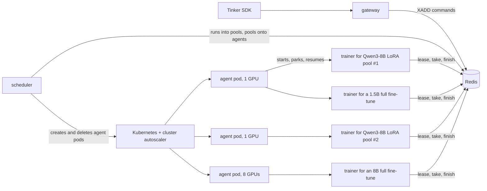
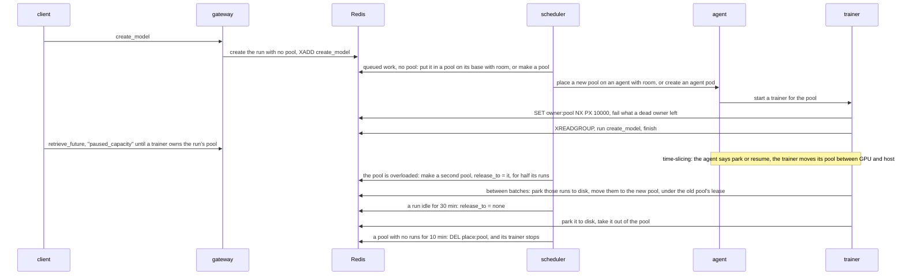

# tinyrl on Kubernetes

**Status: design.** The first piece, one owner per pool, is built and tested on the
[`k8s-prototype`](https://github.com/ShubyM/tiny-open-rl/tree/k8s-prototype) branch. Nothing else here exists yet.

Today you start a trainer for each pool by hand: `python -m tinyrl.trainer <pool>`. Nothing starts trainers for new pools,
sizes them, puts them on GPUs, shares a GPU between them, grows them when they're busy, or brings them back after a crash.
This is the design for the piece that does, on GKE.

## The idea

**Kubernetes supplies GPUs. Redis decides everything else.**



- **A pool is the set of runs one trainer serves**, as the README says today: some LoRA runs on one base model, or one full
  fine-tune. What changes is who makes pools. Today [`pool_for`](../tinyrl/gateway.py) puts every LoRA run on a base into
  one pool, so one GPU serves them all. Here the scheduler makes pools, and a base model gets as many as its load needs.
- **What gets placed is a pool's trainer process**, onto an agent pod that holds GPUs. The scheduler creates agent pods
  with plain `nvidia.com/gpu` requests, sized to the pools that need them (1, 2, 4 or 8 GPUs). An agent starts a trainer
  for each pool placed on it and decides which of them are on its GPUs.
- **Runs move between pools**, so pools can be resized. A run's state moves the way it's checkpointed: its pool's trainer
  parks it to disk in the format `save_weights` already writes, and the next pool's trainer loads it. For a LoRA run that's
  an adapter and its AdamW state, about a second, so splitting a busy LoRA pool or merging two quiet ones is cheap.
- **Parking** covers time-slicing and checkpointing. A trainer parks its pool's tensors to host RAM when its agent needs
  the GPU for another pool, and parks a run to disk when the run goes idle or moves.
- **A pool has one owner.** A trainer serves a pool only while it holds the pool's lease in Redis, and every reply is
  written by a script that checks the lease first.

## What runs where

| Piece | Runs as | Code | Does |
|---|---|---|---|
| gateway | Deployment | [gateway.py](../tinyrl/gateway.py) | the Tinker API, as today. It stops picking a run's pool: it records the run's base, rank and LoRA config, and the scheduler does the rest. While a run has no trainer, `retrieve_future` answers `queue_state: "paused_capacity"`, which the SDK logs, instead of `"active"`. |
| scheduler | Deployment, 1 replica | new: `tinyrl/scheduler.py` | puts runs into pools and pools onto agents; grows and shrinks each base model's LoRA pools with their load; creates agent pods when nothing has room, and deletes empty ones |
| agent | one per agent pod | new: `tinyrl/agent.py` | starts and stops a trainer per pool placed on it; decides which pools are resident on its GPUs |
| trainer | a process in an agent pod | [trainer.py](../tinyrl/trainer.py), extended | serves its pool while it holds the lease; parks, releases and restores runs |
| Redis | StatefulSet, AOF on | | streams, leases, placements, heartbeats, load |

Kubernetes sees a gateway, a scheduler, Redis and some agent pods. The scheduler needs one namespaced Role (`create`,
`delete`, `list` on Pods). Nothing is privileged, nothing uses the host network, and there are no CRDs. A pre-pull
DaemonSet on GPU node pools, or GKE image streaming, keeps a new agent from waiting on the image.

## State

Everything [bus.py](../tinyrl/bus.py) has today stays. What's new, and who writes it:

| Key | Type | Written by | Read by |
|---|---|---|---|
| `pool` in `tinyrl:run:<run>`, and `tinyrl:pool:<pool>` | the run's pool, and each pool's runs | **whoever holds the run**: the scheduler while the run is in no pool, its pool's trainer while it's in one | trainers, scheduler |
| `release_to` in `tinyrl:run:<run>` | a request: move the run to this pool, or to none | scheduler; the trainer clears it when it's done | the run's trainer |
| `parked` in `tinyrl:run:<run>` | path of the run's state on disk, if that's where it is | the trainer that parked it, and the one that loads it | trainers |
| `tinyrl:owner:<pool>` | string with a 10 s TTL: the lease | the trainer that holds it | trainers, scheduler, gateway |
| `tinyrl:place:<pool>` | string: an agent id | scheduler | agents |
| `tinyrl:agent:<id>` | hash {gpus, gpu_bytes, host_bytes, gpu_model} with a 30 s TTL: a heartbeat | that agent | scheduler |
| `tinyrl:load:<pool>` | hash {gpu_bytes, host_bytes, busy, wait}: measured | the pool's trainer | scheduler, agent |

A run's membership has one writer at a time, and the writer changes hands with the run. The scheduler can only put a run
into a pool while it's in none (checked in the same script that writes it), and only the trainer holding a run can take
it out, under that pool's lease. So two parties never both think they own a run.

## A run's life



## Runs into pools: resizing

Pools are where accelerator efficiency is won or lost. One GPU serving every LoRA run on a base is a queue that grows with
the number of runs. Say a run's RL step spends 10 s training and 50 s sampling and scoring: one GPU keeps up with about six
such runs, and from the seventh on, every run waits for every other's `forward_backward`. Ten GPUs serving one run each
is the opposite mistake. The scheduler sizes pools to load:

- **Load.** Each trainer writes, once a minute, how busy it was (`busy`: the fraction of the minute spent running commands)
  and how long commands waited (`wait`: the mean time from a command's `XADD` to its start, read from its stream entry ID,
  which is a timestamp).
- **Assigning.** A run with queued work and no pool (a new run, or one coming back from idle) goes into the pool on its
  base with the most room: memory for its adapter, and `busy` below the grow threshold. If none has room, the scheduler
  makes a pool. A full fine-tune, or a run marked `openrl.exclusive`, always gets a pool of its own.
- **Growing.** When a LoRA pool's commands wait more than 5 s on average for a minute while it's more than 85% busy, and it
  has at least two active runs, the scheduler makes a second pool on the same base, waits until a trainer owns it, then asks
  the busy pool to release half its active runs to it.
- **Shrinking.** When two pools on a base have both been under 30% busy for 10 minutes and their runs fit on one GPU, the
  scheduler asks the smaller to release all of its runs to the other. A pool with no runs is retired.
- **The hard cap is memory**: the base model, plus each run's adapter state, plus a floor for activations, must fit the GPU.
  Load sets the soft cap below it. `MAX_RUNS_PER_POOL` is there for operators who want a fixed one.
- **Hysteresis.** The grow and shrink thresholds are far apart, and a base is resized at most once every two minutes, so
  pools don't flap.

**Releasing a run** is one operation, used for growing, shrinking, idling and draining. Between batches, so nothing of the
run is in flight, the trainer saves the run with its optimizer to `CKPT/<run>/park/<step>`, frees it, and in one script,
under its pool's lease, moves the run from its pool to the target (or to none), records `parked`, and clears `release_to`.
Commands that arrive meanwhile wait in the run's stream. The target pool's trainer sees the run in its pool, and before the
run's next command it recreates the adapter from the run's recorded config, loads the parked state, and deletes `parked`.

| Moving a run | State | To disk and back |
|---|---|---|
| 0.5B LoRA, rank 32 on every linear layer | 17.6M adapter parameters × 12 B = 0.21 GB | 0.2 s on Filestore (2 GB/s) |
| 8B LoRA (Qwen3-8B), rank 32, output head included | 92M × 12 B = 1.1 GB | 1.1 s on Filestore, 0.2 s on Lustre (10 GB/s) |
| 1.5B full fine-tune | 1.54B × 12 B = 18.5 GB | 18 s on Filestore, 3.7 s on Lustre |

LoRA runs are cheap to move, so LoRA pools resize horizontally and freely. A full fine-tune is its own pool; resizing it
means more GPUs for that one pool (FSDP, which tinyrl doesn't have yet), done rarely, by releasing the run and placing its
next pool on a bigger agent. A new pool on a base costs one base model load from the shared Hugging Face cache, about 8 s
for an 8B model on Filestore, plus an agent pod if no agent has room.

## Pools onto agents

The scheduler's other half places pools, and it's the same loop:

```python
async def tick(self) -> None:
  agents = await self.bus.agents()  # live heartbeats, each with its GPU and host memory
  pools = await self.bus.pools()  # each pool's runs, load, placement and size

  await self.resize(pools)  # assign, grow, shrink and idle-release runs, as above

  for pool in pools.values():
    if pool.placed_on and pool.placed_on not in agents:  # its agent is gone: the lease runs out, place it again
      await self.bus.unplace(pool.name)
    elif pool.placed_on and pool.empty_for_s > EMPTY_POOL_S:  # no runs left: retire it
      await self.bus.unplace(pool.name)

  waiting = [p for p in pools.values() if p.runs and not p.placed_on]
  for pool in sorted(waiting, key=lambda p: p.size.gpu_bytes, reverse=True):  # best-fit decreasing
    agent = best_fit(agents.values(), pool.size, pool.gpus)
    if agent:
      await self.bus.place(pool.name, agent.id)
      agent.reserve(pool.size)
    else:
      await self.kube.ensure_pending_agent(pool.gpus, pool.size)  # at most one pending agent pod per shape

  for agent in agents.values():
    if agent.empty_for_s > EMPTY_AGENT_S:
      await self.kube.delete_agent(agent.id)  # the autoscaler then removes the empty node
```

- **A pool fits an agent** when its GPU footprint fits one of the agent's GPU groups on its own, and the footprints placed on
  the agent fit its host RAM, since a pool that isn't resident is parked there. So an agent can hold more pools than its
  GPUs fit at once, and it takes turns between them. `OVERSUBSCRIBE` caps that at a multiple of GPU memory.
- **Waiting isn't always load.** A pool whose commands wait while it's rarely busy is losing turns on a crowded agent, not
  short of compute; the scheduler moves the pool to an agent with room instead of splitting it.
- **Scaling up** is one pending agent pod per GPU shape. kube-scheduler packs agent pods onto nodes, and when none fits, the
  cluster autoscaler adds a node; a nodeSelector picks L4, H100, H200 or B200 by the GPU memory the pool needs.
- **Scaling down** deletes agents that have had no pools for 10 minutes. Runs leave pools only by parking to disk, and pools
  are retired only when empty, so deleting an empty agent can't lose anything. Queue lag is deliberately not the signal: an
  RL run's queue is empty while it samples, but its state still needs a home.
- **Multi-GPU pools** get an agent pod that requests N GPUs, so they land on one node as a gang.

## Estimator

No tables of models. Before a run's first placement, build its model on the meta device from its config
(`AutoConfig.from_pretrained`) and count parameters. [trainer.py](../tinyrl/trainer.py) keeps fp32 master weights, so a full
fine-tune holds 16 bytes per parameter at peak (weights, gradients and two AdamW moments) and 12 between steps, because
`optimizer.zero_grad()` frees the gradients. A LoRA pool holds 2 bytes per parameter of bf16 base, plus 16 per adapter
parameter of each run. Activations don't need estimating: [`token_budget`](../tinyrl/trainer.py) sizes every pass to the
memory that's free.

The trainer writes what it measured to `tinyrl:load:<pool>` once a minute, and the scheduler and agent use that from then on.
A wrong guess costs one placement, not a run.

## Parking: time-slicing and checkpointing are one mechanism

`Model.park` moves tensors off the GPU: the weights, the gradients, and the AdamW moments, which live in `optimizer.state`,
not in the module, so moving the module isn't enough.

| Park to | For | Decided by | Survives |
|---|---|---|---|
| host RAM, a whole pool | taking turns on a GPU | the agent | nothing; it's the same process |
| disk, one run, in [`Model.save`](../tinyrl/trainer.py)'s format with the optimizer | idle runs, moving runs between pools, draining | the scheduler, by asking for a release | a process crash, a lost node |

**The agent decides what's on its GPUs, and nothing else does.** Every second it picks the resident set: pools with queued
work, least recently served first, as many as fit; then idle pools, if there's room left. It tells the rest to park over
their stdin and waits for each to say it has before it tells another to resume, so two pools never race for the same
memory. A busy pool keeps its place for at least 30 seconds, or until its queue is empty, so pools don't thrash. When
everything fits, nothing parks, and CUDA interleaves the processes' kernels by itself.

**LoRA pools park like any other.** A LoRA pool with active runs stays resident because it has queued work. An idle one
parks cheaply: an 8B base is 16.4 GB of bf16, about 0.33 s to host RAM. Idle runs inside a busy LoRA pool don't hold memory
either: after 30 minutes without a command they're released to disk, one at a time.

**A disk park is a checkpoint you could load**, and it's restored only if nothing has happened to the run since: `parked`
is written as the run leaves its pool and deleted by the trainer that loads it. So a crash after a restore can't bring back
stale state; it surfaces as an error, the way a crash does today.

What a pool's trip to host RAM costs on an H100, at about 50 GB/s pinned (20 GB/s pageable):

| Pool | State between steps | Each way |
|---|---|---|
| 0.5B LoRA base with one rank 32 run | 0.99 GB bf16 base + 0.28 GB of adapter state | 25 ms |
| 1.5B full fine-tune | 1.54B × 12 B = 18.5 GB | 0.37 s pinned, 0.9 s pageable |
| 8B full fine-tune (Qwen3-8B) | 8.19B × 12 B = 98 GB, 131 GB at peak | 2.0 s on one GPU, 0.25 s per GPU across 8 |

With fp32 master weights an 8B full fine-tune doesn't fit an 80 GB H100 at all; it needs an H200 or B200, or FSDP. Three
1.5B full fine-tunes share an 80 GB GPU between steps (55 GB) without parking, or two at peak (49 GB).

## One owner per pool

Two trainers serving one pool would split its runs' commands between two copies of the model. A trainer that pauses (a
long GC, a frozen VM, a network partition) and comes back must not answer for a pool someone else has taken over. Three
things together make that hold. All three are on the `k8s-prototype` branch: 57 more lines of code in `bus.py` and
`trainer.py`.

1. **The lease.** A trainer serves a pool only after `SET tinyrl:owner:<pool> <worker> NX PX 10000` succeeds. It renews the
   lease every 2.5 s from the event loop while commands run in a thread, so a long `forward_backward` doesn't let it lapse.
   If a renewal fails, the trainer stops. It also stops reading and running commands once half a lease has passed since its
   last renewal, so a trainer coming back from a pause stops before it touches anything.
2. **The fenced finish.** `Bus.finish` writes the reply, the acknowledgement and the count in one Lua script that first
   checks the lease is still the caller's. A trainer that lost its pool can't answer, so a client only ever sees the owner's
   reply. Releasing a run goes through the same check.

   ```lua
   if redis.call('GET', KEYS[1]) ~= ARGV[1] then
     return 0
   end
   redis.call('XADD', KEYS[2], 'MAXLEN', '=', 1, '*', 'ok', ARGV[3], 'content_type', ARGV[4], 'body', ARGV[5])
   redis.call('EXPIRE', KEYS[2], ARGV[6])
   redis.call('XACK', KEYS[3], ARGV[8], ARGV[2])
   redis.call('XDEL', KEYS[3], ARGV[2])
   if ARGV[7] ~= '' then
     redis.call('HINCRBY', KEYS[4], ARGV[7], 1)
   end
   return 1
   ```

3. **The stranded sweep.** A trainer that paused while blocked in `XREADGROUP` can be handed a command after its lease ran
   out, and it will never answer it. So between batches, when it has nothing in flight itself, the owner claims anything
   that has been in flight anywhere for 5 seconds and fails it.

`test/test_lease.py` runs two real trainer processes on one pool against a real `redis-server`. The second waits, and never
reads from the pool. The first is paused with `SIGSTOP` while it's blocked reading, so Redis hands it the next command. Its
lease runs out; the second takes the pool over and fails the stranded command ("its trainer died, or lost the pool, during
optim_step"). After `SIGCONT` the first finds its lease gone and exits within about a second. The client's reply is still
the second's, nothing is left in flight, and the second goes on serving the pool. Another test restores a run from
`save` with its optimizer into a fresh `Model` and checks that the next three steps give the same losses and bitwise-equal
weights as the run that never stopped, which is what moving a run between pools relies on.

## When things fail

| Failure | What happens | What's lost |
|---|---|---|
| a trainer dies in the middle of `optim_step` | the lease expires within 10 s; the agent starts a new trainer, which takes the lease, claims the command and fails it | the in-memory state of the pool's runs, except runs parked to disk. Later calls get the error they get today ("not on this trainer, ... its trainer restarted"), and the client loads its last checkpoint. |
| a trainer dies while releasing a run | if it died before the release script ran, the run is still in its pool with no state, as above; after, the run is in its new pool with `parked` set, and loads there | as above, or nothing |
| a node dies | its agent's heartbeat stops within 30 s; the scheduler places its pools elsewhere, creating an agent if it has to | the same as a trainer dying |
| the scheduler dies | nothing; trainers keep serving, and the Deployment restarts it | nothing |
| Redis restarts (AOF, fsync every second) | streams and leases come back; up to a second of writes may not, so a lease can expire early and the takeover path runs | possibly one in-flight command, failed |
| Redis fails over to a replica | a lease written just before can be missing, so a second trainer can take the pool. The first one's next renewal fails within 2.5 s and it stops; its replies were fenced, and what it held is swept and failed | a few commands, failed, never answered twice |
| a paused trainer comes back | the deadline, the fenced finish and the sweep, above | one in-flight command, failed |
| a paused trainer writes `save_weights` files | the command is failed, but files may exist at its path | nothing, though a failed save can leave files behind |

## Samplers

When tinyrl has a sampler (vLLM serving what `save_weights_for_sampler` writes), it's a second kind of process on an agent.
It parks with vLLM's `sleep(level=1)` and resumes with `wake_up()`, and the agent treats it like a trainer, with its
sampling queue as its demand. Samplers get pools too, resized the same way, and the scheduler places a sampler pool on the
agent that has its trainers, so they take turns on one GPU and weight sync can go through the node's `/dev/shm` instead of
the shared disk. For small models both stay resident and only their kernels interleave.

A full fine-tune's sampler checkpoint is fp32, because the master weights are. vLLM's `dtype="auto"` would serve an fp32
checkpoint in fp16, so the sampler should run with `--dtype bfloat16`, or the save should write a bf16 copy.

## Code

| File | Lines | Change |
|---|---:|---|
| [bus.py](../tinyrl/bus.py) | 160 → ~210 | `own`, `renew`, `release`; the fenced `finish`; `reclaim` with a minimum idle time (prototyped); assigning and releasing runs; placement, heartbeat and load helpers |
| [trainer.py](../tinyrl/trainer.py) | 271 → ~335 | the lease loop and the sweep in `Trainer.serve` (prototyped); `Model.park`; releasing runs to disk and restoring them; reporting load; obeying park and resume |
| `agent.py` | new, ~110 | the heartbeat, a trainer per placed pool, the residency loop |
| `scheduler.py` | new, ~170 | assigning runs, growing and shrinking pools, placing pools, agent pods through the Kubernetes API |
| `estimator.py` | new, ~25 | parameter count from the config on the meta device, and bytes per parameter |
| [gateway.py](../tinyrl/gateway.py) | 154 → ~152 | `pool_for` moves to the scheduler; the run records its LoRA config; `paused_capacity` |
| `k8s/` | ~120 lines of YAML | gateway, Redis with AOF, the scheduler and its Role, a pre-pull DaemonSet |

About 1,100 lines of Python, up from 692.

## Testing

Like everything else in tinyrl, against a real `redis-server`, real processes and CPU models, with no cluster: the lease
takeover and the sweep (done), a run restored into a fresh trainer (done), moving runs between two real trainers while
commands keep arriving, the assignment, resizing, placement and residency decisions, and an agent running real trainers
through park and resume. A real cluster is needed for: a GPU park actually freeing memory, autoscaling in both directions,
losing a node, and vLLM's sleep and wake.

## How this differs from open-rl

open-rl keeps the truth in Kubernetes. The API server writes `Workload` objects, a placement controller turns each into a
`ClaimLedger`, a DRA `ResourceClaim` and a pod, and a node daemon takes turns between the pods that share a claim. tinyrl
keeps the truth in Redis, which already holds every command, and asks Kubernetes only for GPUs.

| | open-rl | tinyrl |
|---|---|---|
| What gets placed | a pod per worker process | a pool's process, onto an agent pod that already has GPUs |
| LoRA capacity | one worker per base model; its Workload name's instance index "stays 0 until adapter capacity accounting exists" | as many pools per base as load needs; runs move between them in about a second |
| Placement | a Go controller (~2,700 lines, with a 1,274-line design doc): binpack or spread, kube-scheduler as the capacity probe, ledger seats booked by compare-and-swap, assignment IDs, a 2-minute wedge grace | a Python loop (~170 lines): runs into pools by load, pools onto agents by measured size |
| Sharing a GPU | several pods share one DRA claim, seated on a `ClaimLedger` | the processes in one agent pod share its GPUs, requested as plain `nvidia.com/gpu` |
| Who takes turns | a time-slicer DaemonSet on the host network; workers `ACQUIRE` and `RELEASE` it around each batch; one resident per claim | the agent, for its own GPUs; pools stay resident together when they fit, least recently served first when they don't |
| Getting state off the GPU | two ways: cuda-checkpoint through llm-d's snapshot agent (privileged, host PID namespace, finds processes from env tags), and the full fine-tune worker's own sleep and wake | one: the trainer parks tensors to host RAM, or a run to disk |
| LoRA workers | exclusive: always resident, never share a GPU | park like any other pool, and their idle runs go to disk |
| Checkpoints | separate from parking | a run parked to disk is a `save_weights` checkpoint |
| Moving work | recreate the worker's pod, since a pod's claims can't change | release runs to disk and load them in another pool |
| One owner | agreement between the Workload's status, a ledger seat, an assignment ID and the pod's env; workers are trusted to obey the daemon | a lease per pool, checked by the same script that writes each reply or moves a run |
| Queues | Redis lists drained with `LPOP`, so work in flight is tracked separately | Redis streams: `XPENDING` knows what's in flight, `XAUTOCLAIM` hands it to the next owner |
| Sizing | tables of parameter counts and KV-cache bytes per model name; unknown models are sized as Qwen3-8B | the parameter count from the model's config, then what the trainer measures |
| Scaling up | a standing pending claim and its unschedulable pod | one pending agent pod per GPU shape |
| Scaling down | a claim retires when the last workload seated on it is deleted | idle runs go to disk, empty pools retire, and agents empty for 10 minutes are deleted |
| Privileges | two CRDs; a ClusterRole on nodes, pods and ResourceSlices; a DRA driver; a host-network DaemonSet; a privileged host-PID DaemonSet | one namespaced Role over pods |
| Size | ~4,000 lines: the controller, the time-slicer (677), the worker managers (432), the estimator (128), plus generated CRDs | ~400 lines of Python |

What open-rl has that this doesn't, yet: samplers, with weight sync to vLLM and time-sliced vLLM processes; multi-GPU
training; DRA's device selection, for picking GPUs by attributes rather than node pools; `kubectl get workloads` showing
every worker and where it is, where tinyrl makes you ask Redis or the gateway; and runs on real clusters. Everything here
past the lease is still a design.

## Alternatives considered

- **A pod per pool, scaled to zero between turns.** Parking to disk on every RL turn costs 9 s for a 1.5B full fine-tune
  and 49 s for an 8B one on Filestore, each way.
- **Trainers claiming pools themselves, with no scheduler.** A worker that parks a pool in its host RAM and lets go of it
  lets another node take the pool and quietly restart it from an old checkpoint.
- **Replicas of one LoRA pool, each owning some of its runs by a lease per run.** It resizes too, but every trainer renews
  a lease per run, and fencing a reply means checking the run's lease rather than the pool's. Pools that runs move between
  keep one lease per process.
- **A fixed number of runs per LoRA pool.** It's a stand-in for load, and a bad one: ten runs that are sampling cost the
  trainer nothing, and three that train back to back can saturate it. Memory is the hard cap; load sets the rest.
- **Spreading one LoRA pool across GPUs** (one process, data parallel). It speeds up one big batch, not many runs, and adds
  collectives between GPUs to every step.
- **Autoscaling on queue lag** (HPA or KEDA). An RL run's queue is empty while it samples, and a Deployment scale-down kills
  whichever pod it picks, parked state and all.
- **One process per GPU that hosts every pool.** Residency needs no messages, but one crash takes down every pool on the
  GPU, and samplers are separate processes anyway.
- **An agent DaemonSet.** It never makes a pod pending, so the cluster never scales up.
- **cuda-checkpoint.** It needs a privileged agent in the host PID namespace to find processes, and it moves a whole CUDA
  context instead of the tensors that matter.

## Open questions

1. Are the resizing thresholds right: grow at a 5 s mean wait while 85% busy, shrink below 30% busy for 10 minutes?
2. Should agents oversubscribe their GPUs by default, or only when asked?
3. Keep Tinker's semantics, where a crash is an error and you resume from your own checkpoint, or have trainers park runs to
   disk every N steps so a lost node costs at most N steps?
4. One agent pod per pool shape, or one per node holding all of its GPUs?
5. A single Redis with AOF, or replicas with failover, which the lease makes safe but which can fail a few commands each
   time?
