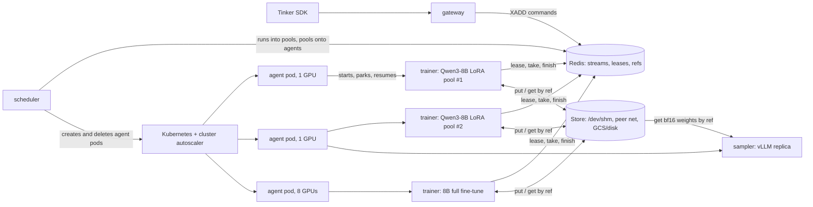
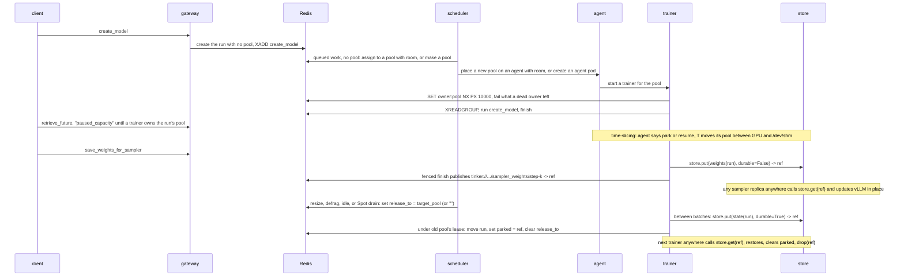

# tinyrl on Kubernetes

**Status.** Portable checkpoints are built. One owner per pool is prototyped on the
[`k8s-prototype`](https://github.com/ShubyM/tiny-open-rl/tree/k8s-prototype) branch. Nothing else here exists yet.

Today you start a trainer for each pool by hand: `python -m tinyrl.trainer <pool>`. Nothing starts trainers for new pools,
sizes them, puts them on GPUs, shares a GPU between them, grows them when they're busy, moves them off a dying Spot node,
or brings them back after a crash. This is the design for the piece that does, on GKE.

## The idea

**Kubernetes supplies GPUs. Redis decides who runs where. A fast state store lets any trainer or sampler resume anywhere.**



- **A checkpoint is the only state that matters.** A run's state is a flat map of canonical, unsharded named tensors: its
  trainable fp32 master weights plus AdamW `exp_avg`, `exp_avg_sq` and `step` for a trainer (12 bytes per trainable
  parameter), or its bf16 weights for a sampler (2 bytes per parameter). Once those tensors are in the store under an
  immutable `ref`, a trainer holds nothing irreplaceable: any trainer or sampler on any node—and at any GPU count—can pull
  that `ref` and continue from the exact next step.
- **One state store does every transfer.** User checkpoints (`save_weights` / `load_weights`), sampler weight sync
  (`save_weights_for_sampler`), GPU time-slicing, resizing LoRA pools, migrating full fine-tunes off crowded or preempted
  nodes, and idling runs to zero GPUs all call the same `store.put` and `store.get`. `put` stages tensors into `/dev/shm`
  (`emptyDir: {medium: Memory}`, ~50 GB/s PCIe Gen5) so the GPU is free in under half a second, serves remote nodes
  straight from that RAM over the pod network (gVNIC TCP/HTTP, or GPUDirect-TCPX / RoCE RDMA on A3/A4), and flushes durable
  checkpoints to shared disk or GCS in the background.
- **A pool is the set of runs one trainer serves**, as the README says today: some LoRA runs on one base model, or one full
  fine-tune. What changes is who makes pools. Today [`pool_for`](../tinyrl/gateway.py) puts every LoRA run on a base into
  one pool, so one GPU serves them all. Here the scheduler makes pools, and a base model gets as many as its load needs.
- **What gets placed is a pool's process**, onto an agent pod that holds GPUs. The scheduler creates agent pods with plain
  `nvidia.com/gpu` requests, sized to the pools that need them (1, 2, 4 or 8 GPUs). An agent starts a process for each
  pool or sampler placed on it and decides which of them are resident on its GPUs.
- **A pool has one owner.** A trainer serves a pool only while it holds the pool's lease in Redis. Every reply, checkpoint
  `ref` pointer, and run handoff is committed by a Lua script that checks the lease first.

## What runs where

| Piece | Runs as | Code | Does |
|---|---|---|---|
| gateway | Deployment | [gateway.py](../tinyrl/gateway.py) | the Tinker API, as today. It stops picking a run's pool or filesystem paths: it records the run's base, rank and LoRA config, and passes logical `tinker://` URIs. While a run has no trainer, `retrieve_future` answers `queue_state: "paused_capacity"`, which the SDK logs, instead of `"active"`. |
| scheduler | Deployment, 1 replica | new: `tinyrl/scheduler.py` | puts runs into pools and pools/samplers onto agents; grows, shrinks, drains and defragments pools with load; creates agent pods when nothing has room, and deletes empty ones |
| agent | one per agent pod | new: `tinyrl/agent.py` | starts and stops a trainer or sampler per placement on it; decides which are resident on its GPUs; serves `/dev/shm` blobs to peers; watches for Spot preemption |
| trainer | a process in an agent pod | [trainer.py](../tinyrl/trainer.py), extended | serves its pool while it holds the lease; puts and gets run state and sampler weights through `store.py` |
| sampler | a process in an agent pod | new: `tinyrl/sampler.py` | runs vLLM; pulls bf16 weights or LoRA adapters from `store.py`; sleeps and wakes on its agent's GPU |
| store | library in trainers, samplers and agents | new: `tinyrl/store.py` | `put`, `get`, `drop` across `/dev/shm`, peer network, and durable storage (`CKPT` or GCS) |
| Redis | StatefulSet, AOF on | | streams, leases, checkpoint `ref`s, blob locations, placements, heartbeats, load |

Kubernetes sees a gateway, a scheduler, Redis and some agent pods (each mounting `emptyDir: {medium: Memory}` at
`/dev/shm`, since Kubernetes otherwise caps `/dev/shm` at 64 MiB). The scheduler needs one namespaced Role (`create`,
`delete`, `list` on Pods). Nothing is privileged, nothing uses the host network, and there are no CRDs. A pre-pull
DaemonSet on GPU node pools, or GKE image streaming, keeps a new agent from waiting on the image.

## State in Redis

Everything [bus.py](../tinyrl/bus.py) has today stays. What's new, and who writes it:

| Key | Type | Written by | Read by |
|---|---|---|---|
| `pool` in `tinyrl:run:<run>`, and `tinyrl:pool:<pool>` | the run's pool, and each pool's runs | **whoever holds the run**: the scheduler while the run is in no pool, its pool's trainer while it's in one | trainers, scheduler |
| `release_to` in `tinyrl:run:<run>` | a request: move the run to this pool, or to `""` (none) | scheduler (or agent on Spot drain); the trainer clears it when done | the run's trainer |
| `parked` in `tinyrl:run:<run>` | immutable `ref` of the run's state in the store while between pools | the trainer that releases it, and the one that restores and drops it | trainers |
| `tinyrl:ckpt:<run>` | hash `{<kind>/<name>: ref}` mapping `tinker://` URIs to immutable `ref`s | `Bus.finish`, under the pool's lease | trainers, samplers |
| `tinyrl:loc:<ref>` | string with TTL: peer address of an agent holding `<ref>` in `/dev/shm` | the agent that staged `<ref>` | any trainer or sampler calling `store.get` |
| `tinyrl:owner:<pool>` | string with a 10 s TTL: the lease | the trainer that holds it | trainers, scheduler, gateway |
| `tinyrl:place:<pool>` | string: an agent id | scheduler | agents |
| `tinyrl:agent:<id>` | hash `{gpus, gpu_bytes, host_bytes, gpu_model, addr, draining}` with a 30 s TTL | that agent | scheduler, store |
| `tinyrl:load:<pool>` | hash `{gpu_bytes, host_bytes, busy, wait}`: measured | the pool's trainer | scheduler, agent |

A run's membership has one writer at a time, and the writer changes hands with the run. The scheduler can only put a run
into a pool while it's in none (checked in the same script that writes it), and only the trainer holding a run can take
it out, under that pool's lease. So two parties never both think they own a run.

## A run's life



## The store: a trainer can resume anywhere

Today [`Model.save`](../tinyrl/trainer.py) calls Hugging Face's `save_pretrained` and `torch.save(optimizer.state_dict())`
to a mutable directory on `CKPT`. In open-rl's two-job 8B full fine-tune benchmark (`docs/fft/fft.md` §9), writing sampler
weights to shared NFS took **74 to 88 seconds of every 130-second RL step**—three fifths of the whole job spent waiting on
storage while GPUs sat idle.

What a trainer or sampler actually needs to move is just a flat `dict[str, torch.Tensor]` plus a small JSON `meta` dict
(`base`, `rank`, `lora`, `step`):

| Bundle | What's in it | Bytes / param | 0.5B LoRA (r=32, 17.6M adapter params) | 8B LoRA (r=32, 92M adapter params) | 1.5B full fine-tune | 8B full fine-tune |
|---|---|---:|---:|---:|---:|---:|
| `weights(run)` | bf16 parameters (adapter or full model), for a sampler | 2 B | 35 MB | 184 MB | 3.1 GB | 16.4 GB |
| `state(run)` | trainable fp32 master weights + fp32 AdamW `exp_avg`, `exp_avg_sq` and `step`, for a trainer | 12 B | 0.21 GB | 1.1 GB | 18.5 GB | 98 GB (12.3 GB/GPU ×8) |

Three choices make these bundles completely portable:

1. **Pure named tensors, no pickle.** Keeping AdamW's `exp_avg`, `exp_avg_sq`, and `step` in the same tensor map under each
   parameter's name (`f"{name}.exp_avg"`, `f"{name}.exp_avg_sq"`, `f"{name}.step"`) instead of a pickled `optimizer.pt`
   indexed by parameter-group integers lets weights and optimizer travel together through zero-copy `safetensors` / raw
   memory buffers. Because [`optim_step`](../tinyrl/trainer.py) sets `lr`, `betas`, `eps`, and `weight_decay` on every
   step, nothing else lives in `AdamW`.
2. **bf16 sampler dumps.** For a full fine-tune, `weights(run)` casts fp32 master weights to bf16 as they leave the GPU,
   cutting sampler transfers in half (16.4 GB instead of 32.8 GB for Qwen3-8B) and avoiding vLLM's `dtype="auto"` trap,
   where an fp32 checkpoint is silently served in fp16.
3. **Canonical, unsharded shapes.** Even when tinyrl adds multi-GPU FSDP2, `state(run)` gathers canonical full tensors
   layer by layer (rank `r` gathering layers `i % W == r` into its own `/dev/shm` in parallel, so peak overhead is one
   layer and all `W` NICs serve peers in parallel), and a restoring trainer slices whichever ranges its new world size
   owns. A run saved on `2×H100` (80 GB) restores straight onto `1×H200` (141 GB), `1×B200` (192 GB), or `4×H100` with
   zero format conversion.

### One interface, three tiers

`tinyrl/store.py` (~85 lines) has one job: take a bundle of tensors out of a GPU, return a fresh immutable `ref`
(`<run>/<uuid>`), and get those tensors into whichever process asks for `ref` as fast as the hardware between them allows.

```python
class Store:
  def put(self, tensors: dict[str, Tensor], meta: dict, *, durable: bool = False) -> str: ...
  def get(self, ref: str, device: str = "cpu") -> tuple[dict[str, Tensor], dict]: ...
  def drop(self, ref: str) -> None: ...
```

Because `ref` is write-once, readers never see torn or overwritten files, and a paused trainer whose lease expired can call
`put` without harming anything—its `Bus.finish` Lua check rejects publishing `ref` to `tinyrl:ckpt:<run>`. Every `put` and
`get` moves through up to three tiers behind that interface:

1. **Tier 1 — GPU ↔ `/dev/shm` on the agent (~50 GB/s pinned D2H/H2D per GPU on PCIe Gen5).**
   `store.put` writes a `safetensors` buffer into `/dev/shm/tinyrl/<ref>` and sets `tinyrl:loc:<ref>` to the agent's peer
   endpoint in Redis. As soon as `/dev/shm` has the bytes, **GPU memory can be freed and the trainer is done waiting**.
   Same-node readers—a trainer resuming after a time-slice turn, or a colocated sampler—`mmap` `/dev/shm/tinyrl/<ref>`
   directly with zero network or disk I/O.
2. **Tier 2 — Peer `/dev/shm` → remote node over the cluster network (12–25 GB/s on gVNIC; 100–400 GB/s on A3/A4).**
   When a trainer or sampler on another node calls `store.get(ref)`, it checks `tinyrl:loc:<ref>`. If the writer's agent is
   alive, it pulls parallel byte ranges straight from that agent's `/dev/shm` into its own `/dev/shm` and onto GPU (using
   stock asyncio HTTP/TCP range streams by default, and swapping in UCX / NVIDIA NIXL over GPUDirect-TCPX on `a3-highgpu-8g`
   or RoCE RDMA on `a3-ultragpu-8g` / `a4` under the same `get` call). When several sampler replicas pull the same `ref`,
   each replica registers its own `loc:<ref>` once fetched so peers fan out instead of bottlenecking on the trainer's NIC.
3. **Tier 3 — `/dev/shm` → durable storage (`CKPT` on Lustre/Filestore, or a GCS/S3 bucket).**
   When `durable=True` (`save_weights`, idle scale-to-zero, or Spot drain), the agent streams `/dev/shm/tinyrl/<ref>` to
   durable storage (synchronously before `save_weights` resolves its future or before a draining agent exits; in the
   background for live moves) and evicts the `/dev/shm` copy once space is needed. If no live peer holds `<ref>`,
   `store.get` reads from durable storage.

| Payload | Size | Tier 1: same-node `/dev/shm` (50 GB/s/GPU) | Tier 2: peer gVNIC (20 GB/s) | Tier 2: peer TCPX / RDMA (100–400 GB/s) | Tier 3: GCS / Lustre (~10 GB/s) | Tier 3: Filestore (2 GB/s) |
|---|---:|---:|---:|---:|---:|---:|
| 0.5B LoRA `state` | 0.21 GB | 4 ms | 10 ms | < 5 ms | 20 ms | 0.1 s |
| 8B LoRA `state` | 1.1 GB | 22 ms | 55 ms | 3–11 ms | 0.11 s | 0.6 s |
| **8B sampler `weights` (bf16)** | **16.4 GB** | **0.33 s** | **0.8 s** | **0.04–0.16 s** | **1.6 s** | **8.2 s** |
| 1.5B FFT `state` | 18.5 GB | 0.37 s | 0.9 s | 0.05–0.19 s | 1.9 s | 9.3 s |
| **8B FFT `state` + AdamW** | **98 GB** | **2.0 s (0.25 s ×8)** | **4.9 s** | **0.25–1.0 s** | **9.8 s** | **49 s** |

### Every state movement is the same call

| Operation | What happens | Tier hit on the critical path | Trainer stall |
|---|---|---|---|
| **Time-slice park / resume** | `ref = store.put(pool_state, durable=False)` → free GPU; later `store.get(ref, "cuda")` | Tier 1 (`/dev/shm` on same agent) | 25 ms (LoRA) to 0.37 s (1.5B FFT) |
| **Sampler weight sync** (`save_weights_for_sampler`) | `ref = store.put(weights(run), durable=False)`; fenced publish to `tinyrl:ckpt:<run>`; samplers call `store.get(ref)` | Tier 1 if colocated, Tier 2 if remote (never touches disk) | **0.04 to 0.33 s** (vs. 74–88 s on NFS) |
| **Move a run** (LoRA split/merge, crowded agent, defrag) | `ref = store.put(state(run), durable=True)` → fenced `parked = ref`; target trainer calls `store.get(ref)` | Tier 1 stage + Tier 2 peer pull (Tier 3 flushes in background) | **22 ms** stage (8B LoRA); **0.05–0.9 s** peer pull |
| **Idle scale-to-zero or Spot drain** | `ref = store.put(state(run), durable=True)` → leave pool (`release_to = ""`) | Tier 1 stage → Tier 3 flush before pod exit | 0.02–2 s GPU release; survives pod/node deletion |
| **User checkpoint** (`save_weights` / `load_weights`) | `ref = store.put(state(run), durable=True)` → flush to Tier 3 → fenced publish to `tinyrl:ckpt:<run>` | Tier 1 + Tier 3 | 0.1–10 s on Lustre/GCS |

## Scaling every workload

Because `store.put` and `store.get` decouple a run's state from the process and node currently holding it, every workload
scales and moves with demand:

| Workload | What it holds | How it scales & moves | Signal | What a change costs |
|---|---|---|---|---|
| LoRA trainer pool | a frozen bf16 base, plus 0.21–1.1 GB of adapter `state` per run | more or fewer pools per base; runs hop between pools or park when idle | `busy`, `wait`, memory | 22 ms to stage + ~55 ms peer pull per 8B LoRA run |
| full fine-tune trainer | 18.5 GB (1.5B) to 98 GB (8B) of `state` | time-shares GPUs via Tier 1 between steps; migrates across nodes (crowded agent, Spot drain, defrag, idle) or changes GPU width across a release via Tier 2/3 | agent resident set, `wait`, `draining` | 0.25–2 s locally; 0.25–5 s across nodes over `Peer` |
| sampler | 3.1–16.4 GB of bf16 `weights`, plus droppable KV cache | stateless replicas anywhere in the cluster | sampling queue | 0.04–0.8 s to pull bf16 weights; 0 s to scale down |

Every trainer reports two numbers once a minute: how busy it was (`busy`, the fraction of the minute spent running
commands) and how long commands waited (`wait`, the mean time from a command's `XADD` to its start, read from its stream
entry ID, which is a timestamp).

### LoRA trainer pools: elastic pools per base

One GPU serving every LoRA run on a base is a queue that grows with the number of runs. Say a run's RL step spends 10 s
training and 50 s sampling and scoring: one GPU keeps up with about six such runs, and from the seventh on, every run
waits for every other's `forward_backward`. Ten GPUs serving one run each is the opposite mistake. So:

- **Assigning.** A run with queued work and no pool (a new run, or one waking from idle) goes into the pool on its base
  with the most room: memory for its adapter, and `busy` below the grow threshold. If none has room, the scheduler makes
  a pool. A full fine-tune, or a run marked `openrl.exclusive`, always gets a pool of its own.
- **Growing.** When a LoRA pool's commands wait more than 5 s on average for a minute while it's more than 85% busy, and it
  has at least two active runs, the scheduler makes a second pool on the same base, waits until a trainer owns it, then asks
  the busy pool to release half its active runs to it.
- **Shrinking.** When two pools on a base have both been under 30% busy for 10 minutes and their runs fit on one GPU, the
  scheduler asks the smaller to release all of its runs to the other. Empty pools retire.
- **The hard cap is memory**: the base model, plus each run's adapter state, plus a floor for activations, must fit the GPU.
  Load sets the soft cap below it. `MAX_RUNS_PER_POOL` is there for operators who want a fixed cap.
- **Hysteresis.** Grow and shrink thresholds sit far apart, and a base is resized at most once every two minutes.

**Releasing a run** is one operation across growing, shrinking, migrating, idling and draining. Between batches, so nothing
of the run is in flight, the trainer calls `ref = store.put(state(run), durable=True)`, frees the run from GPU memory, and
in one Lua script—checked against its pool's lease—moves the run from its pool to the target (or to `""`), sets
`parked = ref`, and clears `release_to`. Commands that arrive meanwhile wait in the run's stream. The target pool's trainer
sees the run in its pool, pulls `ref` via `store.get`, restores the tensors, clears `parked`, and calls `store.drop(ref)`.

### Full fine-tunes: time-sliced locally, portable everywhere

A full fine-tune is one run, so it can't split its runs across two pools, and widening its trainer automatically every few
steps buys little once `Store` removes the 74–88 s NFS bottleneck: training is ~25 s of a ~50 s step, and every width
change moves 12 B/param and alters floating-point reduction order. Instead, it scales cleanly at two timescales:

1. **Step to step on one agent (Tier 1).** Between `optim_step` and the next `forward_backward`, while the client generates
   rollouts and rewards, the agent parks the full fine-tune to `/dev/shm` (0.37 s for 1.5B, 0.25–2 s for 8B) whenever
   another pool on the agent has queued work.
2. **Across nodes and hardware shapes (Tiers 2 & 3).** A full fine-tune is never pinned to the node or GPU SKU it started
   on:
   - **Crowded-agent evacuation & defragmentation:** if two full fine-tunes on one agent become busy simultaneously (high
     `wait`, low `busy`), or two half-empty nodes can consolidate onto one, the scheduler moves one pool to a free agent
     and the new trainer streams `state(run)` over the pod network in 0.25–5 s.
   - **Spot VM preemption:** when GKE gives its 30-second Spot termination notice, the agent sets `draining=1`, the trainer
     dumps `state(run)` (`durable=True`) after its current batch, and the run resumes on a healthy node with zero lost
     steps.
   - **Changing GPU width (FSDP resharding):** because `state(run)` uses canonical unsharded parameter names, a run
     released from `2×H100` (80 GB) can be placed onto `1×H200` (141 GB), `1×B200` (192 GB), or `4×H100` and slice its new
     shards directly from `store.get(ref)`.

### Samplers: decoupled replicas fed by the store

Generating rollouts splits cleanly across prompts and samples, and a sampler holds nothing irreplaceable. Because Tier 2
delivers 16.4 GB of bf16 weights across nodes in under a second (instead of 74–88 s over NFS), **sampler placement is
completely decoupled from trainer placement**:

- **Scale out / in:** more sampler replicas when the sampling queue grows (on any node with free GPUs, including Spot
  pools), fewer when it drains, with nothing to save on scale-down.
- **Opportunistic co-location:** placing a run's single sampler on its trainer's agent is still a great default when host
  RAM fits both—they time-share one GPU and hit Tier 1 `/dev/shm`—but scaling beyond one GPU never hits a storage cliff.

## Pools onto agents

The scheduler's placement loop runs alongside `resize`:

```python
async def tick(self) -> None:
  agents = await self.bus.agents()  # live heartbeats, with GPU/host memory, addr and draining flag
  pools = await self.bus.pools()  # each pool's runs, load, placement and size

  await self.resize(pools, agents)  # assign, grow, shrink, idle-release, and drain Spot agents

  for pool in pools.values():
    if pool.placed_on and pool.placed_on not in agents:  # its agent died: wait out lease, place again
      await self.bus.unplace(pool.name)
    elif pool.placed_on and pool.empty_for_s > EMPTY_POOL_S:  # no runs left: retire it
      await self.bus.unplace(pool.name)
    elif pool.starved_on_crowded_agent:  # high wait, low busy: migrate via the store
      await self.evacuate(pool)

  waiting = [p for p in pools.values() if p.runs and not p.placed_on]
  for pool in sorted(waiting, key=lambda p: p.size.gpu_bytes, reverse=True):  # best-fit decreasing
    agent = best_fit([a for a in agents.values() if not a.draining], pool.size, pool.gpus)
    if agent:
      await self.bus.place(pool.name, agent.id)
      agent.reserve(pool.size)
    else:
      await self.kube.ensure_pending_agent(pool.gpus, pool.size)  # at most one pending pod per shape

  for agent in agents.values():
    if agent.empty_for_s > EMPTY_AGENT_S:
      await self.kube.delete_agent(agent.id)  # cluster autoscaler removes empty nodes
```

- **A pool fits an agent** when its GPU footprint fits the agent's GPUs on its own, and the footprints placed on the agent
  fit its `/dev/shm` budget. An agent can hold more pools than its GPUs fit simultaneously and take turns between them;
  `OVERSUBSCRIBE` caps that multiple.
- **Waiting isn't always compute saturation.** High `wait` with low `busy` means a pool is waiting for GPU turns on a
  crowded agent, so the scheduler migrates it to an uncrowded agent via `Store` instead of splitting it.
- **Scaling up and down.** Unplaced work creates at most one pending agent pod per GPU shape (`nodeSelector` picks L4,
  H100, H200 or B200 by memory). Agents with no placements and no unflushed `durable=True` blobs for 10 minutes are
  deleted. Queue lag is never the scale-down signal: an RL trainer's queue is empty throughout sampling, and runs leave
  agents only by parking to `Store`.

## Taking turns on an agent's GPUs

**The agent decides what's on its GPUs, and nothing else does.** Every second it chooses the resident set: placements with
queued work, least recently served first, as many as fit in VRAM; then idle ones if room remains. It tells evicted
processes to park (`store.put(..., durable=False)` into `/dev/shm`, or vLLM `sleep(level=1)`) over stdin and waits for
acknowledgement before waking the next (`store.get(..., device="cuda")` or `wake_up()`), so two processes never race into
an OOM. A busy placement keeps its seat for at least 30 seconds or until its queue empties. When everything fits at once,
nothing parks and CUDA interleaves kernels on its own.

**LoRA pools park like any other.** An active LoRA pool stays resident while it has queued work; an idle 8B LoRA base parks
16.4 GB of bf16 to `/dev/shm` in 0.33 s. Individual runs inside a busy LoRA pool that sit idle for 30 minutes are released
to `Store` (`durable=True`), one at a time.

With fp32 master weights an 8B full fine-tune (98 GB between steps, 131 GB at peak) doesn't fit an 80 GB H100 on its own;
it needs an H200 or B200, or multi-GPU FSDP. Three 1.5B full fine-tunes share an 80 GB GPU between steps (55 GB) without
parking, or two at peak (49 GB).

## Estimator

No model-size tables. Before a run's first placement, build its model on PyTorch's `meta` device from its config
(`AutoConfig.from_pretrained`) and count parameters. [trainer.py](../tinyrl/trainer.py) keeps fp32 master weights, so a
full fine-tune holds 16 bytes per parameter at peak (weights, gradients and two AdamW moments) and 12 between steps,
because `optimizer.zero_grad()` frees the gradients. A LoRA pool holds 2 bytes per parameter of bf16 base, plus 16 per
adapter parameter of each run. Activations don't need estimating: [`token_budget`](../tinyrl/trainer.py) sizes every pass
to the GPU memory that's free.

Once running, the trainer writes measured bytes to `tinyrl:load:<pool>` every minute, and the scheduler and agent use that
from then on.

## One owner per pool

Two trainers serving one pool would split its runs' commands between two copies of the model, and a paused trainer waking
up late must neither answer a client nor overwrite a checkpoint or `parked` pointer. Three pieces on `k8s-prototype` (57
lines in `bus.py` and `trainer.py`) plus immutable `Store` `ref`s enforce that:

1. **The lease.** A trainer serves a pool only after `SET tinyrl:owner:<pool> <worker> NX PX 10000` succeeds. It renews
   every 2.5 s from the event loop while commands run in a thread. If renewal fails—or more than half a lease (5 s) passes
   on the monotonic clock since the last renewal—the trainer stops before reading or running another command.
2. **The fenced finish and handoff.** `Bus.finish` writes the reply, acknowledges the command, updates counters, and (for
   `save_weights*`) publishes `ref` into `tinyrl:ckpt:<run>` in one Lua script that first checks the lease is still the
   caller's. Releasing a run (`parked = ref`) goes through the same lease check.

   ```lua
   if redis.call('GET', KEYS[1]) ~= ARGV[1] then
     return 0
   end
   redis.call('XADD', KEYS[2], 'MAXLEN', '=', 1, '*', 'ok', ARGV[3], 'content_type', ARGV[4], 'body', ARGV[5])
   redis.call('EXPIRE', KEYS[2], ARGV[6])
   redis.call('XACK', KEYS[3], ARGV[8], ARGV[2])
   redis.call('XDEL', KEYS[3], ARGV[2])
   if ARGV[7] ~= '' then
     redis.call('HINCRBY', KEYS[4], ARGV[7], 1)
   end
   if ARGV[9] ~= '' then
     redis.call('HSET', KEYS[5], ARGV[9], ARGV[10])
   end
   return 1
   ```

3. **The stranded sweep.** Between batches, when the owner has nothing in flight itself, it `XAUTOCLAIM`s anything in its
   pool pending for 5 seconds and fails it cleanly.

`test/test_lease.py` verifies takeover under `SIGSTOP` against a real `redis-server` and two trainer subprocesses, and
`test/test_trainer.py` verifies that restoring a run with its optimizer produces identical losses and bitwise-equal weights
over subsequent steps.

## When things fail

| Failure | What happens | What's lost |
|---|---|---|
| a trainer dies mid-`optim_step` | lease expires within 10 s; agent starts a new trainer, which claims and fails the command | uncheckpointed in-memory steps of active runs in that pool; runs parked in `Store` (`durable=True`) lose nothing |
| a trainer dies while releasing a run | before the release script: run stays in the old pool as above (orphan `ref` is swept); after: `parked = ref` is set and the new pool loads it | as above, or nothing |
| source agent dies while a peer pulls `<ref>` from `/dev/shm` | `store.get` catches the connection error and falls back to durable storage (`CKPT` / GCS) | nothing once flushed; if the source node died before a background flush completed, same as sudden node death |
| a Spot VM gets a 30 s preemption notice | agent marks `draining=1`; trainers dump active runs (`durable=True`) after their current batch and release them | nothing when current batch + flush completes within 30 s |
| a node dies suddenly | agent heartbeat expires in 30 s; scheduler places its pools elsewhere | same as a trainer dying |
| a paused trainer writes `save_weights` | `store.put` writes an unreferenced immutable `ref`, then `Bus.finish` fails the lease check; `tinyrl:ckpt:<run>` is untouched | one failed command; existing checkpoints are never overwritten |
| the scheduler dies | trainers and samplers keep serving; Deployment restarts it from Redis state | nothing |
| Redis restarts (AOF, every-second fsync) or fails over | up to 1 s of writes may be lost, triggering early lease takeover; replies and `ref` pointers remain fenced | at most in-flight commands during the window, failed cleanly, never answered twice |

## Samplers

A sampler (`tinyrl/sampler.py`) wraps vLLM's `AsyncLLMEngine` and uses the same `Bus` and `Store`:

- **In-place full fine-tune updates.** The sampler boots vLLM once from `base` (`dtype="bfloat16"`). When a sampling call
  names `tinker://<run>/sampler_weights/<step>`, the sampler resolves its `ref` in `tinyrl:ckpt:<run>`, pulls the bf16
  tensors via `store.get(ref)` (0.33 s from local `/dev/shm`, or 0.04–0.8 s from a peer), updates vLLM's weights in place
  via `collective_rpc("load_weights")`, and resets the prefix cache—no engine restart and no disk round-trip.
- **LoRA adapters.** `store.get(ref)` fetches the 35–184 MB bf16 adapter in milliseconds into `/dev/shm/tinyrl/<ref>` for
  vLLM's `LoRARequest`, evicting least recently used adapters when local slots fill up.
- **GPU sharing.** On an agent shared with trainers, the sampler obeys the agent's stdin `park` / `resume` protocol via
  vLLM's `sleep(level=1)` and `wake_up()`.

## Code

| File | Lines | Change |
|---|---:|---|
| [bus.py](../tinyrl/bus.py) | 160 → ~215 | `own`, `renew`, `release`; fenced `finish` (with `ckpt` `ref` publish) and `release_run`; `reclaim` with minimum idle time (prototyped); placement, heartbeat, load and `loc` helpers |
| `store.py` | new, ~85 | `Store.put`, `get` and `drop` across `/dev/shm` mmap, peer range pulls, and durable `safetensors` on `CKPT` / GCS |
| [trainer.py](../tinyrl/trainer.py) | 271 → ~335 | lease loop and sweep (prototyped); `Model.weights` (bf16) and `Model.state` (fp32 weights + named AdamW `exp_avg`, `exp_avg_sq`, `step`); parking, releasing and restoring through `Store`; load reporting |
| `agent.py` | new, ~125 | heartbeat, Spot preemption watch, process supervisor, GPU residency loop, `/dev/shm` peer server |
| `scheduler.py` | new, ~175 | assigning runs, LoRA grow/shrink, Spot drain and crowded-agent migration, best-fit placement, agent Pods |
| `estimator.py` | new, ~25 | parameter count from `AutoConfig` on `meta` device, bytes/param |
| [gateway.py](../tinyrl/gateway.py) | 154 → ~145 | `pool_for` and `CKPT` paths go away; records LoRA config; passes `tinker://` URIs; `paused_capacity` |
| `k8s/` | ~120 lines of YAML | gateway, Redis with AOF, scheduler + Role, pre-pull DaemonSet |

About 1,175 lines of Python (plus `sampler.py` when vLLM sampling lands), up from 692.

## Testing

Against a real `redis-server`, real subprocesses, `/dev/shm`, loopback peer HTTP, and tiny CPU models—no cluster needed:

- Lease takeover under `SIGSTOP` and stranded-command sweep (`test_lease.py`, done).
- Bitwise-identical training continuation across `state(run)` → `Store` → restore into a fresh `Model` (done for disk,
  extend to named-tensor `Store` across Tier 1 `/dev/shm`, Tier 2 peer HTTP, and Tier 3 fallback when the source peer dies).
- Zombie trainer fenced during `save_weights`: verify its `Store` `ref` is never published to `tinyrl:ckpt:<run>`.
- Live run migration between two running trainers (`release_to`) while commands keep arriving.
- Scheduler decisions (LoRA split/merge, idle release, Spot `draining=1`, crowded-agent evacuation) and agent GPU residency.

On a real GKE GPU cluster: VRAM release on `park` and vLLM `sleep(level=1)`, cross-node throughput over gVNIC and
TCPX/RDMA, Spot VM evacuation within 30 s, and node autoscaling in both directions.

## How this differs from open-rl

open-rl keeps placement truth in Kubernetes CRDs and moves weights through a shared POSIX filesystem (`/mnt/shared`).
tinyrl keeps control truth in Redis, moves weights through `Store` so any process can resume any run anywhere, and asks
Kubernetes only for GPU pods.

| | open-rl | tinyrl |
|---|---|---|
| Checkpoints & weight sync | mutable paths on shared NFS (`save_pretrained` + `torch.save`): 74–88 s per 8B FFT step (`docs/fft/fft.md` §9) | immutable `ref`s in `Store`: GPU → `/dev/shm` in 0.04–0.37 s, streamed to peers/samplers from RAM in < 1 s, flushed to GCS/disk in background |
| Where a run can resume | LoRA pinned to `instance-0`; FFT tied to its pod's GPU count and pickled optimizer; samplers require shared FS | anywhere in the cluster—any pool, any node, any sampler replica, and (with canonical tensors) any FSDP GPU width |
| What gets placed | a Pod + DRA `ResourceClaim` per worker process | a pool or sampler process onto an agent Pod with plain `nvidia.com/gpu` |
| LoRA capacity | one worker per base model (`instance` hardcoded to 0) | elastic pools per base; runs hop between pools in < 0.5 s through `Store` |
| Placement | ~2,700-line Go controller (`Workload` + `ClaimLedger` CRDs, kube-scheduler probes, CAS seat booking, 2-min wedge grace) | ~175-line Python loop over Redis load and heartbeats |
| Sharing a GPU | host-network time-slicer DaemonSet; pods `ACQUIRE`/`RELEASE` around batches, one resident per claim | the agent, over stdin; placements stay co-resident when they fit, least recently served when they don't |
| Getting state off GPU | two ways: privileged host-PID `cuda-checkpoint` DaemonSet + custom FFT sleep/wake | one: `store.put` and `store.get`, used for time-slicing, sampler sync, resizing, Spot drain and checkpoints |
| LoRA workers | exclusive: always resident, never share a GPU | park and migrate through `Store` like any other pool |
| One owner & fencing | cooperative agreement across CRD status, ledger seat, assignment ID and env vars; NFS writes unfenced | Redis lease per pool; Lua script fences every reply, checkpoint `ref` publish, and run handoff |
| Queues | Redis lists (`LPOP`), separate in-flight tracking | Redis streams (`XPENDING` + `XAUTOCLAIM`) |
| Sizing | hardcoded parameter/KV tables per model name (unknown → Qwen3-8B) | exact `meta`-device parameter count from `AutoConfig`, then live measurement |
| Privileges | 2 CRDs, ClusterRole, DRA driver, host-network + privileged host-PID DaemonSets | 1 namespaced Role over Pods |
| Size | ~4,000+ lines across Go controller, time-slicer (677), worker managers (432), estimator (128), and CRDs | ~480 lines of new Python |

What open-rl has today that this doesn't yet: working vLLM samplers, multi-GPU FSDP training, DRA attribute-based GPU
selection, `kubectl get workloads` visibility (tinyrl exposes state via Redis / `/api/v1/runs`), and real cluster miles.

## Alternatives considered

- **Writing every park and weight sync straight through POSIX/NFS `save_pretrained`.** On Filestore (2 GB/s), parking a
  1.5B full fine-tune takes 9 s each way and an 8B one takes 49 s; in open-rl's benchmark, `save_pretrained` took 74–88 s
  per step. Staging to `/dev/shm` frees the GPU in 0.37 s and lets peers and samplers pull straight from RAM.
- **`cuda-checkpoint` for migration and time-slicing.** Needs a privileged host-PID daemon, snapshots opaque CUDA driver
  state tied to exact GPU SKU and count, and can neither reshard across GPU widths nor feed weights to vLLM.
- **Trainers claiming pools directly with no scheduler.** A worker that parks a pool in its local `/dev/shm` and drops the
  lease lets another node take the pool before `/dev/shm` state has flushed, or spin up duplicate base models unpacked.
- **Per-run leases across symmetric LoRA replicas.** Works, but renews a lease per run and fences per run instead of one
  lease per trainer process.
- **A fixed run cap per LoRA pool.** Ten runs that are sampling cost the trainer nothing; three training back-to-back can
  saturate it. Memory is the hard cap; measured `busy` and `wait` set the soft cap.
- **Widening an active full fine-tune automatically every few steps.** Canonical checkpoints make resharding across GPU
  counts straightforward at release boundaries, but doing it continually moves 12 B/param and shifts floating-point
  reduction order to save a fraction of a ~25 s training step.
- **Autoscaling on queue lag (HPA / KEDA).** An RL trainer's queue is empty throughout rollout generation, and blind Pod
  scale-down kills `/dev/shm` state.

## Open questions

1. Start Tier 2 with a ~50-line asyncio HTTP/TCP range server over `/dev/shm` (covers standard gVNIC at 12–25 GB/s with
   zero native dependencies), and add an optional UCX / NIXL transport for GPUDirect-TCPX and RoCE RDMA on A3/A4?
2. Should `save_weights` wait synchronously for Tier 3 durable flush before resolving its future, or resolve as soon as two
   nodes hold `<ref>` in RAM and flush asynchronously? (Synchronous on Lustre/GCS is simpler and keeps strict durability.)
3. Keep Tinker's crash semantics (unexpected node loss fails steps since the client's last `save_weights`), or optionally
   background-checkpoint active runs to `Store` every `N` steps?
4. Are the LoRA resize thresholds right: grow at >5 s mean wait while >85% busy, shrink below 30% busy for 10 minutes?
5. One agent pod per pool shape (1, 2, 4, 8 GPUs), or one whole-node agent pod per GPU VM managing all of its GPUs?
