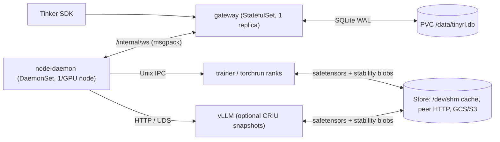

# tinyrl on Kubernetes

## Deployment topology

One `gateway` StatefulSet pod hosts the Tinker HTTP API, the SQLite WAL ledger (`TINYRL_DB=/data/tinyrl.db`), and the fleet controller over `/internal/ws`. One `node-daemon` DaemonSet pod runs per GPU node (`tinyrl-gpu=true`), holding all GPUs on that node and managing isolated trainer and vLLM sampler subprocesses.



| Manifest | Purpose |
|---|---|
| [k8s/namespace.yaml](../k8s/namespace.yaml) | Creates the `tinyrl` namespace |
| [k8s/gateway.yaml](../k8s/gateway.yaml) | Single-replica `StatefulSet` with a 10 GiB PVC for SQLite WAL + ClusterIP `Service` on `:8000` |
| [k8s/node-daemon.yaml](../k8s/node-daemon.yaml) | GPU `DaemonSet` with `shareProcessNamespace: true`, `/dev/shm` `emptyDir`, host SSD model cache, and `terminationGracePeriodSeconds: 25` |
| [k8s/kustomization.yaml](../k8s/kustomization.yaml) | Sets `CONTROL_URL`, `CKPT`, `CKPT_CACHE`, and container image |

### Deploy

1. Build and push [Dockerfile](../Dockerfile) to your container registry.
2. Update `CKPT` and `images[0].newName` in [k8s/kustomization.yaml](../k8s/kustomization.yaml).
3. Label GPU nodes with `tinyrl-gpu=true` (and adjust `GPUS` / `nvidia.com/gpu` in [k8s/node-daemon.yaml](../k8s/node-daemon.yaml) to match your node GPU count).
4. Apply and verify:
   ```sh
   kubectl apply -k k8s/
   PROJECT=<gcp-project> ZONE=<gcp-zone> python k8s/e2e.py
   ```

## Control plane & storage

- **Direct GPU paging over `/internal/ws`:** Each node daemon reports capacity, live worker residency, active tasks, and staged checkpoint versions. [Controller](../tinyrl/control/controller.py) owns durable run/command/checkpoint state ([db.py](../tinyrl/control/db.py)), live node tracking, and fencing; [pager.py](../tinyrl/control/pager.py) and [policy.py](../tinyrl/control/policy.py) place workers, stage checkpoints off-GPU, grant EEVDF GPU turns with projected-lag reservation, and park idle workers.
- **Portable checkpoints & three-path Store:** [store.py](../tinyrl/storage/store.py) writes immutable unsharded `safetensors` bundles (weights + named AdamW moments, no pickle) into `CKPT_CACHE` (`/dev/shm/tinyrl-cache`), serves peers over HTTP immediately (`<version>@<peer>`), and uploads to `CKPT` (GCS/S3/shared disk) in the background with a manifest committed last.
- **Fast sampler startup:** When `TINYRL_SNAPSHOTS` is set (`/dev/shm/tinyrl-snapshots`), [snapshot.py](../tinyrl/workers/snapshot.py) snapshots an asleep vLLM server with CRIU + `cuda-checkpoint` and restores subsequent replicas into isolated PID/net/mount namespaces in seconds. This is why `node-daemon.yaml` sets `securityContext: {privileged: true}`.
- **Fencing & drain:** Every worker lease is bound to `(worker, node, boot_id)`. On lease expiry, the controller fences `boot_id` durably in SQLite and fails in-flight trainer commands cleanly; the node daemon self-fences on lease loss and reaps all child process groups. On `SIGTERM` (e.g. Spot preemption), the node daemon marks `draining=True`, gives trainers `DRAIN_S` (20 s) to save dirty runs to `Store`, flushes pending bucket uploads, and exits.

## Failure behavior

| Failure | Behavior | Recovery |
|---|---|---|
| Trainer process dies mid-step | Node daemon reaps process group and reports dead `Done`; controller fails in-flight command and marks run `lost` | Client calls `load_state` from last checkpoint |
| Gateway restarts | PVC retains SQLite WAL; reconnecting nodes send `hello` with active tasks and loaded runs | Continues seamlessly; unacknowledged trainer claims replay |
| Node drained (`SIGTERM` / taint) | Node sets `draining=True`; controller issues `SAVE` for dirty runs then `STOP`; node flushes uploads | Runs resume transparently on healthy nodes from saved snapshots |
| Node dies suddenly | Lease expires after `LEASE_MS` (10 s); `boot_id` is fenced; samples fail over automatically, dirty trainers marked `lost` | Samplers retry automatically; trainers recover via `load_state` |

## Verification

- **Unit & integration tests:** `python -m unittest discover -s test -t .`
- **Mutation tests:** `python -m test.mutation`
- **Chaos stress test:** `SEED=3 CHAOS=1 python -m test.stress_fleet`
- **Formal TLA+ checks:** See [docs/model/README.md](model/README.md)
- **Live GKE fault-injection suite:** [k8s/e2e.py](../k8s/e2e.py) exercises `trainer_killed`, `gateway_restarted`, `node_drained`, `node_died`, and `no_leaks`
